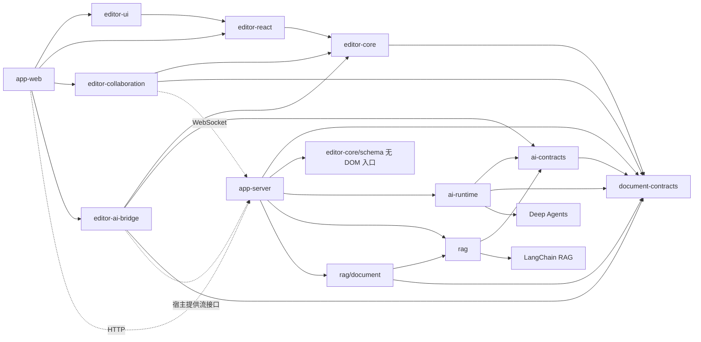

# 知书项目文档地图

状态：设计规划，Chat 业务边界于 2026-10-24 更新。本文组织产品范围与设计责任，不表示功能已经实现。

项目先交付可嵌入、可独立使用的文档编辑与协同产品，再组合知识库、AI 和企业业务能力。文档采用“一个 package 一份主文档、一个 app 一份主文档”；本页负责导航、跨包约束和交付顺序。[原始需求](resreach.md)作为需求输入保留，原先按四个系统视角输出的方式由此文档地图替代。

应用界面的视觉、控件和响应式约定见[知书界面设计规范](design-system.md)。

2026-10-24 明确两类 Chat：**协作 AI 写作 Chat 使用 Server 进程内 DSH Session/Agent + HTTP/SSE；RAG Chat 继续使用 LangChain。** 两者共用 [chat-ui](packages/chat-ui.md)基础组件，app-web 分别封装 WritingChat 与 RagChat，各自维护协议、会话和业务状态，见[业务组件库](apps/app-web.md#ai-chat-业务组件库)。

当前 [协作 AI 写作与 DSH 方案](packages/ai-chat-architecture.md)以写作 AI 为规划主体，基于官方 Cordis/DSH，再接写作、调研和图片插件；RAG Chat 不迁入 DSH，LangChain 问答路线持续使用。旧写作运行时、checkpoint 与 v1/v2 保留为兼容依据，不能据此删除 RAG 所需依赖。空间权限与正文写入由应用负责，用户主动接受后走协同 durable ack。

## 1. 产品交付形态

| 形态             | 用户得到什么                                           | 最小组合                                                                              | 接入方负责什么                                   |
| ---------------- | ------------------------------------------------------ | ------------------------------------------------------------------------------------- | ------------------------------------------------ |
| 嵌入式编辑器     | 结构化编辑、Block 操作、导入导出，可采用自己的界面     | contracts + core；React 业务增加 react，默认界面增加 ui                               | 文档来源、保存、身份与业务页面                   |
| 独立协同文档产品 | 文档创建、多人编辑、在线状态、可靠保存、权限和版本恢复 | 编辑器组合 + collaboration + app-server 的独立文档配置；可用 app-web 的独立文档入口   | 部署存储和身份适配；无需配置知识库、向量库或模型 |
| 企业智能文档平台 | 空间、知识库、搜索、引用问答、AI 创作及企业管理        | 独立协同能力 + Chat/DSH 包组合 + ai-contracts / rag / ai-bridge + 两个 app 的业务模块 | 企业组织与权限策略、知识数据、模型配置及运营策略 |

独立使用同时覆盖“在其他业务中嵌入”和“用最小服务组合运行文档产品”。服务端首期是可按配置注册模块的 Fastify 单体；功能可选不等于必须部署多个服务。

## 2. 目录与阅读顺序

```text
docs/
  README.md                         # 地图、产品边界、交付顺序与跨包约束
  resreach.md                       # 原始需求与 package 拆分输入
  packages/
    ai-chat-architecture.md         # 协作 AI 写作/DSH 方案、两类 Chat 边界与共享 UI
    chat-contracts.md               # 通用会话/消息/Run/审批/产物协议
    chat-ui.md                      # 可独立消费的 React Chat 组件
    dsh-agent.md                    # 官方 Cordis/DSH 封装与服务端端口
    ai-plugins.md                   # 文章写作、调研、图片创建插件
    document-contracts.md           # 01 内容、命令、事件和版本合约
    editor-core.md                  # 02 编辑引擎与扩展模型
    editor-react.md                 # 03 React 集成与宿主接口
    editor-collaboration.md         # 04 协同会话与 Provider 接入
    editor-ui.md                    # 05 默认编辑界面与交互规范
    editor-ai-bridge.md             # 06 AI 草稿与编辑器变更适配
    ai-contracts.md                 # 09 AI 请求、事件、提案与引用合约
    ai-runtime.md                   # 10 现有 LangChain 能力与写作迁移基线
    rag.md                          # 11 来源处理、索引与授权检索管线
  apps/
    app-web.md                      # 07 产品页面、用户流程和前端组合
    app-server.md                   # 08 服务端、数据模型、AI/RAG 和部署运维
```

| 文档                                                        | 设计范围                                                  | 阅读前置                 | 需要产出的实现依据                                    |
| ----------------------------------------------------------- | --------------------------------------------------------- | ------------------------ | ----------------------------------------------------- |
| [AI 写作总方案](packages/ai-chat-architecture.md)           | 协作写作 DSH、共享 Chat UI、RAG LangChain 边界            | 本地图                   | 两类业务组件、写作包清单与 P0—P6 出口                 |
| [12 chat-contracts](packages/chat-contracts.md)             | 通用会话、消息、Run、审批、产物与流协议                   | Chat 总方案              | Schema、确认事件/实时 frame、幂等与兼容               |
| [13 chat-ui](packages/chat-ui.md)                           | RAG/写作共用基础组件、插槽、主题与交互                    | 12                       | 受控 Props、两套业务视图与独立消费验收                |
| [14 dsh-agent](packages/dsh-agent.md)                       | 官方 DSH 装配、Run 协调、持久化和审批桥接                 | 12                       | SDK 兼容、存储端口、应用接入与恢复                    |
| [15 ai-plugins](packages/ai-plugins.md)                     | writing/research/image 独立子入口                         | 09、12、14               | 插件接口、真实 provider、产物与业务验收               |
| [01 document-contracts](packages/document-contracts.md)     | 内容结构、Block 身份、快照、编辑提案、兼容策略            | 本地图                   | 字段与约束、Schema、事件语义、迁移与兼容样例          |
| [02 editor-core](packages/editor-core.md)                   | 基础编辑、扩展、命令、导入导出、无 DOM 的 Schema 入口     | 01                       | Node/Mark 清单、命令行为、事务边界和内容保真规则      |
| [03 editor-react](packages/editor-react.md)                 | 生命周期、订阅、宿主服务、多实例和 React NodeView         | 01、02                   | 组件/Hooks 合约、实例归属、宿主接入示例               |
| [04 editor-collaboration](packages/editor-collaboration.md) | Yjs 绑定、连接状态、Awareness、重连与保存回执             | 01、02；与 08 对齐       | Provider 合约、状态模型、握手和恢复时序               |
| [05 editor-ui](packages/editor-ui.md)                       | 工具栏、菜单、Block 操作、状态反馈、无障碍与主题          | 02、03；了解 04/06 状态  | 组件目录、完整交互状态、键盘与窄屏行为                |
| [06 editor-ai-bridge](packages/editor-ai-bridge.md)         | 生成/改写适配、流事件、草稿预览、接受与撤销               | 01、02；了解 04 定位机制 | 任务状态、提案校验、并发修改与取消语义                |
| [07 app-web](apps/app-web.md)                               | 文档/知识库、WritingChat 与 RagChat 两个业务封装          | 01—06；Chat 联读 12、13  | 分别接入 DSH 写作与 LangChain RAG，共用基础组件       |
| [08 app-server](apps/app-server.md)                         | 文档/协同、身份权限、存储版本、知识库、AI/RAG、任务与运维 | 01；与 04/06/07 联读     | 模块 API、数据归属、事务与事件、REST/WS/SSE、部署配置 |
| [09 ai-contracts](packages/ai-contracts.md)                 | AI 请求、事件、目标约束、编辑提案、证据与引用             | 01                       | TypeBox Schema、流顺序、引用定位与兼容规则            |
| [10 ai-runtime](packages/ai-runtime.md)                     | 现有 LangChain 能力、旧写作兼容及 DSH 迁移范围            | 01、09、14               | 保留 RAG 路线、写作旧任务兼容与分路径退出             |
| [11 rag](packages/rag.md)                                   | 来源规范化、分块、Embedding、索引构建、混合检索与证据     | 01、09；与 08 联读       | 模型/授权存储端口、版本、任务发布与检索验收           |

协作写作建议按总方案 → 12 → 13 → 07 的 WritingChat → 14 → 15 → 08 阅读；RAG Chat 联读 07 的 RagChat、11 和 08，继续使用 LangChain。文档写作再联读 01、09、06。前端只发布 chat-ui 基础组件，应用分别维护两个业务封装；DSH 的 Session/Run 与 LangChain RAG 的会话/请求分别归属。

## 3. 当前仓库与目标结构

写作方案及共享展示规划四个包（chat-contracts、chat-ui、dsh-agent、ai-plugins），均未形成完整对外能力。2026-10-23 已建立 dsh-agent 配置骨架、安装锁定依赖并验证基础装配/释放；其余三个新包尚未建立。WritingChat、RagChat 规划为 app-web 内两个业务组件，当前重构聚焦写作。RAG LangChain 路线持续保留；写作实施阶段见[总方案](packages/ai-chat-architecture.md#11-实施阶段与出口)。

当前两个应用及 document-contracts、editor-core、editor-react、editor-ui、editor-collaboration、ai-contracts、ai-runtime、rag 工作区包已建立。`/ai`、Chat/写作/研究、任务恢复和个人空间原子接受已通过隔离 PostgreSQL 回归，并以本机配置的 MiniMax-M3.1-Flash 验证真实生成、引用及两种写入模式。Qdrant 尚未接入，editor-ai-bridge 独立包仍处于设计阶段；各应用主文档记录实际边界，不将规划接口视为已实现。

服务端继续遵守现有约定：feature 在 `src/modules` 内组装 repository/service，业务层不依赖 Fastify；数据库位于 `apps/app-server/database`；Zod route contract 驱动校验与 OpenAPI，前端客户端由 OpenAPI 生成，离线导出不得连接数据库。

## 4. 包依赖与集成边界

箭头表示代码依赖；虚线表示运行时交互。下图保留编辑器与旧 AI 实现关系；新 Chat/DSH 的目标依赖图见[总方案](packages/ai-chat-architecture.md#4-依赖方向)。这里的接口名和后续文档的 API 名均为拟定产品接口，不是已经存在的实现。



- 所有包不导入 `apps/*`、应用路由、全局 store、企业用户系统或应用数据库。跨包只导入公开入口，禁止读取 `src` 私有文件。
- core 不依赖 React、Yjs 或 AI。react 不强制安装 collaboration、ui、ai-bridge；ui 通过状态与动作插槽展示这些能力，不静态导入其运行时。
- AI bridge 根入口通过宿主端口接入编辑器，只有可选 Tiptap 适配入口依赖 core；图中的 AI → CORE 表示该适配入口。协同宿主注入现有锚点与结构操作通道。app-server 的内容转换适配器可使用无 DOM 的 `editor-core/schema`；知识库业务只消费快照和公开合约。
- ai-runtime 与 rag 相互独立，由 app-server 组合 EvidenceBundle；模型 SDK 留在服务端。rag/document 是同包可选子入口，不形成新工作区包。RAG 接收可信 Scope，授权策略、Qdrant ACL 投影与实时权限复核由 app-server 装配，不内置知书角色规则。
- 扩展集在会话创建时确定。持久化自定义内容时，接入方必须同时提供前端扩展和服务端可校验/可投影的 Schema，不能只部署 React NodeView。

## 5. 跨文档的唯一归属

写作 Chat 的 DSH Session、Run、预览、审批与产物以[总方案状态表](packages/ai-chat-architecture.md#5-模型与状态归属)为准；RAG LangChain 会话/请求独立管理。WritingChat、RagChat 各自归并投影，缓存/查询键包含业务种类，共用 chat-ui 不共用可变状态。下表旧写作记录只作该路径迁移依据。

| 信息/状态                            | 唯一维护位置                                                | 其他位置如何使用                                        |
| ------------------------------------ | ----------------------------------------------------------- | ------------------------------------------------------- |
| 文档 JSON、Block 身份与 Schema 版本  | document-contracts                                          | core、同步投影和 AI 校验引用；不复制类型                |
| 光标、选区、编辑事务与本地撤销       | core；协同模式撤销交给 collaboration 的适配器               | React/UI 订阅，不在 React store 再存一份全文            |
| 协同正文                             | 当前 generation 的 Yjs 二进制状态与更新日志，由服务端持久化 | JSON 是指定 durableSeq 的派生快照；RAG 从快照建索引     |
| 文档标题、归属、ACL、业务版本、附件  | app-server 的各业务模块                                     | app-web 通过 API 获取；不放进 Awareness                 |
| 在线光标/在场状态                    | collaboration 的 Awareness 会话                             | 临时展示；不作为权限、审计或版本事实                    |
| AI 请求/事件/提案/引用合约           | ai-contracts；内容与操作继续引用 document-contracts         | JSON Schema、TS 与校验来自同一规范源                    |
| AI 生成草稿/接受状态                 | ai-bridge 管理客户端任务；app-server 管理服务端生成任务     | 生成完成、接受写入、持久化完成分别确认                  |
| 通用生成/检索算法                    | ai-runtime / rag                                            | 业务授权、数据表、队列与模型配置由 app-server 注入      |
| 空间与知识库关系、检索权限与索引状态 | app-server；Qdrant 保存检索 ACL/切片投影                    | 权威 ACL 仍归业务模块；模型使用前核对实时权限与发布版本 |

必须分别表达：本地已修改、已进入同步流程、已获得服务端持久化回执、已形成业务版本、已完成索引。UI 不能用一个“保存成功”掩盖这些不同进度。正文统一由协同会话管理，宿主不得用 JSON 全文自动保存覆盖正文。

## 6. 用户操作的跨包责任

| 操作           | 完整路径                                                                           | 必须处理的中断或冲突                                                 |
| -------------- | ---------------------------------------------------------------------------------- | -------------------------------------------------------------------- |
| 打开文档       | web 获取授权与元数据 → collaboration 加载该 generation → react 挂载 core → ui 展示 | 无权限、被删除、不兼容 Schema、加载失败；不得显示假空白文档覆盖原文  |
| 编辑并离开     | core 事务 → collaboration 发送 → server 持久化 → 回执 → ui 更新状态                | 断线、落库失败、尚未确认的编辑；刷新后的恢复能力要与实际缓存能力一致 |
| 粘贴图片       | ui 选择文件 → react 宿主上传接口 → server 登记附件 → core 插入 assetId             | 取消、失败重试、重复上传、删除中的附件引用、签名 URL 失效            |
| 多人移动 Block | core 操作 → collaboration 协同合并 → server 持久化                                 | 并发移动/删除不能产生重复 ID 或静默丢内容；未解决前限制该操作        |
| AI 改写选区    | ui 动作 → ai-bridge 捕获目标 → ai-runtime 生成 → 预览 → 宿主结构通道应用并确认     | 选区漂移、目标已改、取消、断流、重复事件；冲突时保留草稿供选择       |
| 知识问答       | web 选择知识域 → server 授权检索 → 带引用回答 → web 打开来源                       | 无证据、来源删除/撤权、索引滞后、部分流失败                          |
| 恢复旧版本     | web 预览差异 → server 生成新 generation → collaboration 重连                       | 旧会话与离线更新被阻止写回；评论锚点失效需显式处理                   |

## 7. 分阶段交付

文档中的 M1—M4 是实现阶段，不是完成状态。跨阶段功能以各主文档中的功能编号追踪；基础鉴权、输入校验、错误恢复随首个相关功能一起交付。

| 阶段              | 产品结果                                         | 关键范围                                                             | 阶段出口                                                               |
| ----------------- | ------------------------------------------------ | -------------------------------------------------------------------- | ---------------------------------------------------------------------- |
| M1 可嵌入编辑器   | 其他 React 业务能安装包并编辑自己的文档          | DC 基础合约、EC 基础编辑、ER 生命周期、UI 基础控件                   | 无 app 路径依赖；JSON 往返保真；中文输入、键盘、只读与多实例可用       |
| M2 独立协同文档   | 最小部署可创建、协作、保存和恢复文档             | CO 全部基础会话能力；SV 文档/权限/版本/附件；WEB 独立入口；表格/图片 | 不启用知识库或模型也可运行；保存回执、重连、权限撤销、恢复旧版本有闭环 |
| M3 知识与 AI 产品 | 检索、引用问答、Chat、个人空间 AI 创作、评论讨论 | AB、SV 知识库/AI、WEB 空间/搜索/知识/评论                            | 引用可回溯；逐段/批量确认不越权；正文变化阻止旧提案；索引可重试        |
| M4 企业增强       | 可治理、可扩展、可运维的企业产品                 | 审批、细粒度策略适配、持久离线、外部数据源、复杂扩展                 | 有明确容量与恢复指标；升级迁移/备份恢复经过验证；高级功能可按部署启停  |

评论、提及、审批、修订建议分别作为业务能力设计。编辑撤销、业务版本历史、审阅中的逐条修订接受属于不同机制，不能互相替代。

## 8. 产品质量与交付门槛

| 维度       | 设计与验收要求                                                                          | 主要责任       |
| ---------- | --------------------------------------------------------------------------------------- | -------------- |
| 内容可靠   | 无效/未知节点不静默删除；Block ID 稳定；JSON 与协同投影一致；备份恢复保留正文与附件引用 | DC、EC、CO、SV |
| 编辑完成度 | 中文 IME、选区、粘贴、快捷键、拖拽、撤销、长文档、表格边界都有明确行为                  | EC、ER、UI     |
| 交互完成度 | loading/empty/error/retry/read-only/offline/saving/conflict 等状态能被理解且有后续动作  | UI、WEB        |
| 无障碍     | 键盘完成主要任务、焦点可见与恢复、控件有名称、状态不只依赖颜色；自动检查与人工流程结合  | UI、WEB        |
| 数据与权限 | HTTP、WS、SSE、检索、附件、导出都经过服务端授权；生成时引用再次确认权限                 | SV             |
| 资源治理   | 包导入无副作用；编辑器销毁释放连接、定时器和订阅；任务支持取消、上限、重试与失败可见    | ER、CO、AB、SV |
| 扩展与发布 | package exports、类型声明、依赖兼容矩阵、Schema 升级与扩展授权清晰                      | 各包主文档     |

建议容量基线：每篇 1,000 个可寻址 Block、约 1 MB 内容，同篇 20 个协作者；参考环境为客户端 4 核/16 GB、服务端 4 vCPU/8 GB、往返延迟 100 ms。初步体验目标为输入到绘制 P95 ≤ 100 ms、远端可见 P95 ≤ 500 ms、健康存储下持久化回执 P95 ≤ 2 s。以上是待压测校准的目标，并非已达到的指标；M2 前固定浏览器、数据集和测量方式，超出容量应给出明确限制或降级策略。

## 9. 实现前需要收敛的决策

| 编号 | 决策                        | 当前方向                                                                                                                                              | 最迟收敛时间与负责文档                                                                                                                                                                                                    |
| ---- | --------------------------- | ----------------------------------------------------------------------------------------------------------------------------------------------------- | ------------------------------------------------------------------------------------------------------------------------------------------------------------------------------------------------------------------------- |
| D-01 | 合约生成与 Zod/OpenAPI 对接 | TypeBox 产出 JSON Schema 2020-12 与 TS 类型；服务端 route 仍用本地 Zod，OpenAPI 3.1 直接引用共享内容组件                                              | 已在 M1 收敛并验证；内容组件检查由离线导出执行                                                                                                                                                                            |
| D-02 | 协同 Provider 与持久化回执  | 首期采用自托管 Hocuspocus；`beforeSync` 事务先写 Yjs 二进制更新及 durableSeq，再允许服务端应用/广播；应用后发自定义回执                               | 方案、PostgreSQL 提交失败恢复/重复重放以及正文更新和结构命令的提交后崩溃恢复 smoke 均已通过；历史重复 ID 用显式维护命令在 M2 修复                                                                                         |
| D-03 | 并发 Block 移动与唯一 ID    | generation 单 owner 串行结构命令；同一旧修订仅先提交者成功；删除 ID 代次内退役，拆分/合并身份确定；重复 ID 由服务端维护命令处理                       | 服务端双端原型与可复现 smoke 已通过；真实 Tiptap/React 正文输入及复制、删除、段落/标题/代码块转换、上下移完整菜单动作矩阵均获 durable ack；结构命令提交后崩溃恢复、operationId 重试及历史重复 ID 新 generation 修复均已验 |
| D-04 | 扩展兼容与授权              | 基础编辑、协同、表格、图片与嵌入均限定在 MIT OSS/项目自有扩展；Pro/Cloud 不作为依赖。表格与图片先扩 contracts/服务端投影，协同先实现 Yjs 映射 adapter | 候选许可/私有部署/离线边界已记录；新增扩展前按准确锁定版本复核授权并完成客户端 Schema、contracts、服务端投影与迁移验收                                                                                                    |
| D-05 | 向量库、Embedding 与 Rerank | 已选择 Qdrant 保存切片文本、向量和检索 ACL；PostgreSQL 保留权威权限与同步状态。Embedding/Rerank 仍以 Qwen3 系列为候选，维度/精度/中文质量经评测收敛   | 2026-10-19 选型收敛；M3，RG/SV 验证真实 ACL 过滤、跨服务发布、召回质量与成本，尚未实际接入                                                                                                                                |
| D-06 | 协同部署规模                | 首期每个数据库单实例 advisory lock；默认 TCP/活跃房间/单房间连接上限 100/50/20，单连接 1 文档、更新帧 1 MiB                                           | 首期锁冲突、超限拒连与恢复 smoke 已通过；多实例路由、fencing、顺序和接管在扩容前补齐                                                                                                                                      |
| D-07 | 支持平台与内容格式          | M1 桌面浏览器与 JSON；M2 窄屏基础编辑；其他格式声明损失范围                                                                                           | 每个阶段开始前，EC + UI + WEB                                                                                                                                                                                             |

M1 的平台目标定为桌面端 Chrome、Edge、Firefox 和 macOS Safari 的当前及上一稳定主版本，主要编辑视口宽度至少 1024 CSS px；实际验收记录具体版本。M1 的无损往返格式是 Schema v1 JSON。HTML/纯文本如实现转换，必须逐项报告支持、降级或拒绝；不承诺无损往返。窄屏和触屏基础编辑在 M2 确认并验收。

## 10. 文档维护规则

每份主文档按“目标与边界 → 功能清单 → 公共接口 → 数据与状态 → 关键流程 → 异常与质量 → 分阶段交付”维护。功能使用包前缀编号（DC、EC、ER、CO、UI、AB、AC、AR、RG、CC、CU、CR、DA、AP、WEB、SV），跨文档引用编号或链接，不复制规范。

修改合约先更新所属主文档，再更新受影响调用方及样例；迁移记录保存在该文档内。实现完成后为功能补充源码入口、验证结果和限制，不把“规划”直接改写成未经验证的“已支持”。

## 11. 包发布与接入交付

各 package 都按可独立消费的产物设计：ESM、类型声明、明确 exports、必要的按需样式和消费示例；沿用当前 `@zhishu/*` scope，实际 registry 与发版策略在首次发布前确定。首期通过 workspace 引用实现，但验收样例从构建后的包入口消费，不配置源码别名：`examples/editor-consumer` 覆盖保存/恢复、多实例、自定义 NodeView、按 ID Block 操作和格式转换，`examples/schema-consumer` 覆盖 Node.js 纯 Schema 入口，`examples/contracts-consumer` 只安装 contracts 包并在 Node.js 验证。

contracts/core/react 首期维护一致的兼容发布组合，collaboration/ui/ai-bridge 可在兼容矩阵内独立升级。React、Tiptap/ProseMirror、Yjs 等需保持实例/类型一致的依赖声明 peer 范围，具体运行时仅由需要它的包声明；普通编辑器不因一个可选扩展而被迫安装完整平台依赖。

发布说明分别列出 npm 包版本、支持的 Schema/扩展格式与协同协议版本；这三者不能用一个版本号代替。破坏兼容的升级必须包含迁移、旧客户端处理和回退方案，包升级不触发静默线上内容迁移。

## 12. AI 写作与 RAG 的包级决策（2026-10-19）

> 历史决策与旧实现迁移基线。2026-10-22 新 Chat、运行时选型、拆包、会话持久化和插件路线以 [AI Chat 与 DSH 插件架构方案](packages/ai-chat-architecture.md)及对应包主文档为准。本节的 Deep Agents、单 request/thread、无需 Chat UI 包和自动写入描述不适用于新方案；RAG 独立边界与内容/权限约束继续保留。

状态：待用户审核。本轮仅修改设计文档；审核通过后再创建包、安装依赖、改动 API/运行时代码或数据库。已选择 Deep Agents TypeScript 作为 harness，LangChain 作为模型与 RAG 组件来源。四个包只承载以下适配责任：

| package                    | 唯一责任                                   | 可独立使用的场景             |
| -------------------------- | ------------------------------------------ | ---------------------------- |
| `@zhishu/ai-contracts`     | AI 请求/事件/提案/引用 Schema 与校验       | 任意前后端实现同一协议       |
| `@zhishu/ai-runtime`       | Deep Agents 写作/研究、引用校验和提案编译  | 没有知识库的 AI 写作服务     |
| `@zhishu/rag`              | LangChain 检索适配、来源定位与证据预算     | 独立搜索、问答或其他生成服务 |
| `@zhishu/editor-ai-bridge` | 编辑器目标、草稿、预览、接受与任务生命周期 | 自带生成服务的编辑器宿主     |

职责分工：Deep Agents 负责研究执行循环、上下文管理和可选子 Agent；LangChain 提供模型、工具、分块与向量存储组件；知书保留权限、Block/快照定位、提案校验与协同写入。普通创作和研究共享这一套模型体系，不额外构建通用 Agent/RAG 框架。

LangGraph 随 Deep Agents 作为底层运行依赖保留；首期启用官方 PostgresSaver checkpoint，应用创建并注入，知书不自定义 StateGraph、不部署独立 LangGraph 服务。每个 requestId 对应一个隔离 thread，明确中断后可使用原任务恢复；业务归属与最终提案仍由 ai_runs 管理。

数据库规划为两张业务表加四张 SDK 内部表，以及一个 Qdrant collection；AI/关键词研究阶段新增五张 SQL 表，向量 RAG 阶段累计六张 SQL 表。拟在已有 workspaces 增加 personal/team 类型，documents 增加 accessMode 和索引策略 aclRevision；成员关系复用现有表：

| 阶段                           | 新增存储                              | 作用                                                          |
| ------------------------------ | ------------------------------------- | ------------------------------------------------------------- |
| AI 写作 / 关键词 Deep Research | ai_runs                               | 合并授权归属、幂等、恢复输入、状态、最终提案、预算和过期      |
| AI checkpoint                  | ai_checkpoint.checkpoints             | 官方图检查点，按 thread/namespace/checkpoint 管理             |
| AI checkpoint                  | ai_checkpoint.checkpoint_blobs        | 官方序列化状态数据                                            |
| AI checkpoint                  | ai_checkpoint.checkpoint_writes       | 官方步骤内中间写入，支持 pending writes 恢复                  |
| AI checkpoint                  | ai_checkpoint.checkpoint_migrations   | 官方表结构迁移版本，整个 schema 共用                          |
| 向量 RAG                       | document_indexes                      | 一篇文档一行，管理正文/ACL 目标、领取重试、发布与清理         |
| 向量 RAG                       | zhishu_chunks_v1（Qdrant collection） | 切片文本、向量、来源定位、完整版本和 ACL payload；不是 SQL 表 |

Qdrant point 保存文本、向量、来源定位和稳定 readAclKeys：团队继承文档用 space 键，个人文档用 user 键并预置 document 键供单篇分享，受限文档只用 document 键。服务端按当前空间成员与独立文档授权计算可用键，强制租户/范围/键过滤，再实时复核。普通加人/踢人只更新 PostgreSQL 关系，不修改 points、不同步名单或向量；只有模式/归属使资源键变化时才登记策略更新。旧文档按 restricted 保留原显式授权，团队继承显式启用；该变化必须统一应用于 HTTP/WS/搜索/AI 权限，不能只改检索。详见 [rag](packages/rag.md)。

恢复所需的有界原始输入留在 ai_runs，模型/分块参数为应用配置。官方四表仍放在 PostgreSQL 的 ai_checkpoint schema，不因采用 Qdrant 改为自研 Saver；不新增 threads、tasks、proposals、task_events、Store、检索 ACL 表、knowledge_sources、source_snapshots、index_jobs 或 index_generations。字段与索引见 [app-server](apps/app-server.md#91-checkpoint-的最小表设计待审)，恢复和清理见 [ai-runtime](packages/ai-runtime.md#5-checkpoint取消与任务归属)。

首期恢复使用 resume 请求与最终结果回读，不保存/重放 token 流；原执行确认退出后才能恢复，预算、权限和目标版本重新核对。完整生成后，手动模式由用户接受，自动模式由本轮已授权且未中断的服务端协调器触发，同走受控协同命令及 durable ack；中断恢复后的结果需手动检查，GET/刷新不自动补写。checkpoint 不直接保存或恢复文档正文。

UI 沿用 editor-react/editor-ui 的可选入口与受控组件，应用负责模型凭据、配额、工作区/文档权限、任务和数据库。首期无需为 AI 另建 React/UI/provider/vector-db 等包。Docling 作为后续外部文件解析 Worker 接入，知书原生内容直接读取契约快照。

| 顺序 | 实现交付                                       | 必须通过的出口                                                                                     |
| ---- | ---------------------------------------------- | -------------------------------------------------------------------------------------------------- |
| A1   | ai-contracts + Deep Agents 薄适配 + bridge     | 模型桩生成 → 预览 → 单次接受；独立与协同宿主各验一次，冲突保留草稿                                 |
| A2   | ai-runtime + app-server AI 模块 + app-web 面板 | 真实写作/研究、PostgresSaver 重启恢复与结果回读；关键词工具、来源校验、预览接受和 durable ack 闭环 |
| A3   | LangChain RAG + knowledge-index + Qdrant       | 一张 SQL 同步表和一个 collection 完成切片/向量/ACL、领取重试与条件发布；撤权、晚到写入和恢复验收   |
| A4   | 外部解析、模型迁移与检索评测完善               | Docling 文件链路、幂等重建、profile 切换、质量/成本/时延报告                                       |

创建工作区包时同步更新根 build/typecheck 顺序与独立消费检查：document-contracts → ai-contracts → ai-runtime/rag；bridge 根入口只需契约，Tiptap 适配和 React 可选入口在 core/react 构建后检查。补充 Node/浏览器导入边界检查，保证 app-web 产物中不含模型 SDK、供应商凭据或服务端代码。所有新功能仍执行 pnpm format / pnpm check，迁移只在显式命令下应用。

首期内容能力保持为段落/标题/代码块生成、明确完整段落改写和有界模型/工具预算；包级实现与验收以各包主文档为准。应用接受需识别生成期间任一已确认正文变化并阻止旧提案，Chat 与逐段审阅按 2026-10-22 页面设计实现。选区精确替换、复杂节点生成、网页研究、长期记忆和多 Agent 高并发仍后置。
