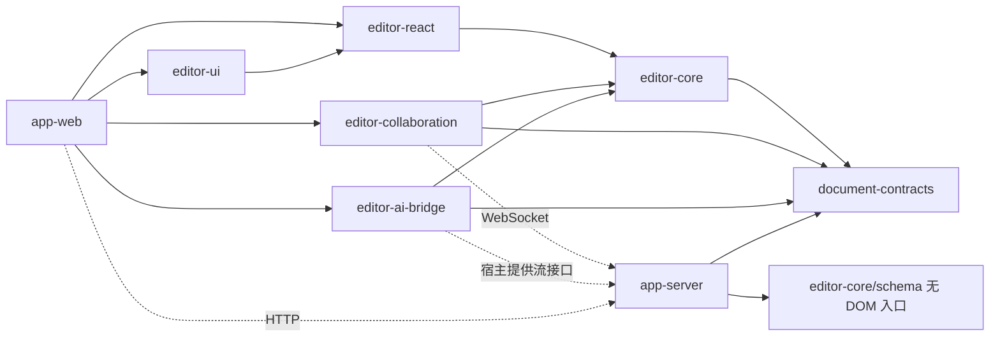

# 知书项目文档地图

状态：设计规划 v0.1。本文组织产品范围与设计责任，不表示功能已经实现。

项目先交付可嵌入、可独立使用的文档编辑与协同产品，再组合知识库、AI 和企业业务能力。文档采用“一个 package 一份主文档、一个 app 一份主文档”，共八份设计文档；本页负责导航、跨包约束和交付顺序。[原始需求](resreach.md)作为需求输入保留，原先按四个系统视角输出的方式由此文档地图替代。

## 1. 产品交付形态

| 形态             | 用户得到什么                                           | 最小组合                                                                            | 接入方负责什么                                   |
| ---------------- | ------------------------------------------------------ | ----------------------------------------------------------------------------------- | ------------------------------------------------ |
| 嵌入式编辑器     | 结构化编辑、Block 操作、导入导出，可采用自己的界面     | contracts + core；React 业务增加 react，默认界面增加 ui                             | 文档来源、保存、身份与业务页面                   |
| 独立协同文档产品 | 文档创建、多人编辑、在线状态、可靠保存、权限和版本恢复 | 编辑器组合 + collaboration + app-server 的独立文档配置；可用 app-web 的独立文档入口 | 部署存储和身份适配；无需配置知识库、向量库或模型 |
| 企业智能文档平台 | 空间、知识库、搜索、引用问答、AI 创作及企业管理        | 独立协同能力 + ai-bridge + 两个 app 的业务模块                                      | 企业组织与权限策略、知识数据、模型配置及运营策略 |

独立使用同时覆盖“在其他业务中嵌入”和“用最小服务组合运行文档产品”。服务端首期是可按配置注册模块的 Fastify 单体；功能可选不等于必须部署多个服务。

## 2. 目录与阅读顺序

```text
docs/
  README.md                         # 地图、产品边界、交付顺序与跨包约束
  resreach.md                       # 原始需求与 package 拆分输入
  packages/
    document-contracts.md           # 01 内容、命令、事件和版本合约
    editor-core.md                  # 02 编辑引擎与扩展模型
    editor-react.md                 # 03 React 集成与宿主接口
    editor-collaboration.md         # 04 协同会话与 Provider 接入
    editor-ui.md                    # 05 默认编辑界面与交互规范
    editor-ai-bridge.md             # 06 AI 草稿与编辑器变更适配
  apps/
    app-web.md                      # 07 产品页面、用户流程和前端组合
    app-server.md                   # 08 服务端、数据模型、AI/RAG 和部署运维
```

| 文档                                                        | 设计范围                                                  | 阅读前置                 | 需要产出的实现依据                                    |
| ----------------------------------------------------------- | --------------------------------------------------------- | ------------------------ | ----------------------------------------------------- |
| [01 document-contracts](packages/document-contracts.md)     | 内容结构、Block 身份、快照、编辑提案、兼容策略            | 本地图                   | 字段与约束、Schema、事件语义、迁移与兼容样例          |
| [02 editor-core](packages/editor-core.md)                   | 基础编辑、扩展、命令、导入导出、无 DOM 的 Schema 入口     | 01                       | Node/Mark 清单、命令行为、事务边界和内容保真规则      |
| [03 editor-react](packages/editor-react.md)                 | 生命周期、订阅、宿主服务、多实例和 React NodeView         | 01、02                   | 组件/Hooks 合约、实例归属、宿主接入示例               |
| [04 editor-collaboration](packages/editor-collaboration.md) | Yjs 绑定、连接状态、Awareness、重连与保存回执             | 01、02；与 08 对齐       | Provider 合约、状态模型、握手和恢复时序               |
| [05 editor-ui](packages/editor-ui.md)                       | 工具栏、菜单、Block 操作、状态反馈、无障碍与主题          | 02、03；了解 04/06 状态  | 组件目录、完整交互状态、键盘与窄屏行为                |
| [06 editor-ai-bridge](packages/editor-ai-bridge.md)         | 生成/改写适配、流事件、草稿预览、接受与撤销               | 01、02；了解 04 定位机制 | 任务状态、提案校验、并发修改与取消语义                |
| [07 app-web](apps/app-web.md)                               | 独立文档入口、空间、知识库、版本、评论、AI 和管理页       | 01—06                    | 页面地图、完整用户路径、状态归属与 API 组合           |
| [08 app-server](apps/app-server.md)                         | 文档/协同、身份权限、存储版本、知识库、AI/RAG、任务与运维 | 01；与 04/06/07 联读     | 模块 API、数据归属、事务与事件、REST/WS/SSE、部署配置 |

RAG、权限、存储等专题直接放进 app-server 主文档的对应章节；前端业务流程直接放进 app-web。包内 README 将来只记录安装和使用方式并链接主设计，避免两份设计同时维护。

## 3. 当前仓库与目标结构

当前已经存在 `apps/app-web` 与 `apps/app-server` 的工程基础，后端包含示例 projects/health 模块；`document-contracts`、`editor-core`、`editor-react`、`editor-ui` 四个 M1 工作区包已建立。`editor-collaboration` 与 `editor-ai-bridge` 尚未建立。根 README、AGENTS 中仍有旧目录 `apps/server` 的描述，本文按实际目录和本轮产品目标规划，不将模板功能视为编辑器功能。

服务端继续遵守现有约定：feature 在 `src/modules` 内组装 repository/service，业务层不依赖 Fastify；数据库位于 `apps/app-server/database`；Zod route contract 驱动校验与 OpenAPI，前端客户端由 OpenAPI 生成，离线导出不得连接数据库。

## 4. 包依赖与集成边界

箭头表示代码依赖；虚线表示运行时交互。这里的接口名和后续文档的 API 名均为拟定产品接口，不是已经存在的实现。



- 六个包不导入 `apps/*`、应用路由、全局 store、企业用户系统或数据库。除 document-contracts 外，其他包只导入所需公共入口，禁止跨包读取 `src` 私有文件。
- core 不依赖 React、Yjs 或 AI。react 不强制安装 collaboration、ui、ai-bridge；ui 通过状态与动作插槽展示这些能力，不静态导入其运行时。
- 协同和 AI 都通过 core 的编辑与锚点能力适配。app-server 的内容转换适配器可使用无 DOM 的 `editor-core/schema`；知识库业务只消费快照和公开合约。
- 扩展集在会话创建时确定。持久化自定义内容时，接入方必须同时提供前端扩展和服务端可校验/可投影的 Schema，不能只部署 React NodeView。

## 5. 跨文档的唯一归属

| 信息/状态                            | 唯一维护位置                                                | 其他位置如何使用                                    |
| ------------------------------------ | ----------------------------------------------------------- | --------------------------------------------------- |
| 文档 JSON、Block 身份与 Schema 版本  | document-contracts                                          | core、同步投影和 AI 校验引用；不复制类型            |
| 光标、选区、编辑事务与本地撤销       | core；协同模式撤销交给 collaboration 的适配器               | React/UI 订阅，不在 React store 再存一份全文        |
| 协同正文                             | 当前 generation 的 Yjs 二进制状态与更新日志，由服务端持久化 | JSON 是指定 durableSeq 的派生快照；RAG 从快照建索引 |
| 文档标题、归属、ACL、业务版本、附件  | app-server 的各业务模块                                     | app-web 通过 API 获取；不放进 Awareness             |
| 在线光标/在场状态                    | collaboration 的 Awareness 会话                             | 临时展示；不作为权限、审计或版本事实                |
| AI 生成草稿/接受状态                 | ai-bridge 管理客户端任务；app-server 管理服务端生成任务     | 生成完成、接受写入、持久化完成分别确认              |
| 空间与知识库关系、检索权限与索引状态 | app-server                                                  | 首期一个空间关联一个知识库；编辑器不感知此关系      |

必须分别表达：本地已修改、已进入同步流程、已获得服务端持久化回执、已形成业务版本、已完成索引。UI 不能用一个“保存成功”掩盖这些不同进度。普通编辑器由宿主保存 JSON；进入协同模式后不得再用 JSON 自动保存覆盖正文。

## 6. 用户操作的跨包责任

| 操作           | 完整路径                                                                           | 必须处理的中断或冲突                                                 |
| -------------- | ---------------------------------------------------------------------------------- | -------------------------------------------------------------------- |
| 打开文档       | web 获取授权与元数据 → collaboration 加载该 generation → react 挂载 core → ui 展示 | 无权限、被删除、不兼容 Schema、加载失败；不得显示假空白文档覆盖原文  |
| 编辑并离开     | core 事务 → collaboration 发送 → server 持久化 → 回执 → ui 更新状态                | 断线、落库失败、尚未确认的编辑；刷新后的恢复能力要与实际缓存能力一致 |
| 粘贴图片       | ui 选择文件 → react 宿主上传接口 → server 登记附件 → core 插入 assetId             | 取消、失败重试、重复上传、删除中的附件引用、签名 URL 失效            |
| 多人移动 Block | core 操作 → collaboration 协同合并 → server 持久化                                 | 并发移动/删除不能产生重复 ID 或静默丢内容；未解决前限制该操作        |
| AI 改写选区    | ui 动作 → ai-bridge 捕获目标 → server 生成 → 草稿预览 → core 原子应用              | 选区漂移、目标已改、取消、断流、重复事件；冲突时保留草稿供选择       |
| 知识问答       | web 选择知识域 → server 授权检索 → 带引用回答 → web 打开来源                       | 无证据、来源删除/撤权、索引滞后、部分流失败                          |
| 恢复旧版本     | web 预览差异 → server 生成新 generation → collaboration 重连                       | 旧会话与离线更新被阻止写回；评论锚点失效需显式处理                   |

## 7. 分阶段交付

文档中的 M1—M4 是实现阶段，不是完成状态。跨阶段功能以各主文档中的功能编号追踪；基础鉴权、输入校验、错误恢复随首个相关功能一起交付。

| 阶段              | 产品结果                                     | 关键范围                                                             | 阶段出口                                                               |
| ----------------- | -------------------------------------------- | -------------------------------------------------------------------- | ---------------------------------------------------------------------- |
| M1 可嵌入编辑器   | 其他 React 业务能安装包并编辑自己的文档      | DC 基础合约、EC 基础编辑、ER 生命周期、UI 基础控件                   | 无 app 路径依赖；JSON 往返保真；中文输入、键盘、只读与多实例可用       |
| M2 独立协同文档   | 最小部署可创建、协作、保存和恢复文档         | CO 全部基础会话能力；SV 文档/权限/版本/附件；WEB 独立入口；表格/图片 | 不启用知识库或模型也可运行；保存回执、重连、权限撤销、恢复旧版本有闭环 |
| M3 知识与 AI 产品 | 文档可检索、引用问答、AI 生成/改写、评论讨论 | AB、SV 知识库/AI、WEB 空间/搜索/知识/评论                            | 引用可回溯；文档级权限生效；AI 冲突不覆盖他人内容；索引可重试          |
| M4 企业增强       | 可治理、可扩展、可运维的企业产品             | 审批、细粒度策略适配、持久离线、外部数据源、复杂扩展                 | 有明确容量与恢复指标；升级迁移/备份恢复经过验证；高级功能可按部署启停  |

评论、提及、审批、修订建议分别作为业务能力设计。普通编辑撤销、业务版本历史、审阅中的逐条修订接受属于不同机制，不能互相替代。

## 8. 产品质量与交付门槛

| 维度       | 设计与验收要求                                                                          | 主要责任       |
| ---------- | --------------------------------------------------------------------------------------- | -------------- |
| 内容可靠   | 无效/未知节点不静默删除；Block ID 稳定；JSON 与协同投影一致；备份恢复保留正文与附件引用 | DC、EC、CO、SV |
| 编辑完成度 | 中文 IME、选区、粘贴、快捷键、拖拽、撤销、长文档、表格边界都有明确行为                  | EC、ER、UI     |
| 交互完成度 | loading/empty/error/retry/read-only/offline/saving/conflict 等状态能被理解且有后续动作  | UI、WEB        |
| 无障碍     | 键盘完成主要任务、焦点可见与恢复、控件有名称、状态不只依赖颜色；自动检查与人工流程结合  | UI、WEB        |
| 数据与权限 | HTTP、WS、SSE、检索、附件、导出都经过服务端授权；生成时引用再次确认权限                 | SV             |
| 资源治理   | 包导入无副作用；编辑器销毁释放连接、定时器和订阅；任务支持取消、上限、重试与失败可见    | ER、CO、AB、SV |
| 扩展与发布 | package exports、类型声明、依赖兼容矩阵、Schema 升级与扩展授权清晰                      | 八份主文档     |

建议容量基线：每篇 1,000 个可寻址 Block、约 1 MB 内容，同篇 20 个协作者；参考环境为客户端 4 核/16 GB、服务端 4 vCPU/8 GB、往返延迟 100 ms。初步体验目标为输入到绘制 P95 ≤ 100 ms、远端可见 P95 ≤ 500 ms、健康存储下持久化回执 P95 ≤ 2 s。以上是待压测校准的目标，并非已达到的指标；M2 前固定浏览器、数据集和测量方式，超出容量应给出明确限制或降级策略。

## 9. 实现前需要收敛的决策

| 编号 | 决策                        | 当前方向                                                                                                                                              | 最迟收敛时间与负责文档                                                                                                                                                                                                    |
| ---- | --------------------------- | ----------------------------------------------------------------------------------------------------------------------------------------------------- | ------------------------------------------------------------------------------------------------------------------------------------------------------------------------------------------------------------------------- |
| D-01 | 合约生成与 Zod/OpenAPI 对接 | TypeBox 产出 JSON Schema 2020-12 与 TS 类型；服务端 route 仍用本地 Zod，OpenAPI 3.1 直接引用共享内容组件                                              | 已在 M1 收敛并验证；内容组件检查由离线导出执行                                                                                                                                                                            |
| D-02 | 协同 Provider 与持久化回执  | 首期采用自托管 Hocuspocus；`beforeSync` 事务先写 Yjs 二进制更新及 durableSeq，再允许服务端应用/广播；应用后发自定义回执                               | 方案、PostgreSQL 提交失败恢复/重复重放以及正文更新和结构命令的提交后崩溃恢复 smoke 均已通过；历史重复 ID 用显式维护命令在 M2 修复                                                                                         |
| D-03 | 并发 Block 移动与唯一 ID    | generation 单 owner 串行结构命令；同一旧修订仅先提交者成功；删除 ID 代次内退役，拆分/合并身份确定；重复 ID 由服务端维护命令处理                       | 服务端双端原型与可复现 smoke 已通过；真实 Tiptap/React 正文输入及复制、删除、段落/标题/代码块转换、上下移完整菜单动作矩阵均获 durable ack；结构命令提交后崩溃恢复、operationId 重试及历史重复 ID 新 generation 修复均已验 |
| D-04 | 扩展兼容与授权              | 基础编辑、协同、表格、图片与嵌入均限定在 MIT OSS/项目自有扩展；Pro/Cloud 不作为依赖。表格与图片先扩 contracts/服务端投影，协同先实现 Yjs 映射 adapter | 候选许可/私有部署/离线边界已记录；新增扩展前按准确锁定版本复核授权并完成客户端 Schema、contracts、服务端投影与迁移验收                                                                                                    |
| D-05 | 向量库、Embedding 与 Rerank | 按中文数据、隔离、部署成本、删除与重建能力选择                                                                                                        | M3，SV；由同一评测集比较                                                                                                                                                                                                  |
| D-06 | 协同部署规模                | 首期每个数据库单实例 advisory lock；默认 TCP/活跃房间/单房间连接上限 100/50/20，单连接 1 文档、更新帧 1 MiB                                           | 首期锁冲突、超限拒连与恢复 smoke 已通过；多实例路由、fencing、顺序和接管在扩容前补齐                                                                                                                                      |
| D-07 | 支持平台与内容格式          | M1 桌面浏览器与 JSON；M2 窄屏基础编辑；其他格式声明损失范围                                                                                           | 每个阶段开始前，EC + UI + WEB                                                                                                                                                                                             |

M1 的平台目标定为桌面端 Chrome、Edge、Firefox 和 macOS Safari 的当前及上一稳定主版本，主要编辑视口宽度至少 1024 CSS px；实际验收记录具体版本。M1 的无损往返格式是 Schema v1 JSON。HTML/纯文本如实现转换，必须逐项报告支持、降级或拒绝；不承诺无损往返。窄屏和触屏基础编辑在 M2 确认并验收。

## 10. 文档维护规则

每份主文档按“目标与边界 → 功能清单 → 公共接口 → 数据与状态 → 关键流程 → 异常与质量 → 分阶段交付”维护。功能使用包前缀编号（DC、EC、ER、CO、UI、AB、WEB、SV），跨文档引用编号或链接，不复制规范。

修改合约先更新所属主文档，再更新受影响调用方及样例；迁移记录保存在该文档内。实现完成后为功能补充源码入口、验证结果和限制，不把“规划”直接改写成未经验证的“已支持”。

## 11. 包发布与接入交付

六个 package 都按可独立消费的产物设计：ESM、类型声明、明确 exports、必要的按需样式和消费示例；实际 npm scope、私有 registry 与发版策略在首次发布前确定。首期通过 workspace 引用实现，但验收样例从构建后的包入口消费，不配置源码别名：`examples/editor-consumer` 覆盖保存/恢复、多实例、自定义 NodeView、按 ID Block 操作和格式转换，`examples/schema-consumer` 覆盖 Node.js 纯 Schema 入口，`examples/contracts-consumer` 只安装 contracts 包并在 Node.js 验证。

contracts/core/react 首期维护一致的兼容发布组合，collaboration/ui/ai-bridge 可在兼容矩阵内独立升级。React、Tiptap/ProseMirror、Yjs 等需保持实例/类型一致的依赖声明 peer 范围，具体运行时仅由需要它的包声明；普通编辑器不因一个可选扩展而被迫安装完整平台依赖。

发布说明分别列出 npm 包版本、支持的 Schema/扩展格式与协同协议版本；这三者不能用一个版本号代替。破坏兼容的升级必须包含迁移、旧客户端处理和回退方案，包升级不触发静默线上内容迁移。
