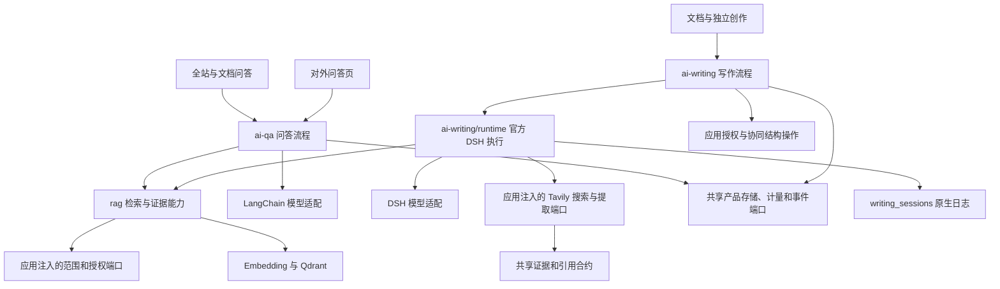
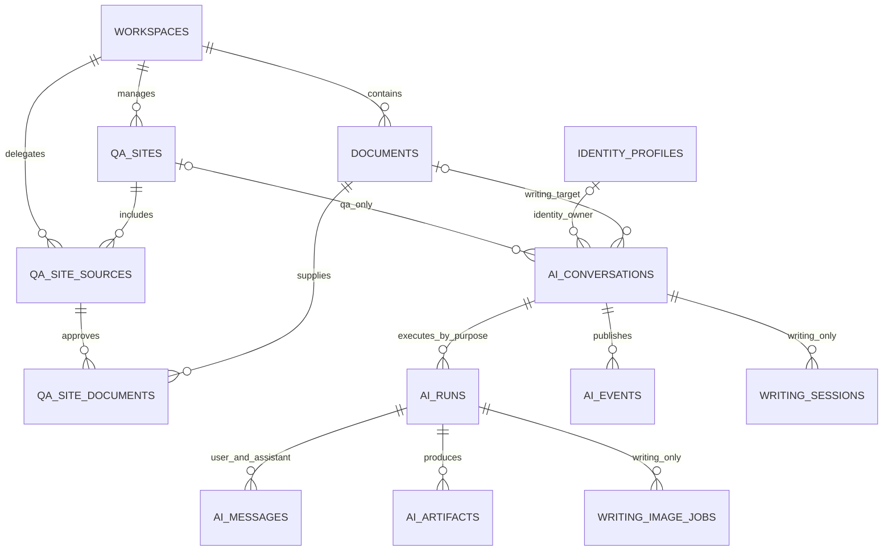
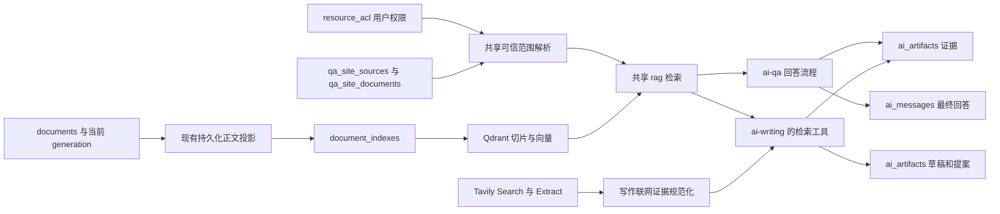

# AI 问答、写作与对外问答站技术设计

设计草案，建立于 2026-11-07，基于 2026-11-09 全仓扫描，于 2026-11-10 调整为问答、写作两个独立业务 package。产品入口、会话上下文与执行流程分别管理，尽可能复用检索、协议、UI、持久化和运维基础设施。允许新增必要表、删除旧实现和破坏性 API/Schema 调整，不保留旧生产协议或兼容执行分支。

本文定义目标模型与实施清单，第 2 节记录审查基线时的源码和历史扫描事实，其余章节为目标设计。实施状态（2026-11-11 切换批次）：`@zhishu/ai-qa` 与 `@zhishu/ai-writing` 两个业务 package、共享产品存储 `ai` 模块与 `qa`/`writing`/`rag`/`qa-sites` 服务端模块、前端 `features/{qa,writing,qa-sites}` 与 `components/chat`、迁移链 0042–0045（备份→退役旧表→建新表→回填）均已落地；旧 `@zhishu/ai-runtime`、`@zhishu/ai-plugins`、`@zhishu/dsh-agent`、`writing-chat`/`projects` 模块及旧协议入口按约定同批退役，`examples/writing-consumer` 改为独立消费新 runtime。已通过的验证：根 `pnpm check`（格式、lint、架构、类型、build、OpenAPI 与客户端零漂移）、`pnpm test:ai`、`pnpm check:ai-packages`、服务端 `test:architecture`/`test:documents`/`test:authorization`，以及一次性库上的端到端冒烟 `smoke:ai`（确定性脚本模型与桩检索，覆盖问答引用与幂等、跨用途拒绝、上下文修订隔离、无密钥联网 503、交接再核验、提案编译与 durable 采纳、取消、站点发布与访客公开问答投影）。尚未验证：真实模型调用、真实 Qdrant 索引、真实 Tavily 请求与浏览器端交互；这些在交付报告中单独声明，不以上述结果冒充。

## 1. 产品目标与边界

| 入口              | 产品用途             | 默认上下文                                        | 主要结果                   |
| ----------------- | -------------------- | ------------------------------------------------- | -------------------------- |
| 全站知识问答      | 查找、理解和核对资料 | 当前租户内有 read 与 ai 权限的资料，可选空间/文档 | 答案、引用和来源           |
| 文档内问答        | 围绕文档提问         | 用户明确选择的当前文档范围                        | 答案和引用，不修改正文     |
| 文档写作助手      | 续写、改写与完善正文 | 当前文档、选区、光标和写作要求，可增加参考资料    | 草稿和可审阅提案           |
| 独立创作页        | 无目标文档的自由创作 | 写作对话和明确选择的资料                          | 草稿，采纳后创建或写入文档 |
| 对外 `/ask/$slug` | 管理员配置的资料问答 | 站点批准的文档及访客选择的站内子范围              | 公开答案和允许的引用摘要   |

问答与写作有独立会话，问答不能隐式变成正文编辑。全站问答面板不会因为导航到文档而自动变为写作助手；文档工具栏和选区动作明确启动写作。两者通过“基于这些资料写作”衔接，创建新的写作会话，重新验证并传递选定证据，不合并原会话历史。

Skills 继续作为能力组织方式：问答组合 scope 与 rag，写作组合 writing 并按需使用相同的 scope/rag 能力。对外问答是问答 package 的受限入口，不建设第三套业务 package。

对外采用当前持久化正文模式。管理员批准文档是否进入公开范围，已批准正文跟随协同持久化与索引更新，新增文档需要明确批准。固定发布快照不属于当前交付范围。

写作支持通过 Tavily 联网搜索。基于网页或平台文档生成的事实性回答、草稿和提案必须显示可追溯引用；平台文档问答默认只使用已授权文档，对外问答只使用站点批准文档。联网搜索的开启与平台范围选择分别管理，配置密钥不会自动为所有会话开放联网能力。

## 2. 当前源码与扫描发现

本节是审查基线（2026-11-10）时的扫描记录；所列兼容实现已在 2026-11-11 切换批次全部退役，保留的旧行号链接仅用于对照当时历史，实际退役证据见 §15.1 与 `scripts/ai-package-consumer-check.mjs` 的静态门禁。

### 2.1 扫描范围和依据

2026-11-09 对 21 个 workspace 做过结构扫描，包含 2 个 app、13 个 package、6 个 example；在 apps、packages、examples、scripts 中枚举到 453 个相关文件，其中 376 个代码文件经 TypeScript AST 检查导入、导出和表声明，发现 33 张 Drizzle 业务表。扫描跳过 node_modules、dist、生成客户端、路由生成文件和 migration 快照。

2026-11-10 复核包依赖、问答运行时、DSH 存储端口、检索接口与表定义。以下是现有实现，不表示后续目标已完成。

| 范围     | 源码事实                                                                                             | 本版决定                                                                          |
| -------- | ---------------------------------------------------------------------------------------------------- | --------------------------------------------------------------------------------- |
| 前端     | AiCreationPage 混合 writing/rag/proposal 分支，RagChat/WritingChat/ProposalResult 分别持有请求和缓存 | 保留问答/写作业务分工，清理混合页面和提案独立 Chat，复用基础组件与传输实现        |
| 问答     | ai-runtime/chat 使用 LangGraph，回答依赖外部传入的历史和证据                                         | 抽出独立 ai-qa package，以有界检索、校验、生成流程替代单节点图与旧 checkpoint     |
| 写作     | writing-chat 使用 DSH，AiService 另有旧 authoring 恢复和应用分支                                     | ai-writing 负责写作执行，应用 writing 模块负责提案应用，删除旧 authoring 执行器   |
| 产品存储 | ai_runs 保存任务和结果，writing_conversations.state 保存整套消息/Run 快照                            | 两种用途共用规范化产品表，各自拥有逻辑会话和上下文                                |
| DSH 存储 | ChatStore.acquire/load/commit 当前以完整 ChatRecord 为单位                                           | 调整为写作执行端口，产品事务由共享应用存储负责，原生 Session 日志保留独立恢复职责 |
| 检索     | packages/rag 的 KnowledgeRetriever.retrieve 返回 EvidenceBundle，research 另有关键词检索             | 复用现有检索接口，统一证据来源；LangChain 组件与 DSH 工具之间通过纯合约连接       |
| 公开授权 | document_shares 的 invite/access 参与用户 ACL 委托和来源校验                                         | 保持普通分享职责，对外问答使用站点、来源、批准文档关系                            |
| 模板残留 | projects 没有租户字段，前端产品无消费，smoke 与 OpenAPI 导出仍依赖                                   | 连同模块、表、脚本断言和生成接口退役                                              |

关键源码：[应用装配](../../apps/app-server/src/app.ts)、[AI 装配](../../apps/app-server/src/modules/ai/index.ts)、[AiService](../../apps/app-server/src/modules/ai/ai.service.ts)、[写作服务](../../apps/app-server/src/modules/writing-chat/writing.service.ts)、[写作存储](../../apps/app-server/src/modules/writing-chat/writing.repository.ts)、[DSH 端口](../../packages/dsh-agent/src/types.ts)、[问答图](../../packages/ai-runtime/src/chat.ts)、[检索接口](../../packages/rag/src/retriever.ts)、[research 工具](../../packages/ai-plugins/src/research.ts)。

数据与消费者：[AI 表](../../apps/app-server/database/schema/ai.table.ts)、[写作表](../../apps/app-server/database/schema/writing.table.ts)、[索引表](../../apps/app-server/database/schema/rag.table.ts)、[业务/权限表](../../apps/app-server/database/schema/document.table.ts)、[创作页](../../apps/app-web/src/features/ai/ai-creation-page.tsx)、[旧缓存恢复](../../apps/app-web/src/features/ai/proposal-client.ts)、[独立消费检查](../../scripts/ai-package-consumer-check.mjs)、[项目模板](../../apps/app-server/src/modules/projects/index.ts)、[OpenAPI 导出](../../apps/app-server/src/scripts/openapi-export.ts)。

当前 ai-contracts 已有 EvidenceItem、SourceCitation 和原文区间匹配校验，但 SourceReference 尚未区分平台文档/网页，chat-contracts 消息仍以 text 为主，服务端配置尚无 Tavily 字段。后文的统一来源、结构化引用及联网工具是新增目标，不将已有引用校验等同于 Tavily 已接入。

### 2.2 当前仍存在的兼容实现

当前源码尚未执行本方案，仍有明确的兼容路径：AiService 按旧 engine 恢复任务，并动态加载 legacy-authoring；ai_runs.input 保留 engine 和 previousRequestIds；独立消费脚本仍校验旧包出口。设计要求删除它们，不能据此宣称当前代码已完成清理。

见 [旧执行器分支](../../apps/app-server/src/modules/ai/ai.service.ts#L358)、[旧任务字段](../../apps/app-server/database/schema/ai.table.ts#L28)、[旧消费 fixture](../../scripts/ai-package-consumer-check.mjs#L89)。这些行号对应本次审查基线，实施后相关链接和基线说明随源码迁移更新。

目标保留 ai-qa 与 ai-writing 两个业务 package，复用现有纯合约、UI 和 rag；原 dsh-agent 的有效 SDK 接入迁入 ai-writing/runtime，避免再维护一层会话协议。普通分享、身份授权与站点批准分别承担自己的业务职责。

## 3. 两个业务 package 与共享基础设施

### 3.1 架构



问答优先采用“解析范围 → 有界检索 → 校验证据 → 生成回答 → 交付复核”的流程。LangChain 提供实际需要的模型与检索组件，首期不建立独立 LangGraph 图、Deep Agents 或 PostgresSaver。写作使用 DSH Agent 进行多步工具调用；它调用共享检索工具取得证据，再完成草稿或提案，不嵌套一个完整问答 Agent。

### 3.2 包职责和依赖

| 目标 package                                     | 责任、公开边界与依赖                                                                                                                                                 |
| ------------------------------------------------ | -------------------------------------------------------------------------------------------------------------------------------------------------------------------- |
| `@zhishu/ai-qa`，目录 `packages/ai-qa`           | 问答流程、问题重写、回答 Schema、引用校验与有界步骤恢复。导出创建问答流程的公开入口，输入纯合约与注入端口，使用 LangChain 模型适配，不依赖 DSH、Fastify 或业务数据库 |
| `@zhishu/ai-writing`，目录 `packages/ai-writing` | 合并 ai-plugins 的写作/图片/编译和原 dsh-agent 的有效 SDK 接入，runtime 内直接装配官方 DSH；只公开写作与纯编译入口，不依赖 ai-qa 或业务数据库                        |
| `@zhishu/rag`                                    | 两者共享的来源规范化、分块、Embedding、Qdrant、EvidenceBundle，以及中立的 scope/rag Skill 资源与工具 Schema；不生成最终答案，不持有会话和 DSH 状态                   |
| `@zhishu/chat-contracts`                         | 共享会话、消息、Run、产物引用与事件信封；purpose 使用判别联合表达用途差异，删除旧 wire format 和 proposal Chat 类型                                                  |
| `@zhishu/ai-contracts`                           | 纯范围选择、证据、来源依赖、引用、提案、审阅与公共端口类型；不包含 ORM、Fastify、LangChain 或 DSH 类型                                                               |
| `@zhishu/chat-ui`                                | 受控消息、输入、引用、状态与产物插槽，不拥有网络、业务会话或全局可变状态                                                                                             |

两个业务 package 互不依赖。`ai-writing` 使用 `rag` 的同一检索合约和 Skill 资源，不调用 ai-qa 的最终回答流程。原 @zhishu/dsh-agent 不作为第三个通用执行包保留；迁入有效逻辑后，删除 ChatStore/ChatLease/ChatRecord、DshChatSession 等旧产品接口及其导出，examples 改为独立消费 ai-writing。LangChain/DSH 原生类型留在各自适配边界，产品状态只由共享应用服务修改。

业务 package 主入口只在服务端运行，前端消费 chat-contracts、ai-contracts 和 chat-ui；写作的纯编译子入口不加载 DSH。evidenceId、quote、blockId 匹配等纯引用校验在 ai-contracts 保留单一实现，当前授权和来源版本复核通过共享 rag 应用端口完成，两个流程只编排调用，不各写一套规则。

通用范围/证据定义只保留一份。检索 Skill 指令和 Schema 随现有 rag 包发布，写作工具由 ai-writing 注册到 DSH；问答流程按同一 Schema 执行受控步骤，流程不依赖模型自发加载 Skill 才保证检索。SKILL.md 及资源必须进入 package 发布文件，独立消费检查验证其可读取。

共享模型配置、凭据解析、限额、超时、取消、日志和用量预留；模型调用由各自官方适配负责，统一回报纯用量记录。首期不再创建万能模型网关、通用 Agent 引擎或第三个 skills 业务包。

Tavily 适配放在 writing 应用模块的集成代码中，通过纯 WebSearchPort 注入 ai-writing。写作包注册 web_search/read_web_source 工具，配套 web-research Skill 使用同一套证据登记和引用校验；不新增 Tavily package，不通过 ai-qa 的最终回答流程中转。网页证据与平台证据都进入 ai_artifacts，但网页不自动进入平台文档、document_indexes 或 Qdrant。

### 3.3 应用模块与唯一责任

| 应用模块                                          | 责任                                                                                                                                                                |
| ------------------------------------------------- | ------------------------------------------------------------------------------------------------------------------------------------------------------------------- |
| `app-server/modules/ai`                           | 重建为共享产品 repository/service：会话/消息/Run/产物/事件事务、租约、幂等、预算和配置装配。删除原 AiService 的混合执行逻辑，模块不选择用户意图、不驱动第二套 Agent |
| `app-server/modules/qa`                           | 组装 ai-qa、问答授权、上下文投影、消息入口和问答到写作的交接                                                                                                        |
| `app-server/modules/writing`                      | 组装 ai-writing、DSH 原生存储、文档目标捕获、图片任务、提案审阅和协同应用                                                                                           |
| `app-server/modules/rag`                          | 保留索引 Worker，提供同一检索/版本/授权适配给两种用途                                                                                                               |
| `app-server/modules/qa-sites`                     | 管理站点、来源批准、访客认证与公开投影；公开消息交给 qa 模块                                                                                                        |
| `app-web/features/qa`、`app-web/features/writing` | 各自拥有业务会话和上下文，复用 chat-ui、纯事件归并和可配置传输实现；缓存和草稿按用途隔离                                                                            |
| `app-web/features/qa-sites`                       | 站点管理和问答页面外壳，复用 qa 前端业务能力                                                                                                                        |

共享产品服务负责持久化状态转换，qa/writing 负责各自业务校验与执行，事务端口接收明确的已校验命令。SQL 留在 repository，运行时网络调用在事务外。共享基础层不导入 qa/writing 模块，根装配注入真实外部依赖。

端口仅用于应用授权/持久化与包、模型、检索或 Tavily 等真实边界，可直接使用类型化回调；不为每个步骤再建立 interface/service/adapter 三层。同一函数只由一个位置实现，公开 index 可以组织本包 exports，旧包名和旧符号的转发出口一律删除。DSH 内存投影仅处理 SDK 原生恢复，不拥有产品消息/Run/审批状态的另一份可写快照。

## 4. Skills 与两种执行流程

| Skill   | 来源与使用方                                             | 输入和结果                                                       |
| ------- | -------------------------------------------------------- | ---------------------------------------------------------------- |
| scope   | rag 中的中立资源；qa 和 writing 使用                     | 范围选择意图 → 服务端验证的 scopeRef、contextRevision 和覆盖摘要 |
| rag     | rag 中的中立资源；qa 流程执行，writing 注册对应 DSH 工具 | 问题、可信范围、有界预算 → evidence artifact、来源版本与引用候选 |
| writing | ai-writing；仅写作流程加载                               | 写作要求、目标、可选证据 → draft/proposal artifact               |

Skill 包含版本化 SKILL.md、使用条件、输入输出 Schema 与所需能力；按需加载说明，工具和流程使用同一 Schema。权限、公开范围、调用次数、token 和输出限制由服务端执行，不依赖指令遵守情况。

问答流程先解析本轮范围意图，必要时用一次有界问题重写处理指代，再执行检索。问题重写不能引入无权历史或扩大范围。业务事实回答生成前必须有有效证据，生成后校验 evidenceId、quote 和定位；合法范围无证据返回 insufficient-evidence。首期优先一个受控检索批次，允许的补检/重写次数显式配置并计量。

写作可以不检索；用户要求依据资料时先使用共享检索能力。原 installResearch 的关键词实现及重复证据登记移除，保留实际有用的搜索/读取动作并接到同一检索端口。后台分块和索引由 Worker 执行，不因用户触发 Skill 才开始维护索引。

工具/步骤使用稳定 stepId、toolCallId、skillVersion，证据与产物按 Run 隔离。问答的 evidence artifact 和写作的 draft/proposal 属于各自 Run；一次 Run 不跨用途执行。图片继续是有审批、真实任务状态和资产存储的写作工具。

web-research 是写作专属的联网调研 Skill，输入公开检索词、域名/时间偏好及有界预算，输出统一的网页 evidence 和引用候选。rag Skill 负责平台资料检索，两者可在同一写作 Run 组合。qa 与公开入口首期不注册 web-research、web_search 或 read_web_source，缺少平台证据时明确说明，不自动搜索互联网填补答案。

## 5. 会话、交接与界面

### 5.1 各自维护业务上下文

全站问答关闭和导航后保留当前问答会话。写作会话绑定一篇目标文档，或明确标识为无目标的创作草稿；切换文档不隐式复用另一个文档的目标和提案。跨文档编辑由显式新建写作会话处理。独立创作页复用 writing 业务流程。

问答上下文包括问题、有效答案、检索范围和证据；写作上下文包括写作要求、目标基线、草稿和已选参考资料。两者可共享历史列表的基础组件，但查询键、输入草稿、AbortController 和活动 Run 不共享可变实例。

文档右侧面板与大纲协调布局，问答和写作有明确标题及入口。窄屏转抽屉或全屏，切换面板保留草稿。Cmd/Ctrl+K 保留全局搜索，通过明确动作进入问答；输入法期间不抢占按键，关闭浮层恢复焦点/选区。

### 5.2 从问答创建写作会话

“基于这些资料写作”仅对有权的内部身份开放。用户选定答案/引用和写作要求，服务端复核来源当前权限、版本与分发策略，再创建 purpose=writing 的新会话、首条输入及 Run。

只传入允许的证据、用户要求和明确目标；原会话历史、原生 Session、待审批动作和运行租约不迁移。旧答案或摘要不能在过滤证据后原样复制；需要摘要时从本次通过校验的证据重新构造。过期资料重新检索，资料不足时说明原因。

新写作会话记录有界 origin 来源标识用于追溯，生成自己的 evidence artifact。origin 是审计信息，不是授权凭据；不复制会话所有权。通过创建幂等键防止重复点击创建多个会话，同进程同数据库事务完成交接，暂不增加 handoff 表。

## 6. 范围、版本与上下文修订

内部 scope 为 all、workspaces 或 documents，all 限定当前租户及 read + ai 权限。服务端验证、去重并排序 ID。scopeRef 表示选择意图，当前授权集合每次重新求值；问答与写作可采用不同的初始选择。

会话只使用 contextRevision 一个上下文修订号，覆盖范围、授权、来源版本、目标基线和配置变化；范围控件及消息提交都校验 expectedContextRevision。Run 固定受理时的修订，用户变更范围先取消或隔离旧执行，再推进修订并启用新上下文，不另存一个需要同步维护的范围修订号。

自然语言范围解析先于受保护历史加载，只读取本轮输入及允许显示的来源标签。问答重新组装允许的历史和证据；写作在修订变化后创建新的 DSH 原生上下文。过滤界面消息不足以清除原生日志中的旧资料，旧 Session 不能继续推理。

依赖变化时，界面可展示用户仍有权查看的旧答案并标记资料已更新；模型上下文只包含当前有效来源和版本。旧混合摘要无法证明来源时剔除或重新生成。已知撤权取消受影响执行，交付和应用边界仍必须再次复核，不将事件通知当作唯一保障。

## 7. 共享数据模型与约束

### 7.1 表映射与数量

两种业务独立会话，共用产品表；只有原生写作执行和图片任务使用专属表。不另建 qa_conversations/qa_runs，不把问答结果塞进 DSH 日志，也不因增加 Skill 新增一套存储。

| 当前表                        | 目标               | 决定                                                   |
| ----------------------------- | ------------------ | ------------------------------------------------------ |
| writing_conversations         | ai_conversations   | 重命名，增加不可变 purpose，移出完整消息/Run JSON 快照 |
| writing_events                | ai_events          | 重命名，双方共用有序产品事件                           |
| ai_runs                       | ai_runs            | 重构为双方共用的执行元数据，移出正文、提案与审阅       |
| 新增                          | ai_messages        | 用户输入与可交付助手消息的唯一正文来源                 |
| 新增                          | ai_artifacts       | 双方的证据，以及写作草稿、提案和图片引用               |
| writing_sessions              | writing_sessions   | 保留名称，补齐租户、写作会话和 contextRevision 约束    |
| writing_image_jobs            | writing_image_jobs | 保留名称，规范化 Run、幂等及资产关联                   |
| 新增                          | qa_sites           | 对外站点及访问策略                                     |
| 新增                          | qa_site_sources    | 站点与来源空间的委托关系                               |
| 新增                          | qa_site_documents  | 管理员逐文档批准关系                                   |
| document_indexes              | document_indexes   | 保留当前文档索引任务与清理语义                         |
| document_shares、resource_acl | 同名表             | 保留普通分享和真实身份授权职责                         |
| projects                      | 删除               | 随模板 API 一次性退役                                  |

目标核心域为 11 张 AI/站点/索引表：5 张共享产品表、2 张写作专属表、3 张站点表、1 张索引表。新增 5 张、重命名 2 张、原地重构其余相关表。按历史扫描的 33 张 Drizzle 业务表计算，新增 5 张并退役 projects 后为 37 张；SDK 自管 ai_checkpoint 表另行退役，不计入业务表数量。

### 7.2 ai_conversations：用途与所有权

字段：id、tenantId、purpose、identityId、visitorId、siteId、scopeSelection、contextRevision、可空 targetDocumentId、configurationId、creationKey、origin、eventSequence、status、expiresAt 和时间。

purpose 为 qa 或 writing，创建后不可修改，由受信任路由指定；它表示业务用途，不是旧的 writing/rag/proposal UI 模式。siteId 非空时 purpose 必须为 qa，targetDocumentId 非空时 purpose 必须为 writing。内部身份使用 identityId，公开匿名访客使用 visitorId，两者恰好一个非空；匿名必须绑定 siteId，登录用户在公开入口也必须绑定 siteId。

以 (tenantId,id) 定位会话，补充 (tenantId,id,purpose) 唯一键供用途外键使用。identity、site、目标文档的约束都带 tenantId。目标文档删除后会话进入目标不可用状态，保留草稿和逻辑定位；物理删除使用明确的解绑/归档事务，不级联销毁用户写作历史。

creationKey 在同租户、同所有者、同用途和同站点上下文内唯一，内部入口的 siteId 为空也纳入去重语义；内部身份与访客分别建立部分唯一索引，显式处理 NULL，防止内部和公开上下文互相命中。owner、siteId、purpose 创建后均不可修改。origin 只存有界的来源消息/产物标识与追溯信息，作为逻辑引用，不授予跨会话读取权。

会话不持有模型原生日志或完整消息/Run 快照。DSH 原生 Session 根据写作会话与 contextRevision 从 writing_sessions 取得；问答没有对应 Session 行。

### 7.3 ai_runs 与 ai_messages：消除循环引用

| 表          | 主要字段                                                                                                                                                                          |
| ----------- | --------------------------------------------------------------------------------------------------------------------------------------------------------------------------------- |
| ai_runs     | id、tenantId、conversationId、purpose、idempotencyKey、inputHash、context、status、attempt、leaseOwner、leaseExpiresAt、fencingToken、execution、usage、errorCode、时间与过期时间 |
| ai_messages | id、tenantId、conversationId、runId、role、parts、clientMessageId、state、generationAttempt、createdAt、committedAt                                                               |

引用方向固定为 conversation → Run → message：Run 不设置 inputMessageId，消息通过同租户、同会话的复合外键引用 Run。每条用户提交在一个短事务内先创建 queued Run，再创建它的用户消息；事务失败整体回滚。恢复通过 Run 查询唯一用户消息，不在 Run 中复制输入正文。

role 仅为 user/assistant。每个 Run 恰好一条用户消息、至多一条最终助手消息；部分唯一索引约束同 Run 同 role 不重复，输入存在由受理事务保证。工具进度、审批和产物更新使用事件，不额外伪装成最终助手消息。clientMessageId 仅用户消息非空，在会话内唯一；Run 的幂等键在会话内唯一。重复任意一个键都必须比对原 inputHash，不同请求内容返回冲突。

ai_runs.purpose 通过 (tenantId,conversationId,purpose) 外键与会话一致。补齐 (tenantId,conversationId,id) 及包含 purpose 的唯一键，供消息、产物和专属任务引用。purpose 在这里作为数据库约束与计量查询所需的投影，不是第二份可独立修改的业务状态。

context 保存受理时的 contextRevision、配置、来源引用与目标版本捕获，不保存整段历史、正文或证据副本。execution 使用用途判别的有界结构：qa 保存步骤与结果定位，writing 保存原生投递/Session/工具调用定位。步骤不再各建一套 Run 表。

Run 状态为 queued/running/waiting-approval/completed/interrupted/failed/cancelled。waiting-approval 只允许 writing，表示执行中的工具审批；最终提案等待用户采纳属于 artifact 应用状态，生成 Run 可以已经 completed。同会话只允许一个 running/waiting-approval Run，queued 有上限。状态转换由共享产品服务执行，业务流程不能绕开租约或修改另一用途的 Run。

ai_messages.state 为 staged/committed/withdrawn：用户消息受理即 committed，模型生成结果可以先写入 staged，再经引用、权限和版本复核提交。客户端快照和产品事件仅暴露 committed 消息，撤权后仍需按当前来源过滤。generationAttempt 与 fencingToken 防止旧尝试覆盖新结果；已 committed 正文不可被重试改写。

删除旧 ai_runs.input.history、result、review、applicationState、receipt 及兼容 engine 字段。inputHash 对客户端原始请求和引用计算，后续检索结果由产物记录。

### 7.4 ai_artifacts：共用产物与写作应用状态

字段：id、tenantId、conversationId、runId、purpose、producerCallId、resultIndex、kind、schemaVersion、state、payload、evidenceRefs、createdAt；提案另有 reviewRevision、review、applicationState、receipt。

kind 为 evidence/draft/proposal/image。qa 只允许 evidence；writing 可以产生全部类型。用途通过 Run 复合外键匹配，数据库 CHECK 限制 kind 和提案专用字段；payload 在边界使用对应 Schema 校验。state 为 staged/committed/withdrawn，已生成的 payload 不原地改写，修订生成新的 artifact 身份。最终答案正文归 ai_messages，不再复制一份 answer artifact。

同 Run 的 producerCallId + resultIndex 唯一，重复工具/步骤完成返回原产物；消息 parts 仅保存 artifact 引用和显示所需的有界信息，不复制完整证据或草稿。producerCallId 由服务端执行身份生成，不能相信模型自行输出的关联 ID。

来源元数据只存在 evidence artifact 的 payload.sources 中，按 sourceId + snapshotId 去重。draft/proposal 的 evidenceRefs 仅记录生成该产物时实际可见的 evidenceArtifactId/evidenceId，包含已读但未直接引用的依据；不再复制文档版本、网页元数据或单独保存一份 sourceDependencies。evidence artifact 自身的 evidenceRefs 为空，授权/版本依赖从其 sources 推导。

Run.execution.evidenceRefs 由服务端登记每次真正交给模型的证据身份集合，包括允许历史的来源依赖；最终消息的授权依赖从该 Run 取得，不仅检查正文实际显示的引用。这样即使模型漏引某份资料，撤权后也不会把受其影响的答案重新装入上下文；不在 message 再复制一份来源元数据。

证据依赖是受控逻辑引用，访问与回收时验证同租户、允许的会话上下文和当前授权。来源更新后保留原快照身份，新执行重新取证。目标文档的并发基线归 Run.context，与来源证据用途不同，不合并为可被模型任意修改的输入。

无需新增 web_sources、citations 或 Tavily 任务表：实际读取的网页摘录、来源元数据和内部文档证据保存于 evidence artifact；ai_messages.parts 和 draft/proposal 只保存类型化 Citation 引用。qa 的 evidence 仅允许 document，writing 可混合 document/web，入口白名单与 Schema 同时约束。供应商请求 ID、工具调用及用量归现有 Run 执行/计量记录，原始响应不复制到会话 JSON。

proposal.payload 使用唯一的 WritingProposalPayload，包含目标基线、target、operationBatch、summary 和 Citation。身份由外层 artifact.id/runId 表达，payload 不再保存旧 proposalId/requestId；原 AuthoringProposal 及其 validator/export 在迁移消费者后删除，不保留类型别名或两套载荷解析。reviewRevision、review、applicationState 和 receipt 仅由 artifact 应用事务维护，生成结果不携带这些可变状态。公开 DTO 只返回允许的引用摘要，草稿/提案显示、导出和应用仍复核来源分发策略。

### 7.5 ai_events、writing_sessions、writing_image_jobs

ai_events：tenantId、conversationId、sequence、type、entityId、payload、createdAt，(tenantId,conversationId,sequence) 唯一。相关实体变更、会话 eventSequence 和紧凑产品事件在同一事务提交，GET snapshot 从产品表构造。删除每个事件复制整个会话快照的格式，事件不保存供应商原始正文或原生日志。

writing_sessions：id、tenantId、conversationId、purpose、contextRevision 与官方 SessionPersistence 持久化列。purpose 固定 writing，使用包含用途的会话复合外键，(tenantId,conversationId,contextRevision) 唯一。官方 header/events 等格式保持 SDK 所有权，日志仅用于原生恢复和产品投影，客户端不可直接读取。原生 store 不再另存完整产品 ChatRecord。

writing_image_jobs：id/key、tenantId、conversationId、runId、purpose、toolCallId、status、assetId/受控 providerResult、时间。purpose 固定 writing，以复合外键引用写作 Run，Run/toolCallId 唯一。保留 pending/unknown/ready/failed 和原始请求幂等身份；图片产物只引用 job/asset，长 base64、临时签名地址不进入消息和原生日志。

### 7.6 站点、来源与批准文档

| 表                | 主要字段                                                                                                                                                                                    |
| ----------------- | ------------------------------------------------------------------------------------------------------------------------------------------------------------------------------------------- |
| qa_sites          | id、tenantId、ownerWorkspaceId、slug、name、description、welcome、suggestedQuestions、accessMode、accessCodeHash、status、revision、accessRevision、quotaPolicy、expiresAt、createdBy、时间 |
| qa_site_sources   | id、tenantId、siteId、workspaceId、publicLabel、grantedBy、时间；同租户 siteId/workspaceId 唯一                                                                                             |
| qa_site_documents | id、tenantId、sourceId、workspaceId、documentId、approvedBy、state、suspensionReason、时间；同来源 documentId 唯一                                                                          |

/ask/$slug 不带租户，因此 slug 使用全局唯一索引并保留禁用站点的占位。qa_site_sources 使用站点和来源空间的租户复合外键。qa_site_documents 的 (tenantId,sourceId,workspaceId) 引用来源，(tenantId,workspaceId,documentId) 引用文档，父表补齐对应唯一键，阻止跨租户、跨来源空间混绑。

管理关系使用关系列；展示配置、限额策略使用受控小型 JSONB/数组。范围白名单由批准关系查询获得，不在站点配置 JSON 再维护一份 documentIds。来源暂停等派生资格以当前关系计算，缓存状态只用于显示和调度。

文档移动/删除先在原业务事务中解除其公开关系，再修改归属，遵守现有树锁顺序。站点撤权副作用由根应用装配的事务端口注入，documents 不反向导入 qa-sites，事务复核不依赖异步消息到达。

### 7.7 索引、回收与不新增的表

消息按 (tenantId,conversationId,createdAt,id) 分页，Run 建立主体/用途/站点预算查询需要的索引，事件按 cursor 顺序读取。站点用量通过会话关联 siteId 查询，初期不在 Run 再复制可修改的站点身份；预算并发使用固定锁键和受控时间窗口统计。

暂不新增技能注册表、通用 checkpoint 表、handoff 表、独立计费汇总表或独立访客表。Skill 定义版本跟随包代码，步骤恢复使用 ai_runs.execution 和已有消息/产物，短期访客使用签名凭据，DSH 恢复使用 writing_sessions。

回收按引用依赖执行：消息/事件先解除 artifact 引用，随后处理产物及图片任务，再回收 Run、原生 Session 和会话；若某引用只保存在 JSON 中，也必须由回收器核对。有未结算用量、未知图片结果或未确认应用回执时先保留/脱敏，不直接级联删除。消息对 Run 为单向外键，没有输入消息与 Run 的双向删除依赖。

## 8. 对外授权、访客与撤销

站点归属管理空间，只有该空间当前 owner/admin 可以创建、配置和启停。绑定来源空间需要该空间管理员的明确委托，qa_site_sources.grantedBy 是持续有效的委托主体；批准每篇文档时逐项验证其 read、ai、share、export 和来源管理资格。

qa_site_documents.approvedBy 审计具体批准动作，持续授权以来源 grantedBy 的当前资格为准。其离开、停用或失去资格后来源失效；新的管理员通过重新验证接管委托。普通作者或分享链接持有者不能自行配置对外站点。

resource_acl 保持真实 identity 主体，document_shares 保持 read/edit、invite/access 与 sourceShareId 语义。公开访客不加入内部空间，站点批准不创建其用户 ACL。

```text
当前有效站点
∩ 有效来源管理员委托
∩ active 的 qa_site_documents
∩ 当前活动文档及其真实空间归属
∩ 委托主体当前可公开用于问答的资料
∩ 当前持久化版本的就绪索引
∩ 本会话选择的站内子范围
```

内部身份在公开入口也使用该集合，不叠加其内部全库权限。公开 QA 不注册正文写入、图片或创建写作会话的动作，接口和产物类型同步限制，不能仅隐藏按钮。

站点展示、来源或批准文档变更统一在事务中推进 qa_sites.revision，用于管理并发及上下文失效，不另存来源范围修订。accessRevision 只表示访客凭据失效：暂停/撤销、访问码或访问方式变化同时推进它。授权事件可增加 siteId，已知变化取消受影响执行/订阅，交付前仍查询当前授权，旧事件正文不能继续回放。两种修订分别服务业务配置和已签发凭据，不互相代替。

公开/访问码模式签发短期签名 Cookie，绑定 siteId、visitorId、accessRevision、expiresAt，采用 HttpOnly/Secure/SameSite，并校验 Origin/CSRF。服务器用签名和站点当前状态验证会话归属，单会话撤销使用会话状态，整体凭据失效使用 accessRevision。密码只保存安全散列，不在 URL 或日志中传递。

## 9. 共享 RAG 与问答恢复

### 9.1 检索、索引与引用

保留正文投影 Worker、document_indexes 租约/重试/tombstone 和 Qdrant collection。内部范围从当前用户权限解析，公开范围从站点批准关系解析，rag 包通过同一可信回调检索。向量 ACL 仅作候选预过滤，不是授权事实。

候选和交付证据核对 tenant、documentId、generation、durableSeq、metadataRevision、indexVersion、snapshotId 与配置指纹。问答和写作使用同一定位、证据和引用校验规则；artifact 绑定实际命中的持久化版本，最终交付前复核。

允许 ready-only 并说明覆盖 X/Y 篇；完全未就绪返回 KNOWLEDGE_NOT_READY，合法范围无依据返回 insufficient-evidence，服务异常使用独立错误语义。初始范围上限可配置，建议最多 8 个明确空间、64 篇明确文档，all 沿当前 10,000 篇保护边界。候选、证据和 token 有界，混合检索/重排经中文问题集验证后接入。

公开引用使用来源 publicLabel 和批准文档标题，跳转到站点内经授权投影的摘要预览并按 blockId 定位。内部目录、未批准附件、原始 evidence 和签名地址不能进入公开响应。管理员预览使用相同来源解析和公开 DTO，与真实访客主体隔离。

### 9.2 问答步骤与中断恢复

ai_runs.execution 记录已完成步骤、scope/context 修订、稳定 stepId 和消息/证据引用。检索证据提交到 ai_artifacts 后，恢复可复用当前仍有效的产物；失效则明确重新检索，不恢复旧图或盲目重放工具。

生成完成后将唯一助手消息写为 staged；后续权限/引用检查和产品事务失败时，恢复读取 staged 消息补交，避免重复生成。staged 消息和证据没有对外事件，提交后才发布答案；公开知识答案不直接把未经校验的 token 流交付访客，界面可以展示检索/生成进度。

供应商已返回、但结果尚未写入任何持久化位置时发生崩溃，无法承诺零重复调用或精确一次收费。该尝试记为 interrupted/OUTPUT_UNKNOWN，保留未知预算，明确重试才开始新 attempt；不会把不可恢复结果伪装为可继续的 checkpoint。写作已有可恢复原生日志时则直接补交产品投影。

### 9.3 平台文档与网页的统一引用合约

ai-contracts 只定义当前使用的一份 EvidenceBundle/Citation 合约和校验。evidence artifact 的 payload 为 sources + items：sources 按 sourceId/snapshotId 唯一保存 title、sourceKind 和来源元数据；items 只保存 evidenceId、sourceId、snapshotId、受控 text 与 locator，通过身份引用 sources，不为每个切片复制元数据。

| 来源     | 服务端保留的定位和元数据                                                                                      | 用户看到的来源                                               |
| -------- | ------------------------------------------------------------------------------------------------------------- | ------------------------------------------------------------ |
| document | tenantId、workspaceId、documentId、generationId、durableSeq、metadataRevision、indexVersion、blockId/原文区间 | 文档标题、允许显示的空间名称、引用原文，点击定位对应文档段落 |
| web      | canonicalUrl、域名/站点名、retrievedAt、可空 publishedAt、contentHash、contentKind、section/原文区间          | 网页标题、站点、原文 URL、检索时间和引用摘录                 |

sourceKind 不由模型随意指定。平台标识来自授权检索，网页 URL 和标题来自 Tavily 实际返回及服务端校验；sourceId/snapshotId 由服务端构造。web.contentKind 区分 search-snippet 与 extracted，搜索摘要不能冒充已阅读全文。网页日期仅在响应确有值时显示，不能把检索时间当作发布时间。

Citation 包含 citationId、evidenceArtifactId、evidenceId、locator 和 quote。模型只能引用本 Run 已登记的证据身份，服务端根据 evidence 生成 title、href 和 sourceKind 的展示 DTO，忽略模型自造链接。quote 必须逐字匹配所引用快照中的区间，citationId 唯一；截断/清洗后的文本需要重新计算 snapshotId 和区间，不能沿用旧定位。

ai_messages.parts 使用 text/citation 等结构化片段表达正文关联，前端按首次出现顺序显示 [1]、[2] 来源标记和去重的来源列表，列表只列正文实际引用的证据；编号是显示值，持久化关联始终使用 citationId/evidenceId。draft/proposal 保存对应的引用及不可变草稿中的 outputSpan，编译器在生成正文结构时映射到稳定 blockId，避免按数组下标维护正文来源。

基于平台文档或网页事实的有效知识回答至少有一条经过校验的引用，关键结论在对应句段旁标记来源；问候、纯写作指令响应与 insufficient-evidence 不强制伪造引用。无效或缺失引用经过有界修复仍不合格时，返回引用校验失败或资料不足，不用未引用内容冒充有依据的回答。纯字符串匹配只能证明摘录来自证据，结论是否受证据支持还需在问题集/人工评估中验证。

内部文档链接复用应用路由与 blockId 定位，打开时重新判权，来源更新则明确提示版本变化；无权来源不泄露标题和正文。公开入口只返回本站点允许的摘要/定位链接，不暴露内部文档路由。网页链接只允许经校验的 http/https，拒绝凭据 URL、危险协议和内部地址，外链使用受控打开策略。

平台证据的 current 表示当前授权与持久化版本，网页证据只表示 retrievedAt 时取得的快照；混合 EvidenceBundle 不统一宣称网页实时有效。引用预览读取已保存摘录，不因网页随后变化静默替换原证据，需要更新时产生新的证据快照。

## 10. 写作、联网调研与 durable 应用

### 10.1 写作与提案应用

ai-writing 在写作 Run 生成 draft/proposal artifact。继续改写创建同会话的新用户消息和 Run；目标文档与写作历史明确，不从活动问答会话自动读取内容。自由写作不强制创建文档，采纳后走幂等导入或目标结构操作。

目标捕获包含 documentId、generationId、durableSeq、contentHash、structureRevision 和选区 Hash。先等待本机未确认更新同步，输入法期间保留用户输入；生成期间正文可以继续协同编辑，应用阶段检查前置条件。

writing 应用服务调用 documents/collaboration 公开端口，按现有租户授权锁与文档锁顺序，在事务内复核目标 read/write/ai、来源分发和结构预条件。部分采纳使用 decisionId、reviewRevision 和逐块决定；产物应用不新建一套生成任务。

applicationState 区分待处理、部分应用、已应用、已拒绝、冲突和结果未知，实际成功依赖 durable receipt。重复决定查询原回执，未知结果按 operationId 恢复，禁止重放可能已落盘的正文修改。原生工具审批、生成完成、用户采纳和持久化完成分别表达。

文档能力决定能否写入，现有 personal-only 限制在来源分发、团队并发及撤权验收通过后删除。跨空间 export 和同空间受限资料向更广读者传播，在生成/交接和采纳边界分别校验。

### 10.2 Tavily 配置与工具执行

配置从服务端 `apps/app-server/.env` 或部署环境注入，沿现有环境变量优先级，在服务端配置边界校验。文档和可提交示例仅使用占位符：

```dotenv
TAVILY_API_KEY=<server-secret>
```

本轮不写入实际密钥。实施时将可选 TAVILY_API_KEY 加入服务端配置 Schema，密钥不进入前端 VITE 配置、capabilities 响应、数据库、模型上下文、日志或错误正文。已配置密钥且宿主为该写作会话开放联网时才注册工具；未配置时普通写作与平台 RAG 仍可用，明确联网不可用，不自动退回免密搜索。

首期使用原生 fetch 调用官方固定地址的 Search/Extract HTTP API，统一处理 Authorization、响应校验、超时和 AbortSignal，避免为两个接口再引入包装 SDK 或 LangChain Tavily Agent。WebSearchPort 暴露有界 search/read 方法，应用在请求前复核联网能力与用量；浏览器不直接调用 Tavily。

1. web_search 调用 `POST https://api.tavily.com/search`，显式设置 max_results、search_depth、include_answer=false、include_raw_content=false 和 include_usage=true，按允许的域名/时间参数检索。读取 results 的 title/url/content，返回规范化候选及可引用的搜索摘要，不把 Tavily 自动生成的 answer 当作原文证据。
2. read_web_source 仅接受当前 Run 登记的来源身份，必要时通过 `POST https://api.tavily.com/extract` 获取正文摘录，处理 results/failed_results 的部分成功。实际提取成功的文本才登记为 extracted 证据；读取失败时保留搜索摘要的类型，不能显示“全文已读取”。
3. 搜索/提取按固定上限执行，建议每 Run 最多 3 次搜索、每次 5 个候选、最多读取 5 页；单次超时、响应字节、摘录长度及 token 使用受控配置。重试次数计入同一预算，供应商 credits 和 request_id 按可得信息记录，不写死价格或假定网络失败未计费。

Tavily 请求只包含检索词及允许外发的上下文，不自动发送内部文档全文、证据、Cookie 或聊天历史。网页内容作为不可信资料，不执行其中要求扩大权限或泄露信息的指令；来源预览复用证据展示，首期不建设通用网页代理。工具仅访问固定 Tavily API 地址，传入的来源 URL 仍经过公开地址/协议校验。

缺失密钥、鉴权失败、额度/限流、超时、网络错误、空结果和提取失败分别返回受控状态。空结果可说明资料不足，供应商异常不能伪装成“已联网但没有相关资料”。未知调用保留用量预留，已持久化结果重试时复用原证据；不能承诺 Tavily 请求在所有失败窗口中精确一次。

### 10.3 写入正文后的来源保留

写作 Chat、草稿和逐段提案使用同一引用组件，区分“平台文档”和“网页来源”，支持查看摘录及打开原文。自由创意、语气润色不强制联网；使用实际检索资料生成事实性内容时，引用与对应句段一起交付。

采纳含引用的草稿/提案时，编译器将已验证来源转换为现有标准 link mark 的句段链接，并可生成文末参考资料段落；平台文档沿已有内部链接格式和 blockId 定位，网页保留原文 URL。引用和正文在同一次结构操作及 durable ack 中提交，部分采纳只带入该部分使用的来源。

来源不能只存在 AI 面板临时状态：刷新、保存重开及 Markdown/HTML 导出后仍保留普通链接和可读来源文字。AI 产物纯文本复制附带实际引用的来源名称和 URL，富文本复制保留链接。本期复用现有正文链接与段落契约，不新增 citation Node/Mark；完整证据快照留在受控 artifact，正文链接不授予原文访问权。后续若需要专门脚注节点，再按内容契约流程单独设计。

## 11. API、共享协议与事件

### 11.1 两套业务入口、一套基础合约

| 接口                                                                     | 行为                                                           |
| ------------------------------------------------------------------------ | -------------------------------------------------------------- |
| `GET /api/ai/qa/capabilities`、`GET /api/ai/writing/capabilities`        | 各用途可用动作、模型能力及限制                                 |
| `GET/POST /api/ai/qa/conversations`                                      | 问答会话列表与创建，服务端固定 purpose=qa                      |
| `GET/POST /api/ai/writing/conversations`                                 | 写作会话列表与创建，服务端固定 purpose=writing                 |
| `GET /api/ai/{purpose}/conversations/:id`                                | 各自授权快照与分页消息                                         |
| `POST /api/ai/{purpose}/conversations/:id/messages`                      | 受理用户输入，202 返回共享 Run 标识                            |
| `POST /api/ai/{purpose}/conversations/:id/scope`                         | 确定性范围选择入口                                             |
| `GET /api/ai/{purpose}/conversations/:id/events`                         | 相同事件信封与 cursor 语义                                     |
| `POST /api/ai/{purpose}/conversations/:id/runs/:runId/cancel`            | 取消该用途的 Run                                               |
| `POST /api/ai/{purpose}/conversations/:id/runs/:runId/retry`             | 显式开始允许重试的新 attempt，并重新准入预算                   |
| `GET /api/ai/{purpose}/artifacts/:id`                                    | 按用途和当前权限读取产物                                       |
| `POST /api/ai/writing/artifacts/:id/review`                              | 提案逐段/整体审阅与应用                                        |
| `POST /api/ai/writing/conversations/:id/approvals/:approvalId/decisions` | 在执行中提交唯一 decisionId 的工具审批；与最终提案审阅分别处理 |
| `POST /api/ai/qa/conversations/:id/messages/:messageId/create-writing`   | 内部用户选定资料后，幂等创建独立写作会话                       |

表中 `{purpose}` 只表示 qa/writing 两组明确注册的路由，不能动态注入执行器或任意 package。URL 用途、会话用途、Run 和 artifact 必须一致，已获问答 ID 不能借写作路由获得编辑能力。

恢复持久化步骤/原生事实是调度器的内部能力，不再另设产品 resume 接口；retry 是失败/中断后的唯一用户重试命令，先核对已有结果和副作用，已完成则返回原结果，需要新调用才增加 attempt 并重新准入。cancelled 不原地续跑，重新生成提交新的用户消息/Run。DSH 官方 SDK 自身的恢复方法可在 runtime 内使用，不映射成第二套产品生命周期。

消息共同字段为 clientMessageId、idempotencyKey、text、expectedContextRevision 和 artifactRefs；写作额外接收经验证的 editorContextRef/写作指令，问答额外字段限于检索与回答偏好。Schema 用判别联合表达差异，实际身份、用途、站点上限和模型配置均由服务端解析。

writing capabilities 增加不含密钥的 webSearchAvailable 及限制信息，写作消息可表达本轮 webSearch 意图，由服务器结合配置和能力策略决定工具是否可用。前端提供联网开关、搜索/读取状态与来源入口；用户明确要求联网而服务不可用时直接说明，不静默以模型记忆代替。qa/公开消息 Schema 不接收可开启联网的字段，引用 DTO 统一来自服务端证据投影。

共享传输负责 HTTP/SSE 分帧、取消、cursor、错误和请求键；业务 hook 各自持有会话状态，纯事件归并函数可共用。不会为了复用客户端而引入一个持有两者活动状态的全局 Assistant 单例。

旧 `/api/ai/chat`、`/api/ai/authoring`、旧 `/api/writing`、AiTaskEvent v1/v2 及 previousRequestIds 合约整体退役。新的两个命名空间在同批切换中替代它们，不运行旧 API/新 API 双协议。

### 11.2 站点与公开入口

| 接口                                                            | 行为                                                         |
| --------------------------------------------------------------- | ------------------------------------------------------------ |
| `GET/POST /api/qa-sites`                                        | 管理站点列表/创建                                            |
| `GET/PATCH /api/qa-sites/:id`                                   | 按 revision 更新展示与访问配置                               |
| `PUT /api/qa-sites/:id/sources`                                 | 配置管理员来源委托                                           |
| `PUT /api/qa-sites/:id/sources/:sourceId/documents`             | 逐文档批准/暂停                                              |
| `POST /api/qa-sites/:id/preview`、`activate`、`pause`、`revoke` | 管理生命周期和访客视角预览                                   |
| `GET /api/public/qa-sites/by-slug/:slug`                        | 公开外壳及访问要求                                           |
| `POST /api/public/qa-sites/:id/visitor-session`                 | 验证访问方式并签发凭据                                       |
| `/api/public/qa-sites/:siteId/conversations/...`                | 同一 qa 服务的受限会话、消息、范围、事件、取消和只读引用接口 |

公开认证适配器构造 PublicAccessContext，调用与内部相同的 qa 流程和共享产品服务，固定 purpose=qa。公开路由逐项注册允许的能力，不透传内部全部接口；完整 evidence、写作交接、提案、图片与正文写入均不提供。

### 11.3 事件、预览与授权修订

共享事件包括 message.created、run.updated、artifact.created、artifact.application-updated、scope.changed，使用相同信封并携带 purpose；事件实体与 outbox 在同一事务提交。最后一类产物应用事件仅 writing 使用，公开投影按白名单过滤 payload。

实时 frame 带 conversationId、runId、attempt、contextRevision、revision 和 index，只表示预览。写作可按能力展示草稿预览，正式正文写入依赖 durable ack；问答正式答案在证据/授权校验提交后交付，公开页面先展示进度。

SSE 断开只释放订阅。显式取消、撤权、到期和 deadline 取消 Run；重新连接先检查当前授权和上下文修订，再读取快照与后续事件。授权变化强制 resync，旧代次事件正文停止回放，客户端丢弃不匹配用途、会话和修订的迟到 frame。

## 12. 并发、计量与运维复用

两个流程使用同一会话单写者、Run 租约和 fencingToken 实现，但锁键按 conversationId 隔离。过期 owner 的持久化写入和产品提交被拒绝；DSH 原生写锁与产品租约协调，失去任一所有权都停止后续调用。跨实例使用现有数据库与执行调度机制，不额外为问答部署一套服务。

Tavily 调用纳入相同的 Run 取消、deadline、并发和计量体系，usage 除 token 外记录有界的 webSearchCalls、webReadCalls 和供应商返回的 credits/未知状态。平台检索、网页搜索和网页提取分别可观测，不把外部 credits 直接当作模型 token。

准入在固定顺序的短事务锁内校验幂等、身份/站点并发和时间窗口预算，然后写 queued Run、用户消息和预算预留。网络调用在事务外执行，步骤/工具使用稳定身份计量，未知结果保留预留直到核对。问答与写作共享主体总限额，可额外分别设置用途限额；公开流量同时受站点限额约束。

ai_runs.usage 是预留和实际用量的唯一产品来源，记录有界的模型/工具调用结算标识、token 和未知成本；原生供应商日志仅作核对，不再次记账。暂用 Run 及索引查询窗口统计，不新增汇总账本；保留期至少覆盖预算窗口和未知结果核对期限。

模型输出可恢复时只补交产品事务，不重新调用模型。供应商没有幂等/结果查询能力的失败窗口明确标为未知，不宣称通用精确一次。图片生成和正文写入遵守各自更强的幂等与回执要求。

缓存按身份、用途、siteId、conversationId、contextRevision 和配置隔离。正文缓存遵守 offlineCacheAllowed，公开回答默认 no-store；只记录定位身份、错误类别、耗时和计量，凭据、原始敏感 prompt 与供应商正文不进入普通日志。两种流程复用观测、错误分类、限流和运维配置。

## 13. 兼容清理与最小实现审查

### 13.1 本次发现和确定的简化

| 风险                                          | 最终决定                                                              |
| --------------------------------------------- | --------------------------------------------------------------------- |
| 两组会话范围/上下文修订号                     | 合并为 contextRevision，控件、消息、缓存和原生 Session 使用同一修订   |
| 站点配置与来源范围重复修订                    | 来源变化推进同一 site.revision，accessRevision 只负责凭据失效         |
| dsh-agent 与 ai-writing 两层产品会话编排      | 有效 DSH 接入迁入 ai-writing/runtime，删除旧包和 ChatRecord 公开接口  |
| proposalId/requestId 与 artifact/run 身份重复 | 仅使用 artifact.id/runId，提案 payload 只保留实际内容和前置条件       |
| evidence、派生产物都复制来源元数据            | 元数据只归 evidence.payload.sources，派生产物只保存 evidenceRefs      |
| resume/retry 两个相近的产品入口               | 自动补交属于内部恢复，用户只使用 retry，并先核对持久化结果和副作用    |
| Skill 配置、步骤和产物各自一套注册/存储框架   | 版本化资源随现有包发布，步骤归 Run，内容归 artifact，不建通用插件平台 |

以上是目标设计修订，未声称现有源码已经删除兼容实现。以下清单和第 15 节必须随实现一起完成，不能把旧代码留作“以后再清理”。

### 13.2 迁移与废弃清单

| 对象                            | 决定与同步修改                                                                                                                  |
| ------------------------------- | ------------------------------------------------------------------------------------------------------------------------------- |
| packages/ai-runtime             | 将有用问答步骤迁入 ai-qa，纯 Hash/预算定义归 ai-contracts，提案编译归 ai-writing；删除包及 legacy-authoring/chat/policy 旧出口  |
| packages/ai-plugins             | 迁为 ai-writing，保留有效写作/图片能力，重复 research 检索接共享 rag；删除旧包名与重导出兼容层                                  |
| packages/dsh-agent              | 官方 DSH 接入迁入 ai-writing/runtime，删除旧包、产品 ChatStore/ChatRecord 协议及脚本引用，dsh-consumer 示例改为独立消费新写作包 |
| 新 ai-qa                        | 接收问答流程，独立消费不加载 DSH 或写作工具                                                                                     |
| packages/rag                    | 保留检索、分块、Qdrant 和授权回调，增加中立 Skill 资源；移除重复证据规则                                                        |
| LangChain/DSH                   | 保留两者实际需要的 SDK/模型适配；移除旧 LangGraph、Deep Agents、PostgresSaver 和仅旧图依赖；写作不再调用完整问答 Agent          |
| modules/ai                      | 共享存储/幂等/预算等基础设施保留并重构，删除混合 AiService、旧路由与旧恢复分支                                                  |
| modules/writing-chat            | 有用能力迁到 writing 后删除；DSH 持久化仅在 writing 中装配，使用公共连接池                                                      |
| 前端 RagChat/WritingChat        | 分别整理为 qa/writing 业务宿主，复用纯组件与传输；保留独立上下文，删除跨模式全局状态                                            |
| ProposalResult、proposal-client | 提案归 writing 的 artifact 审阅，删除独立 proposal Chat、缓存兜底桥和客户端拼装历史                                             |
| document_shares、resource_acl   | 保留原职责，删除将公开站点塞入普通分享/用户主体的目标说明                                                                       |
| projects 模板                   | 按已批准清理范围退役模块、表、app/schema 注册、smoke CRUD、OpenAPI 断言及生成接口                                               |
| 其他无关清理                    | CSS 别名等另行检查真实消费后处理，不作为本次 AI 架构切换的依赖                                                                  |
| 构建、生成物和 examples         | 从源 Schema/exports 更新，迁移包名、测试替身、独立消费和打包脚本，不手改生成客户端                                              |

数据库 Schema 仅从纯合约导入类型，删除 ai.table 等文件对服务端业务模块和旧 ai-runtime 的深层类型依赖；协同回执等通用内容事实归 document-contracts，AI 预算/证据等事实归 ai-contracts，不以重导出维持旧依赖方向。

保持 document-contracts、editor-core/react/ui/collaboration 独立边界，资产引用、协同更新、projection/outbox、业务版本和授权事件继续承担各自的持久化职责，不能因名称相近合并。@nova/casdoor 和测试身份替身按独立消费用途保留，不能仅凭应用没有直接导入判定无用。

### 13.3 必要职责与禁止的重复

SDK 原生日志用于写作恢复，产品表用于对外交付，两者不能各自修改同一份产品状态；Qdrant 是可重建索引，正文仍由协同持久化；ai_events 只作有序投递，不再保存实体全文；writing_image_jobs 表示外部副作用，image artifact 只引用结果。上述职责需要保留，不能以缩表为由丢掉回执、撤权或恢复保证。

文档 Schema/历史读取的既有数据能力、已发布数据库 migration、官方 SDK 当前格式均不是本次要保留的 AI 兼容分支。自管 AI 协议和 artifact 只接受当前 Schema；版本字段用于识别和拒绝不支持的数据，不据此选择旧解析器。本轮只修订方案，不执行生产删除。

## 14. 一次性迁移与切换

1. 核对现有 ai_runs、DSH Session、写作快照、图片和提案关系，生成逐项数据映射。旧 RAG 任务归 qa，旧写作与 authoring 归 writing；输入/产物来源不明的数据隔离记录，不猜测拼接会话。
2. 新增 ai_messages、ai_artifacts 和 3 张站点表；重命名 writing_conversations/writing_events，保留写作 Session/图片表名；补齐 purpose、租户/会话复合外键与约束，重构 ai_runs。已发布 migration 不回写。
3. 一次性拆分写作 ChatRecord 快照中的消息/Run/产物，迁入共享产品表；仅对可信执行身份去重，不按内容 Hash 合并不同用户的独立消息。旧 RAG 仅按可证明的主体和请求链重建问答会话。
4. 旧数据没有可证明的用户输入时保留明确的历史导入记录与来源标记，不伪造用户问句或供应商计费。缺失输入的历史结果离线导出并随迁移报告隔离归档，不建运行时兼容表；只有满足新 Run/消息约束的数据进入可继续会话。
5. 未完成旧任务转为 interrupted，保留输入、草稿、提案审阅、实际回执与未知用量。写作历史迁为新产品投影，新的 DSH 上下文按当前授权重建，旧图/checkpoint 不进入生产恢复。
6. 建立 ai-qa 与 ai-writing，将有效 DSH 接入移入写作 runtime，接入共享检索、预算和事件；分别实现业务入口、交接、站点授权及公开投影。旧事件/提案/引用仅在离线迁移中转换，新 API 和包只接收当前合约。
7. 依次联调迁移、生成完成后的补交、重复命令、来源撤权、提案部分采纳和 durable ack。对照迁移前后消息、任务、产物、回执和用量，保留可审计的未迁入明细。
8. 同批切换服务端、前端、examples 和消费者；删除旧 API/包/缓存桥和双写，核对引用后删除旧 state/result/engine 字段、SDK 自管 ai_checkpoint 与 projects。运行时只维护两个新业务流程和共享目标数据模型。
9. 完成上线观察与恢复演练。数据回退通过显式备份/迁移恢复流程处理，不能靠长期并行旧协议实现兼容。

一次性数据转换只放显式执行的 migration/离线工具中，不进入应用启动、请求处理、共享 service、包公开 exports 或生产构建依赖。临时转换工具执行核对后删除；已发布 SQL migration 按仓库规则保留，不回写或删除。最终 Schema 的新建与历史升级都经过同一 migration 链验证，不能只靠本机手改数据库。

真实模型、Qdrant、PostgreSQL 和对象存储验证使用专用环境。生产 migration 显式执行；文档改动不表示已迁移数据库。

## 15. 验收与实施约束

### 15.1 旧实现退役是交付前置条件

在已有 test:architecture 和 ai-package-consumer-check 中增加边界断言，避免再建一套检查框架。检查生产入口、源码导入、package exports、工作区直接依赖、生成客户端、目标数据库 Schema 和消费示例：

1. 自管生产依赖不再引用 @zhishu/ai-runtime、@zhishu/ai-plugins、@zhishu/dsh-agent、legacy-authoring、旧 AiTaskEvent 或旧 ChatStore/ChatRecord；使用新包的独立消费必须实际通过。
2. 旧 /api/ai/chat、/api/ai/authoring、/api/writing 及其 OpenAPI/生成客户端接口消失，没有转发旧路由、路径别名或新旧请求联合解析。
3. 生产分支中没有按旧 engine/protocolVersion/stateVersion 选择执行器的逻辑；缺少新字段直接校验失败，不推测旧版本、读取旧缓存或补旧默认值。版本标识可识别当前格式，不负责协议协商。
4. 最终数据库不存在旧会话 state、Run 结果/审阅副本、engine/previousRequestIds、重复的范围修订/来源元数据列、checkpoint 表或回滚双写列；不存在为旧 proposalId/requestId、SourceCitation、事件快照保留的别名/转换器。当前产品 Run/Schema 不保留反向 inputMessageId，也不为旧字段补默认值。
5. 测试 fixture、examples、根脚本和生成物只消费新合约；旧格式仅能出现在明确的离线迁移输入或历史审计材料，不能通过测试固定旧生产 API。
6. 旧处理器、连接池、定时器、兼容缓存和独立运行图全部卸载；最终新增表只有本方案的 5 张，不补建 source/citation/skill/checkpoint 表，也不保留只转发参数的包装。

断言范围排除已发布 migration、历史文档和第三方 SDK 自身内部实现；不能仅按全仓 legacy 关键字数量判定。交付时列出实际已删除路径/导出/列及验证结果；仍命中上述生产项则视为未完成，而非“功能完成后再清理”。

### 15.2 功能与一致性验收

| 类别          | 出口                                                                                            |
| ------------- | ----------------------------------------------------------------------------------------------- |
| 独立消费      | ai-qa 无 DSH 依赖；ai-writing 无 ai-qa 依赖；两者无 apps/数据库/HTTP 框架深引                   |
| 共享能力      | 同一检索、范围校验、证据、预算、存储和事件实现服务两者；Skill 资源进入发布包                    |
| 会话隔离      | 问答不能调用写作工具，切换文档/页面不混入其他写作目标；用途不可原地切换                         |
| 交接          | 明确创建新写作会话，重复点击幂等；重新判权、校验版本与分发，不复制旧完整历史                    |
| 数据约束      | 复合外键阻止跨租户/会话/用途关联；公开会话仅 qa，图片/Session/提案仅 writing                    |
| 消息与恢复    | Run/消息无循环外键；输入和 Run 原子受理，staged 不对外交付；已落库结果补交不重复生成            |
| 未知结果      | 输出未落库、供应商超时、图片 unknown 和计量窗口有明确状态，不承诺不可实现的精确一次             |
| 范围与历史    | 收窄、撤权、来源/配置变化后，旧答案、摘要和 DSH 日志不能污染新上下文                            |
| 对外授权      | 管理员、来源委托、逐文档批准、实时版本、停用、访问修订和跨租户伪造全部受控                      |
| 写作应用      | 目标 read/write/ai、分发、并发冲突、重复/部分应用与未知 durable 结果正确                        |
| 实时与清理    | cursor、背压、重连、迟到 frame 过滤、外键回收和未知用量保留正确                                 |
| 原有业务与 UI | 分享、权限、协同、附件、评论、搜索、导出和历史行为保持；覆盖移动/桌面、明暗、输入法、焦点及异常 |

实现按影响范围执行相关 package 构建/测试、服务端 test:architecture/test:authorization/test:documents、pnpm test:ai 和 pnpm check:ai-packages。API 源 Schema 修改后依次执行 `pnpm --dir apps/app-server openapi:export`、`pnpm --filter @zhishu/app-web api:generate`；路由通过 routes:generate 更新，完成类型/build 与 git diff --check，报告真实集成覆盖范围。

文档阶段只执行格式、链接、图示结构和设计一致性检查，不把设计验收写成代码测试已通过。规模化索引、严格结算汇总、固定发布版本和长期访客治理待实际需求与容量证据明确后再演进。

联网与来源的新增验收覆盖：Tavily 配置缺失/鉴权失败/限流/超时/部分提取成功、取消后的迟到结果、搜索摘要与正文类型、虚构 URL/引用身份/quote、重复来源编号、网页内容变化、平台撤权及更新、公开引用投影，以及部分采纳、刷新和 Markdown/HTML 导出后的来源保留。常规测试使用脱敏 fixture；真实 Tavily 验收显式使用专用配置并报告实际调用，不把模拟结果写成真实联网通过。

## 16. 最终数据关系图



上图展示目标 SQL 关系，外键均带 tenantId 及所需会话/用途/来源身份。AI_CONVERSATIONS.purpose 不可变；QA_SITES 只关联 qa 会话，WRITING_SESSIONS 和 WRITING_IMAGE_JOBS 仅关联 writing。身份与匿名访客使用互斥所有权约束，匿名没有内部 identity 行；文档目标可空，适用于无目标创作。问答交接创建新会话，仅记录逻辑 origin，不改变上述外键方向。



document_indexes 保留文档删除后的清理/tombstone，文档定位为受控逻辑引用。Qdrant 是派生索引，writing_sessions 是执行恢复日志，两者都不承担授权事实，也不是消息/产物的第二份产品数据来源。

实施核对：上图与迁移链 0042–0045 后的实际表定义一致——共享 `ai_conversations`/`ai_runs`/`ai_messages`/`ai_artifacts`/`ai_events` 五张，写作专属 `writing_sessions`/`writing_image_jobs` 两张，站点 `qa_sites`/`qa_site_sources`/`qa_site_documents` 三张，检索复用既有 `document_indexes`；未新增设计外的来源、引用、访客、交接或 checkpoint 表，`ai_checkpoint` schema 已随 0043 删除。

## 17. 关联文档与选型依据

联读 [文档地图](../README.md)、[授权规则](../authorization.md)、[应用前端](app-web.md)、[应用服务端](app-server.md)、[Chat 合约](../packages/chat-contracts.md)、[RAG](../packages/rag.md)、[协同](../packages/editor-collaboration.md) 和 [界面规范](../design-system.md)。[旧 AI 架构](../packages/ai-chat-architecture.md)与[既有实施记录](../packages/ai-chat-implementation.md)用于核对历史源码和迁移来源；其中旧兼容目标、按引擎分散的产品存储与 checkpoint 设计不指导新实现。

选型参考官方 [Retrieval](https://docs.langchain.com/oss/javascript/deepagents/retrieval) 对检索组件、先检索后生成及 Agent 工具检索的区分，以及 [Skills](https://docs.langchain.com/oss/javascript/langchain/multi-agent/skills) 对按需加载专业指令与配套资源的说明。本方案据此选择问答的有界检索生成流程和写作的工具驱动流程；两 package 和共享表的边界属于知书自己的产品/工程设计。

Tavily 接入以官方 [Search API](https://docs.tavily.com/documentation/api-reference/endpoint/search) 和 [Extract API](https://docs.tavily.com/documentation/api-reference/endpoint/extract) 为依据：分别取得带 URL/标题的检索摘录和正文提取结果。本方案选择禁用供应商生成答案，使用实际返回的来源作为证据，再由写作 Agent 生成带引用内容；具体字段与参数在实施时按锁定接口版本复核。
