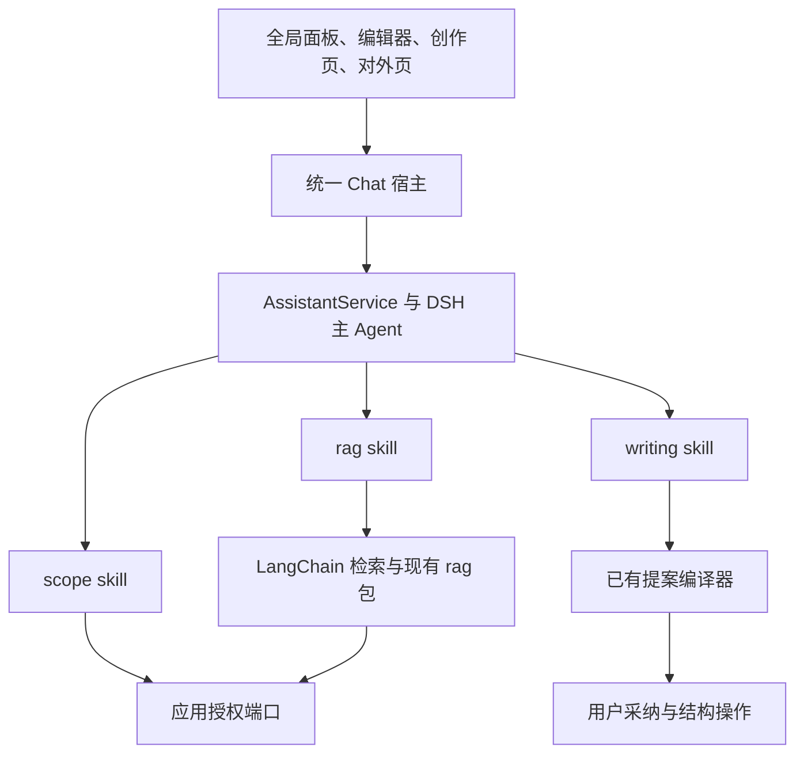
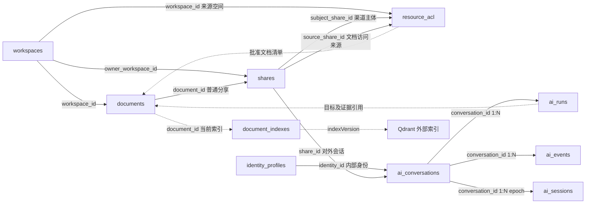

# AI 问答、创作与对外问答站技术设计

设计草案，建立于 2026-11-07，按零新增表与可破坏性重构方向修订于 2026-11-09。本文交付目标架构与数据模型，当前实现基线以第 2 节源码为准。

本版采用统一 Chat、统一 DSH Session/Agent 编排，组合 scope、rag、writing skills。既有表通过重命名、扩列和约束调整承载新业务，AI 任务统一归入 ai_runs。对外问答入口作为通用分享渠道管理，空间绑定复用 resource_acl。

## 1. 范围与实施决策

| 任务入口               | skills 组合                    | 结果                           |
| ---------------------- | ------------------------------ | ------------------------------ |
| 全局问答               | scope → rag                    | 有权限资料中的带引用回答       |
| 文档问答与编辑         | scope、rag、writing 按任务组合 | 解释、草稿、待采纳提案         |
| 独立创作页             | writing，可组合 scope → rag    | 同会话的写作产物与新文档提案   |
| 对外页 `/ask/$shareId` | 受限 scope → rag               | 管理员公开授权范围内的只读问答 |

统一 conversationId、Run、消息流和产物身份，选择空间后可以在当前会话继续写作。内部默认全部可读且允许 AI 使用的资料，范围选择由 scope skill 与服务端授权端口完成。

本版选择实时正文模式。管理员确认公开文档范围，文档内容跟随当前服务端持久化版本及索引更新。新增文档默认等待管理员纳入范围。此前固定发布快照、专用发布索引及独立访客/计量账本的规划由本版范围替代。

零新增表允许调整列、索引、主外键、JSONB 合约以及表名。重构时同步修改调用方和生成 API，新的应用入口统一接入同一助手服务。正文依然通过协同结构操作与 durable ack 提交。

## 2. 当前实现基线

| 范围        | 当前实现                                                                                      |
| ----------- | --------------------------------------------------------------------------------------------- |
| 原 RAG 请求 | RagChat → `/api/ai/chat` → AiService → RagService → LangChain/LangGraph                       |
| RAG 数据    | ai_runs 保存输入、previousRequestIds、历史、证据、来源版本、答案、引用、usage 和状态          |
| 检索索引    | document_indexes 管理当前索引版本、租约与重试，Qdrant 保存切片和向量                          |
| 执行恢复    | ai_checkpoint schema 下的 PostgresSaver 保存原 LangGraph 检查点                               |
| 写作对话    | writing_conversations、writing_events、writing_sessions 承载 DSH 会话、产品 outbox 和原生日志 |
| 写作插件    | writing/research/image 已装配，writing 使用结构化工具输出提案                                 |
| 提案采纳    | ai_runs 中的 authoring 提案、review、applicationState 与 receipt 参与正式写入                 |
| 公开分享    | document_shares 当前仅支持单文档 access/invite，普通链接不授予 AI 使用                        |
| 权限        | resource_acl 保存空间、目录或文档的身份授权，role_permissions 保存用户角色策略                |

原 RAG 每次提问占一条 ai_runs，追问通过 previousRequestIds 加载此前请求。范围由服务端当前权限与前端选择求交集，候选和最终证据再次核对当前正文及索引版本。模型经 chat_result 交付答案及逐字引用，结果校验后持久化并通过 SSE 通知完成。

当前实现入口见 [ai.service](../../apps/app-server/src/modules/ai/ai.service.ts)、[rag.service](../../apps/app-server/src/modules/rag/rag.service.ts)、[Chat runtime](../../packages/ai-runtime/src/chat.ts)、[AI 表](../../apps/app-server/database/schema/ai.table.ts)、[写作表](../../apps/app-server/database/schema/writing.table.ts) 和 [分享及授权表](../../apps/app-server/database/schema/document.table.ts)。已有验证范围见 [AI 验收记录](../ai-knowledge-verification.md)。

## 3. 统一 Agent 与 skills



| skill   | 输入                                      | 输出与执行边界                                |
| ------- | ----------------------------------------- | --------------------------------------------- |
| scope   | 范围控件、空间/文档提及、自然语言范围意图 | 经应用端口验证的 scopeRef 与 scopeRevision    |
| rag     | 问题、scopeRef、有界检索参数              | 当前 Run 的证据、来源依赖、引用候选及覆盖状态 |
| writing | 写作要求、编辑目标、可选 evidenceRef      | 当前 Run 的草稿或 AuthoringProposal           |

每项 skill 封装版本化描述、SKILL.md 指令、输入输出 Schema、依赖、工具和所需能力。在 packages/ai-plugins 复用现有 writing 实现并增加 scope/rag 入口，通过宿主注入 ScopePort、RagPort 和 ProposalPort。工具复用现有 Zod/TypeBox 合约，技能定义可共享，访问上下文与证据登记按会话/Run 隔离。

scope 可独立处理选择操作。rag 在调用前解析 scope，writing 在需要资料依据时组合 rag，形成一次 Run 中的 scope → rag → writing。新任务的主消息由 DSH 编排，LangChain 保留在 RAG 检索实现内。

内部 skillProfile 允许三项能力，公开 skillProfile 只允许站内范围收窄与 rag。模型建议、skillHint 和前端按钮均经过服务端能力检查。工具执行和 UI 控件调用同一应用入口，公共包通过 package.json exports 消费。

## 4. 零新增表的目标映射

| 现有表                                      | 目标表           | 主要变化                                             |
| ------------------------------------------- | ---------------- | ---------------------------------------------------- |
| writing_conversations                       | ai_conversations | 会话归属、当前范围、执行代次与产品 cursor            |
| writing_events                              | ai_events        | 同一会话的已提交 outbox 事件                         |
| writing_sessions                            | ai_sessions      | DSH 原生日志与执行代次映射                           |
| ai_runs                                     | ai_runs          | 所有助手任务、结果、证据、产物、审阅和计量的业务事实 |
| document_shares                             | shares           | 文档分享与对外问答渠道                               |
| resource_acl                                | resource_acl     | 支持身份主体和分享渠道主体，复用其空间外键保存绑定   |
| document_indexes                            | document_indexes | 继续管理当前文档索引                                 |
| documents、workspaces、identity_profiles 等 | 同名表           | 复用现有正文、空间与身份体系                         |

本任务涉及的表数量增加为 0，4 张既有表重命名。writing_image_jobs 等已有功能表保留其业务用途，外键随会话表重命名核对。SDK 恢复使用既有 ai_sessions，RAG 检索继续使用既有 document_indexes 和 Qdrant collection。

## 5. AI 会话与任务结构

### 5.1 ai_conversations

| 字段                                    | 语义与约束                                                                    |
| --------------------------------------- | ----------------------------------------------------------------------------- |
| id、tenantId                            | 会话身份，提供租户复合唯一键供子表引用                                        |
| ownerKind                               | identity 或 visitor                                                           |
| identityId、visitorId                   | identity 主体引用真实身份，visitor 主体使用随机访客身份，两者互斥             |
| shareId                                 | 对外会话引用 shares，内部会话为空                                             |
| scope、scopeRevision                    | 用户当前选择及递增修订，实际可用资料按调用重新判权                            |
| executionEpoch                          | 当前原生上下文代次，原生 Session 身份从 ai_sessions 的会话/epoch 唯一映射取得 |
| configurationId                         | skill、工具合约和模型配置指纹                                                 |
| sequence                                | 已提交产品事件的最后序号                                                      |
| status、expiresAt、createdAt、updatedAt | 会话状态及生命周期                                                            |

visitor 会话必须绑定 assistant 类型分享渠道。已登录用户从对外入口访问时同样绑定 shareId，工具和资料范围按该渠道策略处理。identity_profiles 的 active 状态、分享有效期和当前授权在服务端检查。

原 ChatRecord 中消息与 Run 的业务状态改为从 ai_runs 组装，运行时私有投递身份按对应任务保存。可维护快照缓存，但它仅是派生投影，读取与恢复的权威记录一致。

### 5.2 ai_runs

ai_runs 增加 conversationId 并重构为统一 Run 账本，主体归属通过会话取得。新任务直接使用当前 runId 保存回答、草稿和提案。一次 Run 最多生成一份正式可采纳提案，继续改写产生同会话的新 Run。

| 字段                                       | 语义                                                                             |
| ------------------------------------------ | -------------------------------------------------------------------------------- |
| tenantId、conversationId、id               | 任务复合身份及会话外键                                                           |
| clientMessageId、idempotencyKey、inputHash | 同会话内幂等约束，hash 只针对已提交的用户输入及上下文引用                        |
| input                                      | submitted 消息与执行时解析的 context，包含范围修订、证据登记、来源版本和编辑目标 |
| status                                     | queued、running、waiting-approval、completed、interrupted、failed、cancelled     |
| ownerId、attempt、execution                | 单写者身份、执行次数、原生投递关联、skill 调用结果和恢复所需元信息               |
| result                                     | 最终文本、引用与版本化草稿/提案产物，产物带稳定 artifactId 和来源依赖            |
| review、applicationState、receipt          | 同一提案的逐段决定、正文应用状态和 durable receipt                               |
| usage                                      | 模型调用、检索调用、token、预算预留和稳定调用身份对应的结算凭据                  |
| errorCode、createdAt、updatedAt、expiresAt | 错误及数据生命周期                                                               |

input.submitted 建立后固定，context 与 execution 按 skill 步骤受控登记，最终 result 在完成校验后提交。已完成任务的 result 为必需字段，生成中的片段由 execution/原生日志承载。artifactRef 使用 conversationId、runId、artifactId 定位，服务器校验归属、来源依赖和当前权限。

Chat 会话、task、产物和用量沿该结构存储。ai_runs.result 是业务产物的权威来源，ai_sessions 的不可变工具记录用于原生恢复，ai_events 是对外投影。恢复可根据已提交原生日志补齐产品事务，完成原任务而不重复执行未知副作用。

用户消息从 input.submitted 派生，最终助手消息从 result 派生，审批与 skill 进度从 execution 派生，各自带稳定消息或调用身份。ChatRecord 的 load 从这些事实组装投影，commit 在单写者及 revision 检查下将变化写回对应任务并生成事件。

### 5.3 ai_events 与 ai_sessions

ai_events 复用 conversationId + sequence 唯一键，并补齐租户复合外键。每次业务状态提交与事件写入在同一事务完成，当前 scope、skillCalls、messages 和 artifactRefs 形成经授权的快照投影。

ai_sessions 增加 tenantId、conversationId、executionEpoch，保留现有原生日志列。每个会话/epoch 唯一，nativeSessionId 稳定指向对应原生日志。SDK 日志中的模型输入与工具结果保留在服务端，UI 只接收已验证产品投影。

ai_sessions.id 作为原生 Session 身份，按 conversationId + executionEpoch 唯一定位。会话先建立，再初始化原生日志并登记代次，幂等恢复通过该唯一键找到同一日志。

## 6. shares 作为通用对外渠道

### 6.1 字段与目标类型

document_shares 重命名为 shares，保留原链接身份、有效期和撤销机制，增加渠道类型及配置。

| 字段                                            | document 渠道              | assistant 渠道                                     |
| ----------------------------------------------- | -------------------------- | -------------------------------------------------- |
| targetType                                      | document                   | assistant                                          |
| documentId                                      | 必需，引用原文档           | 空                                                 |
| ownerWorkspaceId                                | 空，管理资格从目标文档取得 | 必需，引用管理空间                                 |
| permission                                      | read 或 edit               | ask                                                |
| kind                                            | access 或 invite           | access                                             |
| config JSONB                                    | 仅该类分享的配置           | 名称、简介、欢迎语、推荐问题、能力白名单与额度策略 |
| accessMode、accessCodeHash                      | 按已有阅读功能处理         | public 或 code，访问码保存密码哈希                 |
| status、revision、rangeRevision、accessRevision | 链接状态及策略修订         | draft/active/paused/archived 及各项修订            |
| expiresAt、revokedAt、createdBy                 | 沿用有效期、撤销和审计语义 | 可设置到期时间或长期有效，管理权由当前空间资格决定 |

使用 CHECK 明确两类字段的互斥条件，按 targetType 校验 JSONB 合约。保留文档分享的 documentId 外键和供 resource_acl.sourceShareId 引用的复合唯一键，assistant 渠道的 documentId 为空。shareId 为公开地址定位身份，增加全局唯一约束并在迁移前检查存量冲突。

targetType 建立后固定，渠道类型变化通过创建新的分享身份表达。subjectShareId 写入时通过数据库约束触发器核实目标为 assistant，普通文档来源的复合外键继续约束 sourceShareId。

普通文档加入授权仅接受 targetType=document。assistant 渠道的 ask 权限限定于公开问答，其访问凭据经专用主体适配器验证。已有分享查询、联接、计数、清理、通知和授权 SQL 全部按目标类型显式分支。

### 6.2 匿名访问

服务器签发含 visitorId、shareId、accessRevision、expiresAt 的签名 Cookie，采用 HttpOnly、Secure 和适用的 SameSite，并校验 Origin/CSRF。访客会话归属由已验证凭据构造，客户端提供的身份字段只作为待校验输入。

凭据有效期、渠道状态及 accessRevision 在每次命令、订阅和结果读取时检查。会话级撤销落在 ai_conversations.status，渠道整体撤销修改 shares。访客身份及其历史按既有会话记录管理。

## 7. resource_acl 保存多空间绑定

### 7.1 主体扩展

resource_acl 原有身份主体继续保存用户角色，增加 subjectShareId 表达向分享渠道授予来源空间的检索资格。

| 字段或约束        | 目标规则                                                                           |
| ----------------- | ---------------------------------------------------------------------------------- |
| identityId        | 改为可空，身份授权时必需                                                           |
| subjectShareId    | 可空，分享渠道主体时引用同租户 shares                                              |
| 主体互斥          | identityId 与 subjectShareId 恰有一个非空                                          |
| 资源互斥          | 沿用 workspaceId/catalogId/documentId 恰有一个非空                                 |
| 分享渠道绑定      | subjectShareId 非空时只允许 workspaceId，role 固定为 ai-source，sourceShareId 为空 |
| scopeConfig JSONB | 仅 ai-source 行保存公开分类名及 approvedDocumentIds 文档白名单                     |
| 唯一性            | 同租户、subjectShareId、workspaceId 唯一                                           |
| 授权审计          | 沿用 createdBy、createdAt、updatedAt 以及 authorization_events                     |

subjectShareId 是接受来源授权的渠道。原 sourceShareId 仍表示某个用户授权来自哪条文档访问链接，保留原复合外键和语义。授权查询严格区分两种主体，用户角色的 admin/editor/viewer 与 ai-source 分开匹配。

通过外键约束来源空间与分享渠道均在同一租户。JSONB 只保存单个绑定的配置及有上限的文档 ID 清单，跨表存在性与资格在授权事务中验证。PostgreSQL CHECK 用于本行结构，外键用于可关系化的资源引用。[PostgreSQL 约束文档](https://www.postgresql.org/docs/current/ddl-constraints.html)

空间成员列表、成员计数、角色计算、邀请、管理员连续性和用户权限查询显式限定身份主体。渠道主体授权由公开范围端口解析，避免将来源绑定计入团队成员或用户授权。资源与主体的外键均按 tenantId 复合约束。

### 7.2 授予、撤销与文档变化

管理空间 owner/admin 创建、配置和停用对外渠道。来源绑定的授予者还必须具有该来源空间的 owner/admin 资格，纳入清单的每篇文档逐篇检查 read、ai、share、export。createdBy 记录授权人，其当前身份与持续委托资格在公开检索时重新验证。

公开入口最多绑定 8 个来源空间、总计最多 10,000 篇批准文档。管理员确认空间范围时由服务端生成 approvedDocumentIds，新增文档再次确认后纳入，已纳入文档的正文按当前持久化头更新。

来源管理员可以删除该来源的 ai-source ACL，管理空间管理员可以删除整个渠道的来源绑定。删除绑定、移除批准文档、收窄权限或改变访问策略时，在原授权事务中增加 rangeRevision/accessRevision 并写 authorization_events。

源文档移动、改为受限、归档、删除或授权人失去资格时停止其后续交付。需要重新显式纳入的文档从白名单剔除，普通内容编辑只触发已有索引更新。恢复文档或重新授予用户权限后，公开授权通过管理员范围操作重新确认。

### 7.3 最终检索集合

```text
当前有效的 assistant 分享渠道
∩ 该渠道 subjectShareId 对应的 ai-source ACL
∩ scopeConfig.approvedDocumentIds
∩ 当前仍属于该来源空间的活动文档
∩ 授权人当前可委托用于对外 AI 的文档
∩ 当前持久化头对应的就绪索引
∩ 本会话 scope skill 选择的子范围
```

绑定关系、白名单、文档归属和当前权限全部通过服务端查询。公开请求不使用管理员身份执行任意资料检索，RAG 的 ACL key 仅作为预过滤，候选和证据交付继续复核上述集合。

## 8. RAG 与范围上下文

现有 RagService 接收可信访问上下文，内部身份分支通过用户 ACL 求范围，对外分支通过 shares 与渠道主体 ACL 求范围。公共 rag 包继续接收 resolveScope、authorizeCandidates、verifyEvidence 回调，其内部保持与应用授权解耦。

复用 document_indexes 当前版本与同一 Qdrant collection。问题 Embedding、召回、原文引用及 generation/durableSeq/metadataRevision/indexVersion 校验沿现有能力，内部和公开请求各自构造可信白名单。EvidenceBundle 继续使用 current 语义。

内部全部范围和公开渠道都返回授权总量、ready/pending/failed 覆盖。新助手可在 ready-only 策略下回答并显示覆盖数量，全部未就绪时返回知识未就绪。引用的 sourceId、snapshotId 和 blockId 对应实际命中的当前版本，打开引用时再次判权。

scope 变更保持 conversationId，增加 scopeRevision。自然语言范围解析先读取本轮输入和有权限的来源标签，再加载受保护历史。控件修改范围时先结束旧范围在途 Run，下一条消息创建新 Run。

当前任务在执行中需要收窄范围时，将交接写入 ai_runs.execution，增加 executionEpoch 后继续同一个逻辑 Run。旧原生日志可能含旧资料，宿主建立新的 ai_sessions 上下文，只装载按当前范围过滤的消息与产物。旧 frame、证据和迟到结果按修订与 epoch 拒绝交付。

## 9. 写作与正式应用

writing skill 在当前 Run 中使用编辑目标和可选 rag 证据生成草稿/提案，直接写入该 ai_runs.result。消息引用、artifactRef、review、applicationState 和 receipt 均围绕同一业务任务解析。

捕获目标前等待正文持久化确认，记录 documentId、generationId、durableSeq、contentHash、structureRevision 以及选区 Hash。采纳时在业务事务内重新检查目标权限、来源分发资格和结构预条件，继续复用现有操作编译与 durable ack。

逐段采纳使用 decisionId 和 review revision，重复请求返回原决定与回执。结果未知时查询原 Run、决定和 operationId。正文在生成期间被同事修改时保留提案，并按当前目标重新生成。

创建新文档沿知书 JSON 幂等导入流程。来源证据、答案和派生草稿继承授权依赖，跨空间及团队分发按权限策略执行。现有个人空间写回限制在团队授权与并发验收通过后调整。

## 10. API 与事件

### 10.1 统一助手

| 拟定接口                                                                 | 行为                                |
| ------------------------------------------------------------------------ | ----------------------------------- |
| `GET /api/assistant/capabilities`                                        | 当前上下文可用的 skills 和产物动作  |
| `GET/POST /api/assistant/conversations`                                  | 列表或创建会话                      |
| `GET /api/assistant/conversations/:id`                                   | 经当前授权过滤的快照                |
| `POST /api/assistant/conversations/:id/messages`                         | 幂等提交消息，202 返回 runId 与快照 |
| `POST /api/assistant/conversations/:id/scope`                            | scope skill 的范围命令              |
| `GET /api/assistant/conversations/:id/events`                            | cursor 订阅统一事件流               |
| `POST /api/assistant/conversations/:id/runs/:runId/cancel`、`resume`     | 统一 Run 操作                       |
| `GET /api/assistant/conversations/:id/runs/:runId/artifacts/:artifactId` | 授权读取产物                        |
| `POST /api/assistant/conversations/:id/runs/:runId/review`               | 采纳并返回正文应用状态              |

统一消息含 clientMessageId、idempotencyKey、text、可选 skillHint 与 context。context 带 expectedScopeRevision、artifactRefs 和 editorContextRef，真实主体、skillProfile 与有效资料集合由服务端解析。

### 10.2 分享管理与对外入口

| 拟定接口                                            | 行为                                               |
| --------------------------------------------------- | -------------------------------------------------- |
| `GET/POST /api/shares`                              | 按管理资格列举或创建带 targetType 的渠道           |
| `GET/PATCH /api/shares/:id`                         | 读取或按 revision 更新配置                         |
| `PUT /api/shares/:id/sources`                       | 管理 assistant 渠道的 ai-source ACL 及批准文档清单 |
| `POST /api/shares/:id/preview`、`activate`          | 按当前资格预览范围及问答，确认后激活               |
| `POST /api/shares/:id/pause`、`revoke`              | 立即停止对应渠道的后续访问                         |
| `POST /api/public/shares/:id/visitor-session`       | 校验 public/code 策略并签发访客凭据                |
| `POST /api/public/shares/:id/conversations`         | 通过同一服务创建公开会话                           |
| `/api/public/shares/:shareId/conversations/:id/...` | 复用统一消息、scope、events、Run 和只读产物合约    |

文档分享继续提供其阅读与加入动作，assistant 公开合约仅开放问答能力。对外路由负责凭据验证及公开投影，执行交给同一 AssistantService。

### 10.3 产品协议与提交边界

chat-contracts 演进为单一新协议，包含 messages、runs、scope、scopeRevision、executionEpoch、skillCalls 和 artifactRefs。每次 ai_runs 与会话状态提交，同时增加 sequence 并写 ai_events。新客户端按统一 cursor 归并。

assistant.delta 等临时 frame 携带 Run、attempt、epoch、revision 和 index。知识事实答案在引用验证后提交完整文本，写作预览按能力开放。SSE 断开只释放订阅，显式 cancel、过期、撤权和 deadline 取消对应 Run。

生成完成与正式正文应用分别反馈。客户端遇到结果未知先读取原 Run，重复幂等键配不同输入返回冲突。UI 根据稳定错误码呈现范围失效、知识未就绪、skill 不可用、目标冲突、渠道失效和额度超限，并保留输入。

## 11. 计量、并发与回收

所有执行在 ai_runs 中先认领，再进入 DSH。按会话建立 active Run 条件唯一约束，按 clientMessageId/idempotencyKey 建立幂等唯一约束，并为 tenantId、conversationId、状态和时间建立相应索引。

渠道与主体的并发和时间窗口限制，在固定顺序的准入锁内查询已有 Run 并插入 queued 记录。请求量按已受理 Run 统计，实际消耗和预留写入 usage，稳定 toolCallId 对应的调用凭据用于幂等结算。入队、预算预留和任务认领在同一事务完成。

provider 网络调用在短事务外执行。会话原生执行由 DSH 单写者锁管理，业务提交检查 ownerId/attempt 和当前授权修订。实例失去锁后停止提交，恢复根据原生日志及 ai_runs 状态补齐已有任务，未知副作用沿原操作记录核对。

保留期至少覆盖额度统计窗口和未知结果核对期限。用户删除历史时先逻辑删除、脱敏，窗口内必要的计量事实留到结算完成，之后按任务、事件、原生日志、会话顺序回收。渠道先撤销后回收，保持仍需引用的历史关系。

## 12. 权限、JSONB 与事务约束

| 层次             | 负责的事实                           |
| ---------------- | ------------------------------------ |
| shares           | 渠道身份、访问策略、配置与修订       |
| resource_acl     | 用户授权及分享渠道的来源空间授权     |
| ai_conversations | 具体会话主体、用户范围和执行代次     |
| ai_runs          | 本次执行、证据、结果、应用状态及用量 |
| ai_sessions      | 原生执行日志与恢复过程               |
| ai_events        | 可授权交付的产品投影                 |

所有身份/分享/空间/会话的可关系化引用使用租户复合外键。resource_acl 的 approvedDocumentIds 以 JSONB 有界清单保存，校验 Schema、唯一性、大小、租户与空间归属；实际查询再次联接文档状态和授权。该清单在资源移动、删除及撤权事务中清理，GIN 索引按反向查找需求建立。[PostgreSQL JSONB 文档](https://www.postgresql.org/docs/current/datatype-json.html)

授权变更、来源绑定、渠道范围变更继续遵守现有租户授权锁顺序，复用 authorization_events 的有序 outbox。渠道相关事件可在原事件表扩展 shareId 引用。前端缓存、在途任务、引用读取和原生历史恢复均根据新修订失效。

内部正文和草稿缓存遵守 offlineCacheAllowed，按身份、会话、范围和内容版本隔离。公开答案与引用默认 no-store，恢复历史先经服务端复核。签名 Cookie 的凭据及访问码不进入日志。

## 13. 破坏性重构与迁移顺序

1. 在专用数据库核对现有分享、ACL、AI 记录与原生日志，记录主键、来源和映射，清查无法满足新约束的行。
2. 通过新增的前向 migration 执行 4 个表的重命名，补齐 shares 类型、ACL 主体及其互斥约束、AI 会话/任务外键和必要索引。
3. 现有文档分享映射为 targetType=document。保留原访问/邀请来源及其实际资格，逐项验证 resource_acl.sourceShareId 的复合外键。
4. 从旧写作会话的 Run 投影回填 ai_runs，将原有 authoring 任务按可信来源身份关联，验证 owner、输入及产物 Hash 后合并同一执行。旧 RAG 可先逐条建立可读历史会话，保留 input.history，避免错误拼接分叉历史。
5. 已完成的历史结果按新协议投影，原生 DSH 日志建立 epoch 映射。旧未完成 LangGraph 任务保留输入及中间产物，标记可解释的 interrupted，由新 Run 继续用户任务。
6. 改造 DSH store 的 load/commit，从 ai_runs 组装 ChatRecord，并在同一事务中更新业务状态、会话 cursor 与 ai_events。核对模型已完成但业务提交失败的恢复路径。
7. 统一 AssistantService、skills、授权端口和新客户端，更新生成 API。原分离聊天入口及重复状态来源随本次切换收敛，历史读取统一走新查询。
8. 在身份、授权、任务数量、用量、提案及 durable receipt 的迁移对照通过后，再清理失去用途的字段和旧执行适配。已发布 migration 保留原记录，实际业务库迁移显式执行。

原 ai_checkpoint 中需要留存的旧任务检查点在清理前完成读取或归档核对。新的 rag skill 只复用检索能力，执行恢复随统一 DSH 日志管理。

## 14. 验收出口

| 类别         | 必须覆盖                                                                      |
| ------------ | ----------------------------------------------------------------------------- |
| 零新增表     | 迁移前后业务表数量、表重命名映射、外键和索引对照                              |
| 单一事实源   | ai_runs 与 ChatRecord/outbox 投影一致，原生完成后业务提交失败可恢复           |
| skills 组合  | 同一会话与 Run 内 scope → rag → writing 的证据传递、取消和重试                |
| 范围与历史   | 选择空间、范围收窄、授权变化和 epoch 交接后，旧资料不进入新模型上下文         |
| 普通分享     | 原 read/edit、invite/access、到期、撤销、加入及独立来源权限保持正确           |
| 渠道授权     | 普通作者被拒绝，来源空间资格不足被拒绝，subjectShareId/sourceShareId 无法混用 |
| 跨租户与伪造 | scope、批准文档、分享、访客、会话、产物及引用身份全部经过归属校验             |
| 实时索引     | 正文更新、索引处理中/失败、删除与移动后的候选及证据复核                       |
| 写作应用     | 目标漂移、重复/部分采纳、分发权限、durable ack、结果未知与撤权阻止落盘        |
| 配额与回收   | 并发准入、重复消息、未知消耗、保留期、历史删除及额度结算                      |
| 消费与体验   | API 生成、包独立消费、桌面/移动端、亮暗主题、键盘、输入法与异常恢复           |

实施时按范围运行 test:architecture、test:authorization、test:documents、pnpm test:ai 与 pnpm check:ai-packages，模型、数据库、Qdrant 和协同集成使用专用环境。压测分别报告准入锁、Run 查询、JSONB 范围过滤、检索和整体回答的 P50/P95。

## 15. 关联文档

联读 [文档地图](../README.md)、[应用前端](app-web.md)、[应用服务端](app-server.md)、[授权规则](../authorization.md)、[AI Chat 历史设计](../packages/ai-chat-architecture.md)、[Chat 合约](../packages/chat-contracts.md)、[RAG](../packages/rag.md) 和 [协同主文档](../packages/editor-collaboration.md)。当前运行行为以源码和既有验收为准，本文定义重构目标。

## 16. 最终表结构关系图

下图为目标模型。实线表示规划后的 SQL 外键父子关系，虚线表示逻辑定位。resource_acl 中的渠道主体行构成 shares 与来源 workspaces 的多对多关系。



- shares 一行是一条文档分享或对外问答渠道，targetType 决定其字段与入口能力。
- resource_acl 一行是用户授权或渠道的来源空间绑定，主体互斥约束保证角色语义。
- ai_conversations 一行是一个逻辑会话，ai_runs 一行是其中一次完整执行。
- ai_events 是已提交产品事件，ai_sessions 是原生上下文代次的执行日志，两者各有明确归属。
- document_indexes 保留删除清理职责，文档定位沿现有逻辑引用，Qdrant 不参与 SQL 外键。
