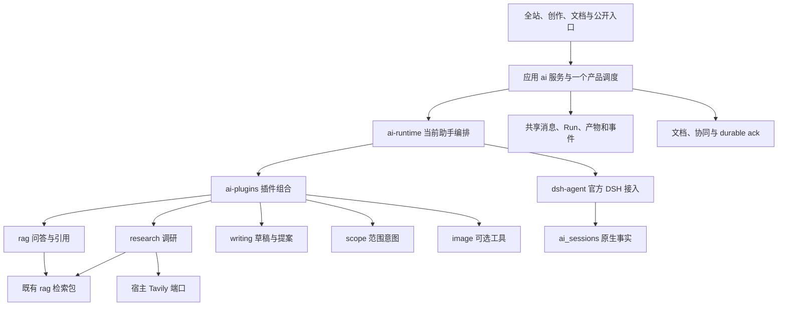
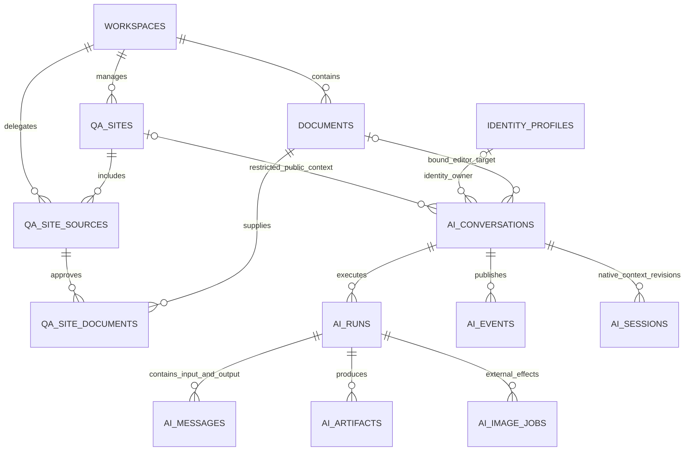
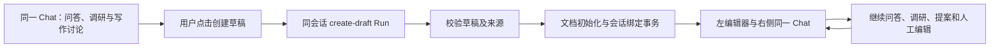

# DSH 插件化助手、独立创作与对外问答技术设计

状态：2026-11-13 已实施统一 DSH 插件化助手。ai-qa/ai-writing 双流程已退役，dsh-agent/ai-runtime/ai-plugins 三包按本文职责落地，0046 向前迁移删除 purpose 分叉并将 writing_sessions/writing_image_jobs 重命名为 ai_sessions/ai_image_jobs（业务表仍为 37 张）。独立创作页改为先 Chat、用户受理 create-draft 并原子绑定后展开左编辑器右 Chat。验证结果见第 14 节末尾的实施记录；本文其余部分仍为目标设计来源。

本版保留现有权限、证据、计量、产品表和协同能力。目标是同一 conversationId 内持续问答、调研和写作；用户决定创建草稿前只显示 Chat，创建成功后进入左侧编辑器、右侧 Chat。旧参考目录只供比较，不作为工作区依赖或整包回滚来源。

## 1. 当前实施基线与代码扫描

### 1.1 本轮扫描

在主工程 apps、packages、examples、scripts 中按 TypeScript AST 检查导入和 pgTable 声明，枚举到 20 个 workspace：2 个 app、12 个 package、6 个 example；解析 384 个代码文件，发现 37 张 Drizzle 业务表。排除 node_modules、dist、生成客户端、路由生成文件、output、submodule 和 zhishu-master 参考目录。另行读取用户指定的三个参考 package。

| 当前事实                                                                   | 源码依据                                                                                                                                                                    | 新设计需要改变的部分                                                           |
| -------------------------------------------------------------------------- | --------------------------------------------------------------------------------------------------------------------------------------------------------------------------- | ------------------------------------------------------------------------------ |
| ai-qa 是有界问答流程，ai-writing 内有 DSH runtime、写作和检索工具          | [问答流程](../../packages/ai-qa/src/flow.ts)、[写作 runtime](../../packages/ai-writing/src/runtime/kernel.ts)                                                               | 统一模型与工具编排，迁移有效校验和恢复逻辑，不再保留两个产品执行器             |
| 写作已经能检索平台知识库，不是缺少 RAG 接入                                | [平台工具](../../packages/ai-writing/src/tools/platform.ts)、[写作服务](../../apps/app-server/src/modules/writing/writing.service.ts)                                       | 将检索和引用作为同一 Agent 可组合的插件能力                                    |
| 根装配分别构造问答模型、写作服务和调度；产品存储已共享                     | [根装配](../../apps/app-server/src/ai-systems.ts)、[共享存储](../../apps/app-server/src/modules/ai/ai.service.ts)、[调度](../../apps/app-server/src/modules/ai/dispatch.ts) | 一个产品调度和 Agent 接入，继续复用 repository、预算、事件及授权               |
| purpose=qa/writing 进入会话、Run、产物和原生日志外键，qa 只能产生 evidence | [AI 表](../../apps/app-server/database/schema/ai.table.ts)、[原生日志表](../../apps/app-server/database/schema/writing.table.ts)                                            | 删除用途分叉及其约束，保留租户、会话外键和公开入口限制                         |
| 创作页一直预留左侧区域，右侧切换两个 Chat；问答转写作会新建会话            | [创作页](../../apps/app-web/src/features/writing/creation-page.tsx)                                                                                                         | 初始完整 Chat，意图切换不换会话，用户创建草稿后才展开编辑器                    |
| 自由草稿是页面 draftText 及 Markdown 预览，创建文档后离开工作台            | [草稿预览](../../apps/app-web/src/features/writing/writing-draft.tsx)                                                                                                       | 草稿绑定服务端真实文档，在原页面、原对话继续编辑；不以本地字符串决定已创建状态 |
| 已有文档导入会校验内容、构建协同初始状态并幂等创建文档                     | [文档服务](../../apps/app-server/src/modules/documents/document.service.ts)                                                                                                 | 复用初始化能力，补上与会话绑定联合提交的真实事务边界                           |
| 站点、来源批准、访客和引用投影已实施                                       | [站点服务](../../apps/app-server/src/modules/qa-sites/qa-site.service.ts)                                                                                                   | 使用同一个 Agent，公开策略固定为只读批准资料                                   |
| 0042–0045 已完成上一轮旧表归档、退役、建表和回填                           | [迁移目录](../../apps/app-server/database/migrations/)                                                                                                                      | 新增向前 migration，不能修改或重新执行旧版本回滚来换架构                       |

此前文档记录 2026-11-11 双流程版本通过 pnpm check、AI 测试、独立消费及隔离环境 smoke。这是上一版本的验收记录；本轮只做静态扫描和文档检查，未复跑这些测试，也不将它们当作新插件架构已通过的证据。

### 1.2 参考目录的使用边界

用户提供的参考路径为 `zhishu-master/zhishu-master/packages/{dsh-agent,ai-runtime,ai-plugins}`。其中 dsh-agent 有官方 Session/Loop 接入，ai-plugins 有 writing/research/image，但 ai-runtime 仍包含 LangGraph、Deep Agents、PostgresSaver 及 legacy-authoring，旧 DSH 接口还持有完整 ChatRecord 产品快照。

本版采用这些包名和清晰的职责划分，代码优先从主工程已改进的实现迁移。参考版本的旧执行图、兼容入口、整套产品快照、依赖锁定和数据库表不能直接恢复。重新使用包名不代表重新支持旧协议。

## 2. 产品模型：一位助手，多个可组合能力

| 入口              | 会话与默认行为                                           | 写作行为                                                     |
| ----------------- | -------------------------------------------------------- | ------------------------------------------------------------ |
| 全站助手          | 随时打开，默认在当前身份有权资料中问答，可选择空间/文档  | 用户可以继续提出创作要求，保持同一对话；创建草稿仍需明确动作 |
| 独立创作 `/ai`    | 初始完整 Chat，提供问答/创作意图选择、资料范围和联网开关 | 用户收集资料后点击创建草稿，进入左编辑器、右 Chat            |
| 文档页助手        | 显式带入当前文档/选区，仍可问答、调研                    | 生成对该文档的可审阅提案，不改成另一个 Chat                  |
| 对外 `/ask/$slug` | 同一 Agent 的受限配置，仅使用站点批准资料                | 不开放创建草稿、文档编辑、图片或联网工具                     |

问答/创作是用户本轮希望助手如何帮助的意图，影响指令和默认动作，不是不同引擎、会话或数据库用途。research 可与问答/写作组合，不单独建设一个研究 Chat。不同用户/会话有独立原生上下文，不共享全局可变 Agent 实例。

创建草稿由用户判断时机。助手可建议补充背景、列提纲、整理来源，但不根据“资料已经够了”的模型判断自动创建文档。问答过程中可解释、列举和总结，尚未创建草稿不等于禁止生成文本。

## 3. 三个 package 的职责和依赖



### 3.1 唯一责任

| package                       | 保留的责任                                                                                                   | 不拥有的事实                                                                        |
| ----------------------------- | ------------------------------------------------------------------------------------------------------------ | ----------------------------------------------------------------------------------- |
| `@zhishu/dsh-agent`           | 官方 Cordis/DSH Agent、Session、Loop、原生持久化、取消、工具审批及原生恢复适配                               | 不认识问答/写作用途，不保存产品 ChatRecord，不修改业务数据库或创建第二份产品队列    |
| `@zhishu/ai-runtime`          | 使用一个 DSH 实例配置入口策略、可用插件、上下文输入和统一结果；将当前问答校验/结果交付与写作执行接入同一流程 | 不再有 LangGraph/Deep Agents，不自建模型 Loop、SQL repository、定时器和产品状态存储 |
| `@zhishu/ai-plugins`          | scope、rag、research、writing、image 的指令资源、工具、结果 Schema 和提案编译                                | 不另建 Session/Agent，不持有会话单例、数据库、路由、密钥或用户权限系统              |
| `@zhishu/rag`                 | 保留来源处理、分块、Embedding、Qdrant、可信范围回调及证据读取                                                | 不生成最终答案，不装配 Agent，不包含 DSH 状态                                       |
| ai-contracts / chat-contracts | 证据、Citation、提案及唯一会话/消息/Run/事件合约                                                             | 不平行维护旧格式解析或引擎判别类型                                                  |
| chat-ui / 编辑器各包          | 受控展示、输入及原有编辑/协同能力                                                                            | 不加载服务器执行内核和模型凭据                                                      |

依赖方向为 ai-runtime → dsh-agent、ai-plugins、纯合约；插件消费 rag/纯合约和公开的工具注册能力，不反向依赖 runtime。DSH 原生类型留在 SDK 接入或工具边界，业务数据库只引用纯合约。

三个包都有实际职责，不能用同名 index 重导出 ai-writing 来伪装迁移。runtime 组合一次 DSH 执行，不再另套一个调度器；产品 Run、租约、预算和 outbox 仍由应用 ai 服务负责。原生状态与产品状态通过显式回调连接，各有唯一拥有者。

### 3.2 当前代码迁移归属

| 当前代码                                                         | 新归属                                                               |
| ---------------------------------------------------------------- | -------------------------------------------------------------------- |
| ai-writing/runtime 中有效的官方 SDK 装配、原生日志投影和生命周期 | dsh-agent；去掉 WritingRunContext、提案和产品状态的强耦合            |
| ai-writing 的 writing/platform/web/image 工具、编译器和资源      | ai-plugins 的对应子入口，复用一份检索工具和证据登记                  |
| ai-qa 的证据检查、引用修复、输出校验和补交规则                   | rag 插件/纯合约与 ai-runtime 当前流程，删除独立问答生成执行器        |
| ai-systems 中的业务装配、qa/writing 的公共执行和调度             | 应用 ai 服务；撤去独立问答模型循环和两份业务调度                     |
| writing 的文档应用、图片存储和 Tavily HTTP 适配                  | 应用 ai 模块内的实际业务职责，继续通过 documents/assets 公开端口工作 |
| qa-sites 与 rag Worker                                           | 保留现有模块边界，注入同一助手服务                                   |

先迁移有效能力及消费方，再删除 ai-qa/ai-writing 包、旧命名空间和旧示例依赖。SDK 接入代码只移动一份；不存在新旧包长期相互转发、重复编译或同时监听任务。

## 4. 插件与 Skill 组合

插件是宿主注册的可信工具实现，Skill 是随插件发布的按需指令/资源。用户选择能力不等于加载任意外部代码。本期使用静态包内清单，不建设插件市场、动态脚本平台、数据库注册表或万能 Provider 框架。

| pluginId | 能力                                                                | 结果及限制                                          |
| -------- | ------------------------------------------------------------------- | --------------------------------------------------- |
| scope    | 将控件/自然语言范围意图解析为服务器验证的选择                       | 更新会话范围；不授予权限，不启动另一模型流程        |
| rag      | 检索/读取平台文档、依据资料回答、校验证据及引用                     | 普通消息 + Citation + evidence；无依据明确说明      |
| research | 分解调研问题，组合平台检索与可用的 Tavily 搜索/提取，整理结论和不足 | 消息、来源和证据；不自动创建草稿，不嵌套研究 Agent  |
| writing  | 在 Chat 中讨论写作，按明确命令生成草稿或当前文档提案                | draft/proposal artifact；正式修改正文仍经过受控应用 |
| image    | 保留已实施的图片任务及资产引用能力                                  | 使用真实任务状态、审批和幂等，不由聊天显示冒充成功  |

rag 和 research 复用同一份平台搜索/读取工具，不分别实现 keyword/vector 检索。research 的网页工具通过宿主 WebSearchPort 注入。writing 需要知识依据时直接使用这些已启用工具，不调用“另一个问答 Agent”。

每项 Skill 有明确的 id/version、用途、Schema 和实际资源。SKILL.md 用于说明，确定性工具负责校验和执行；资源进入发布包并在独立消费中验证。启用/禁用不只更改提示词，还必须改变本 Run 的可见工具和服务端执行权限。

### 4.1 能力与授权

宿主根据当前身份、入口、目标文档、站点和服务端配置构造允许的插件/工具集合，用户选择只是其子集。客户端不能提交生效权限，Agent 也不能自行授予能力。

内部入口可按需组合 scope/rag/research/writing，图片和联网分别受配置与能力限制；对外固定为受限 scope/rag。每次工具执行、证据交付和正文应用再次判权，不能仅靠按钮隐藏或模型承诺。

创建草稿还有独立的宿主命令门槛：无目标文档且本轮不是用户受理的 create-draft 命令时，writing 可以参与文字讨论，但不能登记可创建文档的 draft 结果或调用导入/创建动作。该限制在工具及产品提交边界同时执行，不能只写进 Skill 提示词。

一个 Run 固定受理时的意图、命令、目标和插件配置。权限/范围变化使旧 Run 停止交付，contextRevision 推进并重新投影允许历史；DSH 使用新上下文，原生日志中的旧资料不能继续参与推理。普通意图切换不需要新建产品会话，也不自动搬运历史。

## 5. 前端重设计：先 Chat，再编辑器与 Chat

### 5.1 尚未创建草稿

独立创作页初始是一页完整 Chat，消息区居中并限制阅读宽度，输入区固定在底部。没有左侧空白画布、占位编辑器或自动创建的隐藏文档。对话与资料引用是用户的主要工作区。

```text
┌──────────────────────────────────────────────────────────┐
│ AI 助手         [问答 / 创作]                 历史对话    │
├──────────────────────────────────────────────────────────┤
│                                                          │
│              需求讨论、资料问答、调研结果                  │
│              引用可展开，并可继续追问                      │
│                                                          │
├──────────────────────────────────────────────────────────┤
│ [资料范围：全部有权资料 ▼] [联网：关闭/开启]               │
│ 输入问题或写作要求……                         [发送]      │
│                                        [创建草稿]        │
└──────────────────────────────────────────────────────────┘
```

问答/创作选择只改变本轮意图提示和操作文案，不替换 Chat 组件、不切换 transport、不丢失对话。scope-picker 保留全部有权资料、多空间和文档范围；可见空间不等于可检索全部正文，最终集合仍由服务器计算。

创建草稿按钮是明确动作，不依赖模型打分或达到固定资料数量。至少有用户要求后可用；资料不足时提示可以继续补充，但不以虚构的“资料完整度”阻止用户决定。草稿目标空间与资料来源空间分开，不能把检索空间直接当保存位置。

### 5.2 创建草稿后

```text
┌──────────────────────────────────────────────────────────┐
│ 草稿标题        保存位置：个人/团队空间        返回对话   │
├─────────────────────────────────┬────────────────────────┤
│ 原有编辑器工具栏                 │ 同一 Chat、同一历史    │
│                                 │                        │
│ 可编辑的真实文档                 │ 问答 / 创作意图        │
│                                 │ 来源、调研、提案审阅   │
│ 引用链接随正文保留               │                        │
│                                 ├────────────────────────┤
│ 持久化状态、字数                 │ 资料范围 / 联网 / 输入 │
└─────────────────────────────────┴────────────────────────┘
```

桌面主区域左侧为现有 DocumentCollaborationEditor，右侧 Chat 约 360–420px，编辑器优先占据剩余宽度。应用导航可收起，按主区域实际可用宽度进入双栏，不仅依赖视口断点。编辑器与 Chat 各自滚动，不再包一层导致整个页面双重滚动的容器。

窄屏使用“文档 / 对话”切换，Provider 和编辑器生命周期放在稳定宿主中，切换不重建协同会话或丢失选区/未确认更新。布局变化不重置 Chat、提案决定、输入框或引用面板。

“返回对话”仅切换工作台展示，可以再次打开已绑定文档；不清空 targetDocumentId，不复制会话。编辑既有文档时直接使用双栏，目标变化由显式选择处理。

### 5.3 状态的唯一来源

| 状态             | 事实来源                           | 界面行为                                                  |
| ---------------- | ---------------------------------- | --------------------------------------------------------- |
| 尚无目标文档     | 服务端会话 targetDocumentId 为空   | 完整 Chat                                                 |
| 正在创建         | 当前 create-draft Run 的状态       | Chat 保留，显示进度并禁用重复创建                         |
| 已创建           | 服务端确认文档初始化及会话绑定提交 | 在原页面展开编辑器，Chat 保持原会话                       |
| 创建失败         | Run 失败且没有成功绑定事实         | 保留历史/要求/已生成 artifact，提供重试                   |
| 结果未知         | 同一 operationId 的结果尚待核对    | 查询已有 Run/文档事实，不盲目创建第二篇                   |
| 目标被删除或撤权 | 当前文档状态和授权                 | 明确目标不可用，保留允许的对话/未确认草稿，不自动新建文档 |

不新增独立 draftStatus、layoutPhase 或 draftText 持久化业务状态。布局主要从服务端 targetDocumentId 派生，未确认的展示预览不能表示草稿已经保存。源选择和临时输入可有界缓存，身份/站点/会话隔离规则继续适用。

## 6. 创建草稿与后续写作流程

### 6.1 创建命令

用户点击创建草稿，提交目标空间、标题/要求、期望 contextRevision 和幂等键。服务器重新验证当前身份、目标空间创建/写入能力、全部实际来源依赖及分发规则，受理同一会话的 create-draft Run。

“草稿”是工作阶段，最终承载物就是现有 documents 中的一篇可编辑文档。本期不新增草稿表、不增加第二套正文存储，也不引入未被需求要求的发布工作流。默认保存到用户明确选择或有权的个人空间；没有合适目标时要求选择，不回退到列表中的任意团队空间。

同一会话的创建命令在准入锁内复核已绑定目标和在途 create-draft Run。重复提交返回已有任务/结果；更换幂等键也不能绕过在途限制并行创建第二篇草稿。用户需要另一篇文档时走明确的新建会话/目标操作，不把重试解释为再次创建。

### 6.2 生成、初始化与绑定

1. 短事务原子写入命令输入、queued Run 和预算预留。稳定 operationId/幂等身份归 Run，不使用固定的 free 字符串或对话面板临时 ID。
2. 在事务外由同一 DSH Agent 整理当前允许的历史、证据和写作要求，产生可校验的 draft artifact。模型不得自行决定创建时机或伪造文档、Block ID。
3. 使用现有内容契约/编译器校验正文及引用，构建合法协同初始状态并保存稳定 blockId；重试复用同一不可变草稿和编译结果，不按循环下标伪造正文身份、不重新分配 ID 或重新生成导入正文。正式创建前再次核对授权、来源、目标空间、contextRevision 和租约 fencing。
4. 复用 documents 的幂等创建/导入及协同初始化能力，将新文档、初始持久化正文、会话 targetDocumentId/contextRevision 和相应产品结果在同一数据库事务提交。必要的事务端口由根装配注入，documents 不反向导入 ai，也不能越过文档 repository 直接插表。
5. 只有上述持久化/绑定成功才返回草稿已创建。客户端更新同一会话的快照及 URL 轻量定位，展开原工作台编辑器，不跳走到另一个页面或创建一个写作 Chat。

模型调用、联网和向量查询不放进数据库事务。最终事务沿既有授权、空间/目录及文档锁顺序执行。文档创建期间取消、来源撤销、目标空间撤权或 contextRevision 改变都必须阻止旧结果绑定，不能仅在 HTTP 入口判权。

数据库已提交但响应丢失时，通过原 Run/operationId 回读成功结果；不重跑生成或重复建文档。绑定后 targetDocumentId 是权威事实，URL 参数只负责定位，不能覆盖服务器关系或将无权文档带入编辑器。

### 6.3 创建后的正文写入

当前文档正文由协同会话负责，draft artifact 是初始生成的不可变审阅/追溯材料，不随编辑器同步成第二份可变正文。用户继续编辑和保存仍走现有协同 durable ack，不增加 JSON 全文自动保存。

后续 AI 修改生成 proposal artifact，捕获 documentId、generation、durableSeq、structureRevision、内容/选区 Hash，用户接受后复用结构操作。工具审批、生成完成、用户采纳和持久化完成分别表达；部分采纳、冲突、撤权和未知结果遵守当前幂等/回执规则。

问答在有文档时仍可只返回答案，切换意图不触发隐式改写。创建草稿的明确用户命令授权初始化这篇新文档，不等于永久授权以后自动采纳所有提案。

## 7. 数据模型：复用现有 37 张表

### 7.1 表变更

| 当前表                                       | 目标          | 改动                                                                                                                               |
| -------------------------------------------- | ------------- | ---------------------------------------------------------------------------------------------------------------------------------- |
| ai_conversations                             | 同名          | 删除 qa/writing purpose 及强制跨用途交接的 origin；保留所有权、scopeSelection、contextRevision、targetDocumentId、配置、幂等与状态 |
| ai_runs                                      | 同名          | 删除 purpose，统一 context/execution，保留输入身份、租约、状态、attempt、用量和错误                                                |
| ai_messages                                  | 同名          | 继续通过同租户/会话的 Run 外键存用户和助手消息，保留结构化引用                                                                     |
| ai_artifacts                                 | 同名          | 删除 purpose 及 qa-only 限制，仍只存 evidence/draft/proposal/image 及其真实应用状态                                                |
| ai_events                                    | 同名          | 保留紧凑产品 outbox，不保存整份会话/正文快照                                                                                       |
| writing_sessions                             | ai_sessions   | 重命名并删除 writing-only 字段/外键，供所有 DSH 会话使用                                                                           |
| writing_image_jobs                           | ai_image_jobs | 重命名并删除用途分叉，供实际有权启用图片插件的内部会话使用                                                                         |
| qa_sites、qa_site_sources、qa_site_documents | 同名          | 保留已实施的站点、来源管理员委托、逐文档批准和访问修订                                                                             |
| document_indexes                             | 同名          | 保留当前索引、租约、重试和删除清理职责                                                                                             |
| documents 与协同/权限/资产等表               | 同名          | 草稿复用正常文档与既有初始化，不新增草稿实体                                                                                       |

本轮目标为零新增业务表、两项语义明确的重命名，业务表仍为 37 张；核心 AI/站点/索引表仍为 11 张。不得将“零新增”理解为把关系塞进无界 JSON 或取消授权约束。已发布 0042–0045 不回写，在其后生成新的 migration。

### 7.2 会话、命令与外键

不以 purpose 决定执行器或允许的产物。内部/公开策略由当前身份和 siteId 构造；siteId 非空的会话必须没有 targetDocumentId，服务器的公共命令白名单同时拒绝草稿创建、编辑、图片和联网。所有权/siteId 创建后不能被客户端转换，访客不能借切换意图变成内部会话。

保留 tenantId/id 及会话/Run 复合唯一键，子表仍通过租户与会话外键防止错绑。删除 purpose 相关冗余唯一键和 CHECK 后，补齐不含 purpose 的对应约束；不能简单 drop 外键就让跨租户关系失去约束。身份与访客互斥，匿名必须绑定站点，creationKey 的唯一索引继续正确处理 siteId 为 NULL 的内部场景。

同一会话依旧只允许一个活跃 Run，有界排队。用户消息和 Run 在同一短事务受理，引用方向为 conversation → Run → message，不增加 inputMessageId 循环引用。用户消息正文只存一次，幂等重试比对原始请求 inputHash。

AssistantRunContext 记录本轮意图、实际 command（chat/create-draft 等）、contextRevision、配置、目标捕获和已验证的插件选择。command 表示实际受理动作，不是 qa/writing 引擎选择。统一 execution 只保存原生投递、稳定工具调用、证据引用和恢复定位，删除 QaExecution/WritingExecution 分叉。

intentHint 是每轮输入，不新增一份会话用途状态；有效能力由服务器每次解析。contextRevision 是唯一模型上下文修订，不再新增范围修订号。现有跨用途 origin 关系在迁移审计导出中保留必要来源，不在生产继续解析或创建旧 handoff 数据。

### 7.3 证据、产物与恢复

证据来源元数据唯一存于 evidence.payload.sources，items 通过 sourceId/snapshotId 引用；派生产物只存 evidenceRefs。Run.execution.evidenceRefs 记录实际交给模型的全部证据，包括未显示为引用的依据和允许历史的来源依赖。不能只按答案显示的 Citation 检查撤权。

ai_sessions 的官方 header/events 等由 SDK 管理，用于原生恢复，不直接暴露浏览器。产品快照由消息/Run/产物查询组装，不再恢复 ChatRecord 整套业务状态。原生日志已完成而产品提交失败时补交经授权校验的结果；不存在可恢复事实时明确中断/未知，不自动重放图片或正文副作用。

artifact 身份归 id/runId，WritingProposalPayload 不复制 requestId/proposalId。生成正文归消息或相应产物，审阅和应用回执归 proposal artifact，外部图片任务状态归 ai_image_jobs，图片 artifact 只引用资产。目标文档正文只归协同与 documents。

## 8. 来源引用、RAG 与 Tavily

### 8.1 一套证据与引用

平台文档和网页使用当前纯 EvidenceBundle/Citation 合约。文档来源保存 documentId、generation/durableSeq、metadata/index 版本和 blockId/区间；网页来源保存受校验 URL、标题、站点、检索时间、内容 Hash 和实际摘录类型。来源元数据来自可信端口，不能由模型凭空补齐。

引用必须指向已登记、当前可用的证据，quote 匹配实际保存文本与定位。客户端按 citationId/evidenceId 显示句段旁来源标记及去重来源列表，不以显示编号作为持久化身份。机械匹配不能证明语义支持，需在问答/调研问题集评估结论与来源是否相符。

内部文档引用定位到实际文档段落并在打开时判权，公开引用使用站点内受限投影。网页显示真实原文 URL 和检索时间，搜索摘要不能冒充已读全文；网页快照不宣称永远实时有效。

采纳到正文时使用现有 link mark 和参考资料段落，引用与正文共同持久化。刷新、保存重开、Markdown/HTML 导出保留来源；AI 产物纯文本复制带来源名称和 URL。完整证据留在受控 artifact，不新增 citation Node/Mark 或来源表。

### 8.2 平台检索与问答门槛

继续使用同一个 rag 服务、索引 Worker、Embedding 和 Qdrant collection。范围由服务器当前授权与选择求交，向量 ACL 只作预过滤；候选和交付证据复核租户、真实文档归属、权限及当前持久化/索引版本。

RAG 插件的知识事实回答必须经过检索/证据校验并带有效引用。确定性前置检索或结果门槛由 runtime/宿主保证，不能因为只有一个 Agent 就把检索变成可以被模型跳过的提示。无依据、索引未就绪和服务故障保持独立状态。

保留候选、证据、token、来源数和工具次数上限。ready-only 明确覆盖数量；重排和复杂多路检索按实测质量决定，不新增一个图引擎。

### 8.3 联网调研

Tavily HTTP 适配留在应用，research 插件通过 WebSearchPort 使用 Search/Extract。配置仅使用服务端 TAVILY_API_KEY，文档和示例只写占位符，不复制实际密钥；缺失配置只禁用联网，不影响普通问答和写作。

Search 显式关闭供应商生成 answer，登记实际返回的 URL/标题/摘要；按需 Extract 后才登记正文摘录，并处理部分失败。域名/时间偏好、超时、AbortSignal、字节/token 和调用预算沿当前受控配置。网页内容是不可信资料，不将内部全文、原始证据、凭据或整段历史自动外发。

本轮联网意图与资料范围分别管理。公开策略不开放联网；内部明确要求联网而调用失败时说明真实状态，不以模型记忆冒充联网成功。调用 credits、requestId 和未知成本归同一个 Run 计量，不承诺供应商请求精确一次。

## 9. 对外问答与权限边界

继续复用 qa_sites、qa_site_sources、qa_site_documents。站点管理空间当前 owner/admin 配置站点；每个来源空间由其管理员明确委托，文档逐篇批准，不因新文档加入空间而自动公开。来源委托主体当前管理资格及 read/ai/share/export 需要持续有效。

有效范围为活动站点、有效来源委托、活动批准记录、当前文档真实归属/权限、当前就绪索引及访客选择子范围的交集。内部身份进入公开入口也不能叠加内部全库权限。普通 document_shares、resource_acl 和角色策略不改成公开站点主体。

站点引用只显示允许的标题、公开来源名称和摘要定位，不暴露内部路径、原始 evidence、未批准附件或内部文档地址。创建草稿、绑定目标、提案应用、图片和联网从公开接口及插件集合同时排除；不能单靠前端不显示。

site.revision 用于配置、来源和批准范围并发/失效；accessRevision 只负责已签发访客凭据失效。签名短期 Cookie、会话所有权、Origin/CSRF、当前访问状态和过期时间沿现有机制验证。已知撤权取消在途执行和订阅，交付前仍最终复核。

文档移动/删除与站点批准解除继续使用原事务和根装配注入的端口，遵守既有锁顺序。不得把撤权改成只等异步索引或通知完成后才生效。

## 10. 统一 API、事件与前端接入

### 10.1 内部入口

| 接口                                                           | 行为                                                 |
| -------------------------------------------------------------- | ---------------------------------------------------- |
| GET /api/ai/capabilities                                       | 当前入口允许的插件/工具及受控限制，不含密钥          |
| GET/POST /api/ai/conversations                                 | 会话列表/创建，不接收 qa/writing purpose             |
| GET /api/ai/conversations/:id                                  | 当前授权快照及分页消息，包含 targetDocumentId        |
| POST /api/ai/conversations/:id/messages                        | 同一会话受理问答、调研或创作意图，202 返回 Run       |
| POST /api/ai/conversations/:id/context                         | 验证并更新范围等上下文，推进 contextRevision         |
| POST /api/ai/conversations/:id/draft                           | 用户明确创建草稿，固定为 create-draft 命令，幂等受理 |
| POST /api/ai/conversations/:id/target                          | 显式绑定有权的既有目标文档，不创建新 Chat            |
| GET /api/ai/conversations/:id/events                           | 按 cursor 订阅当前允许的产品事件                     |
| POST /api/ai/conversations/:id/runs/:runId/cancel              | 取消当前执行                                         |
| POST /api/ai/conversations/:id/runs/:runId/retry               | 重试前先核对已持久化结果/副作用，必要时增加 attempt  |
| POST /api/ai/conversations/:id/approvals/:approvalId/decisions | 执行中工具审批，稳定 decisionId                      |
| GET /api/ai/artifacts/:id                                      | 授权读取产物投影                                     |
| POST /api/ai/artifacts/:id/review                              | 逐段/整体审阅提案，通过既有结构操作应用              |

普通消息包含 clientMessageId、idempotencyKey、text、expectedContextRevision、intentHint、受控插件/联网偏好及 artifactRefs，目标从服务端绑定读取，必要编辑上下文引用须验证。客户端不能把普通 chat 命令改成隐式创建文档；草稿初始化只从 draft 接口受理。

插件选择/联网偏好在受理 Run 中记录实际生效值，刷新可从最新 Run 派生，不另存第二份权限状态。宿主计算配置/工具集合变化时更新 configurationId/contextRevision 并构建正确原生上下文；旧 Session 中已禁用的工具仍必须在执行端被拒绝。

已绑定文档时 draft 接口返回既有目标或明确的已绑定状态，不因重试再建文档。target 接口复核权限、终止旧目标在途编辑并推进修订，旧 proposal 的目标和前置条件不可被改写成新目标。

### 10.2 公开入口与事件

qa-sites 管理路径保留。`/api/public/qa-sites/:siteId/conversations/...` 只注册同一 ai 服务的受限会话、消息、范围、事件、取消和引用投影，不泛化透传内部全部动作。

产品事件继续使用同一个信封、sequence 和 cursor。消息、Run、产物、审批及会话绑定的变更在相应产品事务中提交紧凑事件；绑定成功通过 conversation.updated 提供新的 targetDocumentId/contextRevision，不另建一份 draft-created 业务状态。

预览 frame 携带 conversationId/runId/attempt/contextRevision/streamEpoch/revision/index，不能表示正文已保存。channel 为 text/thinking/tool：思考与工具步骤只在运行期间展示，创作与问答的最终正文由工具参数流解码进 text 通道逐字到达，形成打字效果；持久消息到达后整体替换预览。公开知识答案在证据与授权校验提交后交付，界面先展示进度。SSE 断开只释放订阅，显式取消/撤权/deadline 才终止 Run。

重连先校验授权代次，读取受当前权限过滤的快照，再恢复事件。旧代次正文不能继续回放；丢弃迟到 frame、重复片段和不匹配修订。取消的 Run 不原地续写，重新生成是明确的新输入；内部原生恢复不是额外产品 resume 接口。

### 10.3 前端文件归属

应用收敛为 `features/assistant` 的统一会话宿主和创作工作台，复用 `components/chat`、scope-picker、引用组件、提案审阅和图片结果控件。qa-sites 继续提供管理与公开页面外壳。

删除独立 QaChat/WritingChat 的请求/状态分叉、createWritingFromQaMessage 交接和 purpose 路由工厂。不能在新 Assistant 下继续隐藏维护两个 Chat，再按 tab 选择。编辑器由已有公开组件组合，不复制编辑器或协同 Provider。

UI 继续遵守 HeroUI v3、现有设计 token、输入法组合、键盘焦点和明暗主题。资料来源与保存空间的选择文案明确区分；创建到团队空间前展示现有可见规则，草稿名称不意味着文档自动私密，默认优先有权个人空间。

## 11. 并发、预算、正文与回收

继续使用共享产品单写者、租约和 fencing，同一会话有界排队。一个产品调度负责认领 Run，DSH 自己的原生队列不变成第二份可写业务队列。原生日志锁与产品租约丢失都阻止迟到提交，连接数及 Session 回收仍有明确上限。

准入、模型、平台检索、网页搜索/提取及图片调用共用 Run 的预留/实际计量身份。未知供应商结果保留预留直至核对，不能以网络错误假定未收费。结果已落库时补交产品事务，不重复模型调用；无持久化结果的失败窗口明确 interrupted/OUTPUT_UNKNOWN。

AI 原生完成、证据就绪、产品消息提交、文档初始化、用户采纳和 durable ack 各自表达。创建草稿的模型输出不等于文档已创建，界面上的编辑器连接成功也不等于全部内容已持久化。

正文、未确认协同更新和可恢复编辑草稿沿 IndexedDB/现有协同机制，遵守 offlineCacheAllowed；不以 LocalStorage 或 Chat JSON 全文覆盖文档。布局切换与继续问答都不重建或覆盖正在编辑的正文。

回收核对消息/产物/证据/图片/Run 的依赖后执行，未确认应用回执、未知成本或图片结果先保留/脱敏。删除对话不能隐式删除已创建文档；文档仍遵守用户原有管理、历史和回收站流程。

## 12. 从已实施版本迁移的顺序

1. 以当前 37 表及 0042–0045 为基线建立转换映射，核对现有会话、消息、证据、提案、图片和原生日志；保留历史验收记录，不从参考目录整包覆盖源码。
2. 建立新的 dsh-agent/ai-runtime/ai-plugins 责任边界，迁移当前有效代码、测试和依赖。问答校验保留为当前插件/运行规则，模型和工具仅使用一个 DSH Loop。
3. 新增向前 migration：删除用途分叉并重建必要外键/索引，重命名两张原生/图片表；保留规范化消息/产物/回执。旧 origin 的必要关联导出为迁移审计，不恢复跨用途交接执行代码。
4. 已完成 qa/writing 历史保留各自原 conversationId，不猜测合并两段不同会话。新的统一入口可继续它们；原问答没有原生日志时按当前允许的产品历史初始化新的 DSH 上下文，不伪造旧 turn 或启动旧生成器。
5. 未完成的旧流程记录为明确中断，保留输入、证据、草稿、实际回执及未知成本；新重试走当前 runtime。已实施原生日志按 SDK 当前格式及上下文修订映射，任何无法安全延续的日志保持审计，不重放副作用。
6. 接通统一内部/公开 API、插件权限与 create-draft 事务；前端改为同一 Chat 和由 targetDocumentId 派生的两阶段布局。
7. 从源 Schema 生成 OpenAPI/Orval/路由，迁移消费者、示例和构建脚本；同批删除 ai-qa/ai-writing、双模型装配、两个业务服务/调度及旧 API，保留已实际复用的基础设施。源码路径迁移后同步修正文档链接，不能为了旧链接保留空壳源码。
8. 验证全新空库完整迁移链及 0045 数据升级，检查数量、身份、来源、目标、用量与回执对照。显式执行部署迁移，本轮文档不代表已操作数据库。

临时迁移工具不进入应用启动、包公开 exports 或生产请求链路。已发布 SQL migration 作为历史链保留，不回写和删除；旧 AI wire format 不因此进入运行时联合解析。

## 13. 零兼容与去冗余的交付标准

恢复 dsh-agent/ai-runtime/ai-plugins 名称后，要检查实际实现和公开出口，而不是继续使用当前“出现这三个包名就失败”的黑名单。现有 [独立消费检查](../../scripts/ai-package-consumer-check.mjs) 与 [模块边界检查](../../apps/app-server/src/modules/module-boundaries.test.ts) 必须同步改为验证新职责和禁用旧协议。

| 必须退出生产                                                                           | 必须保留的实际能力                                  |
| -------------------------------------------------------------------------------------- | --------------------------------------------------- |
| ai-qa/ai-writing 双执行器、两套直接模型装配、重复调度/缓存/transport                   | 一个 DSH 执行与一份产品存储/计量/事件               |
| 参考版 legacy-authoring、createChatRuntime 旧图、Deep Agents、PostgresSaver 及兼容出口 | LangChain 中真实用于分块/Embedding/Qdrant 的组件    |
| ChatRecord/ChatStore 的完整产品快照、整份 snapshot 事件、旧事件解析                    | SDK 当前原生日志、紧凑产品 outbox 与规范化消息      |
| purpose 分叉、qa-only 产物限制、写作专属原生日志约束、handoff API                      | 租户/会话外键、当前授权、公开能力上限和文档目标约束 |
| 固定 free 草稿身份、前端本地正文作为“已创建”事实、隐藏空文档                           | Run/operationId 幂等、实际文档绑定、协同持久化回执  |
| 同名包转发新旧实现、旧路由别名、根据旧版本补字段/选择旧执行器                          | 当前单一 Schema、明确错误、必要的离线迁移           |

不因字段或方法包含 qa/writing/resume 字样就机械删除：WritingProposalPayload 等真实领域合约、官方 SDK 的原生恢复、正常文档历史格式和已发布 migration 各有必要职责。需要退出的是重复业务事实和旧执行路径。

不能为了重新使用旧包名，把旧源码原样复制回来再套适配层；不能为了兼容当前双包消费者，保留两个空壳 re-export 包。新消费者只依赖当前公开 exports，插件、runtime、基础接入均有实际职责。

## 14. 验收与检查

| 类别       | 必须验证的行为                                                                        |
| ---------- | ------------------------------------------------------------------------------------- |
| 统一 Agent | 一段对话可问答→调研→创建草稿→继续问答/改写，Run、工具和计量没有第二条引擎分支         |
| 插件组合   | 组合/禁用真正影响工具可见与执行；公开主体无法通过构造请求获取写作/联网/图片           |
| 完整 Chat  | 首次打开无空编辑器或隐藏文档；问答/创作切换保留同一历史、范围和输入                   |
| 用户创建   | 单击后由同一会话受理；重复点击、响应丢失、刷新、取消和异常都不重复建文档              |
| 原子绑定   | 文档初始化与会话绑定成功一致；来源/空间撤权、修订变化和租约丢失阻止旧结果提交         |
| 双栏工作台 | 创建后左 Editor 右 Chat；窄屏切换不丢协同状态、提案、输入或历史                       |
| 保存与来源 | 标准正文链接、部分采纳、刷新、复制及 Markdown/HTML 导出保留引用，已保存只依赖真实回执 |
| 范围与公开 | 当前用户/站点范围正确，来源更新/撤权后旧日志与派生摘要不污染新推理                    |
| 迁移       | 空库全链与现有 0045 升级、外键、原生 Session 映射及历史消息/产物/用量对照             |
| 独立消费   | DSH 底座不需要业务数据库，runtime 通过注入端口组合插件，插件/纯编译独立消费不加载应用 |
| 退役       | 旧双包/路由/图/缓存/用途 Schema/黑名单规则退出，新的三个包不是兼容转发层              |

实现按影响执行包构建/类型/测试、服务端 test:architecture/test:authorization/test:documents、pnpm test:ai、pnpm check:ai-packages。更新根脚本实际包名和构建顺序，再运行检查，不能把引用旧包导致的失败归为环境问题。

API 源 Schema 更新后依次执行 `pnpm --dir apps/app-server openapi:export`、`pnpm --filter @zhishu/app-web api:generate`，路由通过 routes:generate；不手改生成物，生成前核对既有改动，离线 OpenAPI 不连接数据库。收尾执行局部 Prettier、适用 lint/type/build 和 git diff --check。

有行为变化的真实流程在现有测试/消费者中覆盖，不为每个转发 helper 建镜像测试，不另造一套检查框架。数据库、WebSocket、Qdrant、对象存储和付费模型/Tavily 用专用环境；明确区分 fixture、静态检查和真实集成结果。

### 14.1 本轮实施记录（2026-11-13）

源码入口：`packages/dsh-agent`（官方 SDK 原生执行/Session/Loop/审批/恢复，`createDshRuntime`、`DshSession.recordExchange`）、`packages/ai-runtime`（`createAssistantRuntime` 组合一个 DSH 执行与插件，确定性前置检索与不足证据门槛）、`packages/ai-plugins`（scope/rag/research/writing/image 子入口、`compileProposal`/`compileDraft`、Skill 资源）；服务端 `apps/app-server/src/modules/ai/assistant.service.ts`（统一受理、create-draft 原子绑定、提案应用）、`assistant.routes.ts`（`/api/ai` 单一命名空间）、`native.ts`/`images.ts`/`tavily.ts`；前端 `apps/app-web/src/features/assistant/`（`assistant-chat.tsx`、`creation-page.tsx`）。迁移 `0046_unified_assistant.sql`。

已实际通过（fixture/静态/隔离环境）：

- 包测试：dsh-agent 12、ai-plugins 12、ai-runtime 6、ai-contracts 6、chat-contracts 9、rag 与 app-web test:chat 全绿（`pnpm test:ai`）。
- 迁移：`ai-migration.test.ts` 在隔离 PGlite 上验证空库全链终态 37 张业务表，以及 0045 数据升级保留历史、中断未完成 Run、重建复合外键、导出 origin 审计、站点目标约束与创建去重。
- 服务受理：`assistant.service.test.ts`（PGlite）验证统一受理与插件子集、公开主体仅 scope/rag、create-draft 幂等/在途守卫/已绑定回读/不可编辑空间拒绝、目标绑定推进修订并拒绝旧修订。
- 服务端 `test:architecture` 6、`test:authorization` 18、`test:documents` 7 全绿；`pnpm check`（format/lint/architecture/typecheck/build/OpenAPI/客户端漂移 0）通过；`pnpm check:ai-packages` 独立消费与退役扫描通过。

真实集成（专用隔离环境，已运行）：`pnpm --dir apps/app-server smoke:ai` 在一次性 `zhishu_ai_test_smoke` PostgreSQL（独立 docker 容器，非业务库）与真实协同 WebSocket 上通过，覆盖统一 capabilities、问答引用+幂等+键复用冲突、范围修订隔离、无密钥联网拒绝、create-draft 原子绑定且正文落盘带来源链接与参考资料段、已绑定回读不重复建文档、携带来源再校验后提案 durable apply、取消、公开站点管理/批准/激活/访客会话/公开引用答案/证据投影隐藏内部标识/公开草稿拒绝。模型与检索为脚本化 fixture（无真实模型/Tavily/Qdrant 流量）。

仍需真实外部凭据才能验证（未声称已验证）：真实模型生成质量、Tavily 真实联网（未配置密钥，联网以 fixture 覆盖禁用与失败状态）、Qdrant 真实向量检索与对象存储私有图片。这些不阻塞上述已验证链路。

## 15. 表结构与布局关系图



外键包含 tenantId 及会话/来源定位。targetDocumentId 指向真实可编辑文档，公开会话必须为空。document_indexes 保留逻辑文档定位和 tombstone 清理，不因源文档删除被历史引用外键阻止；Qdrant 不参与 SQL 外键。



布局不是另一套业务状态机，以上节点对应实际命令及持久化事实。失败或结果未知留在可恢复的原会话，不能靠前端路由跳转假定创建成功。

## 16. 实现 Prompt 与关联文档

交给实施 Agent 的入口见 [实现 Prompt](ai-assistant-implementation-prompt.md)。它只规定实施边界和交付要求，字段/API/验收以本文为唯一设计来源，避免再维护一份平行规格。

联读 [文档地图](../README.md)、[授权规则](../authorization.md)、[应用前端](app-web.md)、[应用服务端](app-server.md)、[界面规范](../design-system.md)、[Chat 合约](../packages/chat-contracts.md)、[AI 合约](../packages/ai-contracts.md)、[RAG](../packages/rag.md) 和 [协同](../packages/editor-collaboration.md)。dsh-agent、ai-runtime、ai-plugins 的旧包文档保留迁移背景，最新职责以本文为准；已实施双包版本和参考归档都不能覆盖本版目标。
