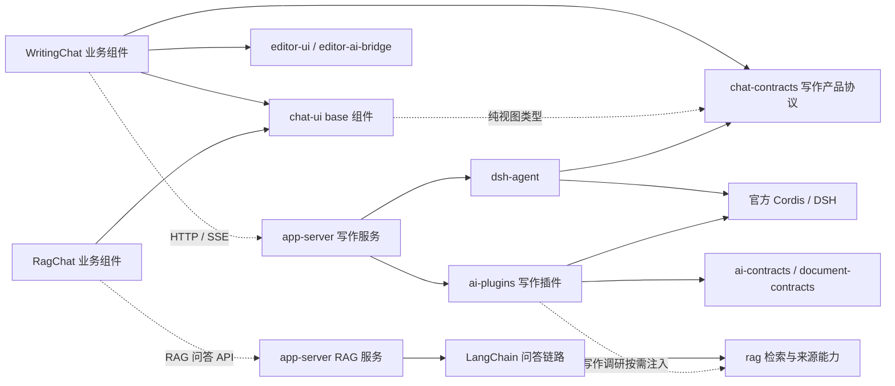

# 协作 AI 写作 Chat 与 DSH 插件架构方案

实际进展：2026-10-24 已接入官方 DSH 写作、独立 LangChain RagChat、共享 chat-ui、持久化/审批/HTTP/SSE 和 writing/research/image。具体实现与验证边界见 [实施记录](ai-chat-implementation.md)。下文保留原目标设计，不能将全部阶段表视为已验收。

**原设计时状态（已由上方实施更新覆盖）**：2026-10-24 设计方案，功能尚未实现。本文规划协作 AI 写作 Chat；RAG Chat 继续使用 LangChain，两者复用 chat-ui 基础组件。包级规范见 [chat-contracts](chat-contracts.md)、[chat-ui](chat-ui.md)、[dsh-agent](dsh-agent.md)、[ai-plugins](ai-plugins.md)，两个业务封装见 [app-web](../apps/app-web.md#ai-chat-业务组件库)。[返回文档地图](../README.md)。

协作 AI 写作的运行方式确定为 Server 进程内 Session/Agent + HTTP/SSE，直接装配官方 Cordis/DSH 库。RAG Chat 的问答生成、会话与检索编排继续使用 LangChain 技术路线；当前 DSH 规划不迁移 RAG Chat 的引擎、历史或 checkpoint。

历史设计基线：当时仅完成文档。2026-10-23 已建立 dsh-agent 的 package/TypeScript 配置与上游来源记录，安装锁定依赖，并验证基础服务装配/释放；公共 API、对话执行和应用接入尚未实现。文中的接口、表和验收项均为目标设计。现有写作应用代码及既有测试仍属于 Deep Agents/LangGraph 实现，不表示 DSH 已接入；RAG Chat 保留 LangChain 路线。该文档阶段的限制已由本次实施记录更新。

## 1. 决策与目标

1. 按可开源、可独立安装的标准建设 `chat-ui` 基础组件，供 RAG Chat 与协作 AI 写作 Chat 复用。app-web 分别封装 `RagChat` 和 `WritingChat`，各自拥有会话、请求、草稿和业务动作。
2. 协作 AI 写作服务端直接基于 `@deepseek-ai/cordis`、`@deepseek-ai/dsh-agent`、`@deepseek-ai/dsh-agent-loop`、`@deepseek-ai/dsh-session`、`@deepseek-ai/dsh-user-approval` 封装，嵌入现有 Server；RAG Chat 继续由 LangChain 驱动。
3. chat-ui 接收宿主视图与回调；WritingChat 将 DSH 产品事件映射到基础组件，RagChat 将 LangChain RAG 问答结果映射到同一基础组件。浏览器不加载任一服务端执行内核。
4. 先贯通协作 AI 写作的基础对话，再开发 writing、research、image 插件。research 是写作中的资料调研与报告能力，与独立 RAG Chat 分别编排。
5. `nova-dsh/packages/harness`、`chat-ui` 只作为设计参考，不复制为当前项目的依赖或源码，不使用跨仓库本机路径。
6. 保留知书已有内容契约、Block ID、引用校验、权限边界、协同结构命令与 durable ack。AI 输出先成为产物，文档写入走现有应用路径。
7. 写作 SessionService 管理 DSH 活跃句柄、单写者、持久化与事件投影；RAG 会话由其 LangChain 问答服务管理。两者的取消、恢复和连接生命周期分别按各自 API 能力处理。

### 两类 Chat 的边界

| 维度       | 协作 AI 写作 Chat                            | RAG Chat                                            |
| ---------- | -------------------------------------------- | --------------------------------------------------- |
| 当前规划   | 本次重构和插件建设的主体                     | 保持 LangChain 路线，复用基础 UI                    |
| 业务组件   | app-web 的 WritingChat                       | app-web 的 RagChat                                  |
| 服务端执行 | 官方 DSH Agent Loop / Session                | LangChain 问答与检索链路                            |
| 主要结果   | 创作草稿、文档提案、调研/图片产物            | 有证据的答案、来源与引用                            |
| 正文交付   | 用户确认后经协同结构操作与 durable ack       | 问答结果不直接写正文；转写作时创建独立写作请求      |
| 会话和恢复 | 写作 Conversation、DSH Session、Run、审批    | RAG 自己的会话、历史、请求及实际恢复能力            |
| 共用能力   | chat-ui 的消息、输入、滚动、状态、插槽和主题 | 同一套 chat-ui 基础组件，业务所需卡片由各自封装提供 |

共享展示不要求共享执行器、业务状态机或 wire 协议。资料检索端口、来源引用等可在明确授权后复用；RAG 历史不会作为 DSH Session 直接恢复，写作会话也不成为 RAG 会话。

## 2. 现状与需要拆开的责任

| 当前入口                                            | 当前责任                                          | 目标去向                                                                              |
| --------------------------------------------------- | ------------------------------------------------- | ------------------------------------------------------------------------------------- |
| `apps/app-web/src/features/ai/ai-creation-page.tsx` | 布局、输入、任务、缓存、资料、文档、审阅          | 通用展示进入 chat-ui，共用对话逻辑进入 app-web 业务组件库，资料与文档流程留在 feature |
| `apps/app-web/src/features/ai/ai-message-card.tsx`  | 查询任务、渲染、错误、复制、提案接受              | 通用展示进入 chat-ui，会话状态由 app-web 统一维护，接受提案由业务回调完成             |
| `apps/app-web/src/features/ai/ai-client.ts`         | SSE、鉴权、草稿恢复、提案取文本                   | HTTP/SSE、鉴权及身份缓存归 app-web 业务组件库，提案逻辑按业务归属迁移                 |
| `apps/app-server/src/modules/ai/ai.service.ts`      | 历史、任务执行、预算、恢复、文档接受              | 仅写作执行协调接 dsh-agent；RAG 保留 LangChain，授权与文档接受由应用维护              |
| `apps/app-server/src/modules/ai/ai.repository.ts`   | Drizzle、并发、任务、审阅与回执                   | 继续作为应用 adapter，通过端口接入包，不搬数据库模型                                  |
| `packages/ai-runtime`                               | Deep Agents 写作/研究、LangGraph Chat、编译与校验 | 仅迁移写作路径；RAG 所需 LangChain 能力继续保留，写作编译迁往 ai-plugins/writing      |
| `packages/ai-contracts`                             | 任务协议、证据、文档提案与审阅                    | 保留证据与业务契约；写作新协议由 chat-contracts 承担，RAG 不强制换协议                |

当前写作页内的 Chat 使用 `previousRequestIds` 串联任务，页面最多 16 轮，本机缓存使用 `ai-draft/current`。这属于写作旧实现；本次写作目标采用服务端会话、消息和 Run，RAG Chat 的历史模型单独维护。

## 3. 包清单与独立消费

| 包                       | 环境                    | 唯一责任                                         | 独立消费方式                           |
| ------------------------ | ----------------------- | ------------------------------------------------ | -------------------------------------- |
| `@zhishu/chat-contracts` | 浏览器 / Node.js        | 会话、消息、Run、审批、产物及产品事件 Schema     | 自带 UI 或执行器实现同一协议           |
| `@zhishu/chat-ui`        | React                   | 受控展示、输入与交互组件、主题和插槽             | 仅传入视图模型与回调即可使用           |
| `@zhishu/dsh-agent`      | Node.js                 | DSH 装配、执行协调、事件转换、存储和审批桥接端口 | 嵌入 Fastify、其他 HTTP 服务或测试宿主 |
| `@zhishu/ai-plugins`     | Node.js；契约入口跨环境 | 写作、研究、图片插件；按子入口消费               | 只安装并启用实际需要的能力             |

本次写作方案及共享展示共规划四个包；chat-ui 可供两个 Chat 独立消费，dsh-agent 和 ai-plugins 承载写作链路。两个业务组件库属于 app-web 源码，不形成独立 workspace 或发布单元。现有 `ai-contracts`、`document-contracts`、`rag`、编辑器相关包继续按原职责消费。首期将三个插件放在同一包的子入口，避免在插件契约尚未稳定时建立三个独立发布单元。出现独立依赖、发布周期或外部维护需求后再拆包。

建议目录如下，均为待创建内容。各包按职责组织，不将现有应用文件整块移动后继续依赖应用内部模块。

```text
packages/
  chat-contracts/src/       # schemas、events、validation、version compatibility
  chat-ui/src/              # message、composer、approval、artifact、theme
  dsh-agent/src/            # runtime/use cases、cordis composition、persistence、approval、projection
  ai-plugins/src/
    contracts/             # 浏览器安全的配置与产物 Schema
    writing/               # 写作策略、结构输出、提案编译
    research/              # 来源工具、证据登记、报告
    image/                 # provider/job 协调、图片产物
apps/app-web/src/
  components/writing-chat/  # WritingChat、DSH 产品事件归并、写作草稿与审批
  components/rag-chat/      # RagChat、LangChain 问答 API、答案/引用与 RAG 会话
  features/ai/              # 协作写作页面、资料选择、审阅和产物 renderer
examples/
  chat-consumer/           # 构建产物 + chat-ui + 受控数据与回调，无知书业务
  dsh-consumer/            # Node.js + 测试模型/存储，不安装 Fastify
```

## 4. 依赖方向



`chat-ui` 仅依赖纯视图类型、React 和 UI 原语，不绑定 LangChain 或 DSH。WritingChat 归并写作产品事件；RagChat 按现有 RAG API 归并问答状态，再各自投影为基础组件 Props。两条链路的流协议、取消和恢复能力由各自 transport 声明，不为复用 UI 强制统一。

`WritingChat` 位于 `apps/app-web/src/components/writing-chat`，`RagChat` 位于 `apps/app-web/src/components/rag-chat`，分别维护业务 Hook、transport、投影和缓存。资料控件、文档审阅与引用/产物 renderer 按 feature 组合；两个业务封装均依赖 chat-ui，不相互调用对方状态机。实际已重复的认证、SSE 解析等基础设施可使用应用已有公共能力。边界见 [app-web](../apps/app-web.md#ai-chat-业务组件库)。

## 5. 模型与状态归属

下表中的 DSH Session、Run 和审批均指写作链路。RAG 继续管理自己的 LangChain 会话与问答请求；两者都以各自服务端确认为准。

| 状态                              | Owner                               | 约束                                                         |
| --------------------------------- | ----------------------------------- | ------------------------------------------------------------ |
| Conversation 业务归属与可见性     | 应用服务端                          | 租户、发起主体、关联工作区；ID 不是授权凭据                  |
| 写作 DSH Session 历史与模型上下文 | dsh-session + 持久化 provider       | 写作日志为权威来源，不接管 RAG 历史                          |
| RAG 历史、检索上下文与问答请求    | LangChain RAG 服务及宿主存储        | 独立于写作 Session/Run，权限与来源重新校验                   |
| Run 受理、预算与幂等              | dsh-agent 用例 + 应用存储端口       | 绑定消息 ID、SDK turn 与执行 attempt；终态持久化后才发布确认 |
| Agent 活跃句柄、循环和工具调度    | 官方 Agent Registry / Agent Loop    | 不另建 harness 内核或自写 while 工具循环                     |
| 实时预览与连接状态                | WritingChat / RagChat 各自会话状态  | 按业务种类和会话隔离，不在两个组件间共享可变状态             |
| 输入草稿与资料选择                | 对应 Chat / 业务 feature / 宿主缓存 | 缓存键含 writing 或 rag、身份、业务上下文和会话              |
| 审批执行结果                      | dsh-user-approval                   | 单次许可；应用 ACL 与业务限制始终先行                        |
| 文档提案、审阅、写入回执          | 应用 + ai-contracts + 协同 owner    | 接受时重新校验；正文只通过结构操作通道写入                   |
| 图片和研究产物                    | 插件产物记录 + 宿主存储             | 持久化 asset/source 引用；访问 URL 由应用临时解析            |

写作链路首次实现一个 Conversation 绑定一个服务端生成的 DSH Session ID，按需重建 Agent。Run 表示该写作会话的一次执行；网络重发保留幂等身份，恢复保留原 Run 并增加 attempt。RAG 不因此采用 DSH turn/step、审批或 Run 恢复语义。

## 6. 从输入到结果的数据流

以下为协作 AI 写作的数据流；RAG 使用独立的 LangChain 问答流程。

1. 写作页面将身份上下文、资料选择器、产物 renderer 和文档动作组合到 WritingChat，由它向 chat-ui 提供视图和回调。
2. 应用会话逻辑提交带稳定客户端消息 ID、幂等键、模式和资料引用的请求；正文与资料权限由服务端重新解析。
3. app-server 验证身份、会话访问、能力、参数和预算范围，然后调用 dsh-agent 用例。
4. dsh-agent 原子受理 Run、获取会话单写者权限，通过官方 Registry 创建或恢复 Agent，在其作用域装配需要的插件。
5. 官方 Agent Loop 消费用户消息，调用模型与工具。dsh-agent 将 Session 确认事件、实时 stream frame、工具与审批投影为公开 Chat 协议。
6. WritingChat 处理写作事件去重、预览替换、快照恢复和连接状态，再交给 chat-ui 展示；文档写入与附件动作由写作 feature 完成。

上述写作 SSE 断开只结束订阅，默认不取消已受理 Run；明确的停止操作才请求取消。服务端执行具有预算、deadline 和生命周期 owner。该行为与现有“断线使任务中断”不同，迁移时必须有端到端验收。

## 7. DSH 依赖基线与核对结果

2026-10-22 查询 npm 发布元数据与发布包类型声明，得到以下兼容组合。2026-10-23 已按该组合安装 dsh-agent 骨架依赖并验证基础服务装配；完整清单和验证边界见 [dsh-agent 依赖基线](dsh-agent.md#22-依赖基线)。

| 包                               | 候选精确版本 | 注意事项                       |
| -------------------------------- | ------------ | ------------------------------ |
| `@deepseek-ai/cordis`            | `4.0.5`      | 插件作用域、服务装配与释放     |
| `@deepseek-ai/dsh-agent`         | `0.2.1-rc.2` | Registry、Agent 公共接口与事件 |
| `@deepseek-ai/dsh-agent-loop`    | `0.2.1-rc.2` | 具体执行循环与 factory         |
| `@deepseek-ai/dsh-session`       | `0.2.1-rc.2` | 原生日志和会话                 |
| `@deepseek-ai/dsh-user-approval` | `0.2.1-rc.2` | 单次审批与审计                 |

DSH 四包的 `next` 标签均指向 `0.2.1-rc.2`；其 `latest` 标签不一致：agent/agent-loop 为 `0.1.0-rc.6`，session/user-approval 为 `0.0.1-rc.1`。禁止通过各包独立的 latest 标签决定兼容组合。实施前锁定完整 peer 闭包并运行兼容原型，后续升级通过兼容矩阵记录。

五个指定包不是全部装配依赖。还需按发布 manifest 核对 `dsh-llm`、模型 provider、`dsh-scope`、`dsh-tools`、`dsh-system-prompt`、`dsh-session-projection`、`dsh-session-persistence`，以及 agent 声明的 workspace/typert 等 peer。类型依赖、服务注入依赖和实际启用的插件分别记录；不默认安装整套 CLI、Shell 或文件系统工具。

已确认的衔接点：Agent `send` 是入队操作，不返回最终结果；持久化通过官方 provider 与 flush 边界接入；assistant 流预览是进程内 frame；审批结果只有单次允许、拒绝、取消和不可用。详细约束见 [dsh-agent](dsh-agent.md)。

2026-10-23 根据用户明确的同进程 Session + SSE 约束，直接使用官方 Agent、Agent Loop、Session、Tools、LLM 和 Approval 等内核公共服务。以本地官方源码及发布物为依据独立封装，具体来源、API 语义与运行链路见 [dsh-agent](dsh-agent.md#2-官方源码依据与依赖)。SDK Client、stdio、Gateway/WebSocket 和官方浏览器客户端均不进入默认链路；HTTP/SSE 由现有应用适配。

## 8. 开源与发布标准

- 沿用 `@zhishu/*` scope；实际发布 registry 与项目对外许可证在发布前确认，本文不擅自声明项目许可。引入的依赖保留许可证、NOTICE 和来源记录。
- 各包提供 ESM、`.d.ts`、明确 `exports`、`files`、`sideEffects`、peer 范围、变更记录和独立消费示例。新增包使用当前仓库的 TypeScript 构建方式，按实际构建工具补配置。
- 根导入无环境副作用。浏览器包不访问 Node 模块、模型密钥、Fastify 或数据库；服务端包不自动 listen、连接数据库或注册进程级信号。
- UI 样式使用有作用域的类名和公开 CSS 变量，宿主不必复制项目全局 Tailwind 配置。运行时样式单独导出，React 作为 peer。
- UI、插件和 provider 通过实际需要的入口消费，避免 root barrel 引入所有能力；HTTP/SSE 与身份接入留在应用，不通过通用组件入口导出。
- API、事件、Schema、包版本、DSH Session 格式版本分别管理。新字段和未知插件产物有兼容策略；未知执行命令拒绝，未知展示内容提供降级。
- 从打包产物验证独立消费，不依赖 `apps/*`、源码路径 alias、另一个项目目录或仓库根隐式配置。

发布检查至少包括：Node/浏览器导入与类型检查、tarball 的 exports/文件完整性、CSS 独立使用、可选入口依赖、依赖许可证清单和独立例子。声明发布前先用 `pnpm pack` 生成产物，在隔离消费目录安装验证；workspace 中可以引用源码不等于 npm 包可用。正式发布仍是独立操作，本次方案不包含 registry 发布。

## 9. 存储、传输与权限边界

本节 Session/outbox/审批与恢复约束针对 DSH 写作。RAG 的 LangChain 存储和 API 独立维护；数据库记录、查询键和缓存按业务种类隔离，原始事件不能跨链路投递。

数据库 schema 和 migration 继续位于 `apps/app-server/database`。候选存储是会话元信息、原生 Session 日志、公开事件 outbox、审批请求，以及现有 ai_runs 的扩展；具体字段与事务要求见 [dsh-agent](dsh-agent.md)。消息列表首期从可重建投影读取，不建立第二份模型历史。

持久化公开事件带顺序游标，实时 token frame 带 attempt/index 而不冒充 durable cursor。重连从授权后的快照和确认事件恢复；未确认片段允许被最终消息替换。SSE、数据库确认与正文 durable ack 是三个不同状态。

资料内容是非可信输入；浏览器只提交引用，服务端按身份、版本与范围解析。工具只能访问宿主授予的检索、产物、写入等能力。DSH 交互审批不授予原本不存在的文档权限。读取历史、恢复、输出引用、下载图片和接受提案都执行当前权限检查。

## 10. 插件路线

以下插件均属于写作 Agent 体系。research 可复用 rag 检索端口，但不替代 LangChain RAG Chat 的问答服务。

| 插件     | 输入                                | 对话中展示                     | 持久化产物                 | 宿主能力                               |
| -------- | ----------------------------------- | ------------------------------ | -------------------------- | -------------------------------------- |
| writing  | 指令、已授权目标/资料快照、写作意图 | 草稿、文档提案、差异与接受入口 | 受 ai-contracts 校验的提案 | 读取目标、当前权限、受控接受           |
| research | 问题、研究范围、预算                | 阶段摘要、来源、引用、报告     | 报告、证据与来源版本       | 搜索/阅读，按需组合 rag 或网页服务     |
| image    | 提示词、尺寸、数量、参考资源        | 生成进度、图片预览、失败重试   | asset 引用与生成参数       | 图片 provider、私有存储与访问 URL 解析 |

研究通过官方工具循环搜索、阅读和形成报告，进度只展示可理解的阶段与结果。图片 provider 独立于文本模型配置，异步 job 与取消/查询能力必须明确。文章接受、图片插入正文与研究报告转文档均作为应用动作，不由聊天流自动提交正文。

## 11. 实施阶段与出口

| 阶段                  | 交付                                                                            | 必须通过的出口                                                                                        |
| --------------------- | ------------------------------------------------------------------------------- | ----------------------------------------------------------------------------------------------------- |
| P0 依赖与兼容原型     | 精确版本矩阵、Server 同进程官方 Agent/Session 装配、模型桩、SSE、存储与审批原型 | 无 CLI 子进程；能发送、去重、单会话取消、SSE 重连、flush、重启读取；证明 Session/run 关联与多用户隔离 |
| P1 通用前端与协议     | chat-contracts、chat-ui、两类 Chat 的受控视图 demo                              | 共用 base 组件，无执行引擎依赖；验证 RAG 引用和写作卡片的独立组合                                     |
| P2 写作基础对话       | dsh-agent、WritingChat、写作会话/消息/Run API 与 SSE                            | 写作真实链路、草稿竞态、幂等、重连、恢复、撤权、单写者；RagChat 独立接 LangChain API                  |
| P3 文章写作           | writing 插件、现有提案编译迁移、业务审阅                                        | 保存重开、逐段/整篇接受、重复接受、冲突、撤权与协同 durable ack                                       |
| P4 调研               | research 插件、来源/引用 UI                                                     | 搜索/阅读工具闭环，证据不足、引用校验、预算、中断恢复与报告转文档                                     |
| P5 图片创建           | image 插件、provider 与存储适配                                                 | 真正创建并存储图片；超时、未知 job 状态、重试幂等、取消与访问授权                                     |
| P6 写作清理与发布准备 | 写作旧入口退出、打包消费与迁移说明                                              | 旧写作任务保留策略、包产物与 OpenAPI 检查；RAG LangChain 路线持续可用                                 |

本次阶段验收以写作 AI 为主；RAG 不在 DSH 迁移范围内，复用基础组件时分别验证它的适配和功能。各阶段交付完整纵向链路。图片、写作、研究不得只用静态卡片或固定返回数据宣布完成。默认先写作再研究、图片；三个插件接口在 P1/P2 预留，但不会提前实现空 provider。

## 12. 现有实现迁移与回退

1. 当前 Deep Agents/LangGraph 写作与 v1/v2 写作任务作为兼容基线；RAG 的 LangChain 依赖与运行路径继续使用，不统称为待淘汰运行时。
2. 服务端记录业务种类、执行引擎和版本。新写作会话使用 DSH；RAG 新旧会话继续使用 LangChain；旧写作 checkpoint 不转换为 DSH Session。
3. 先接写作只读回显和基础对话，再接写作/调研插件。同一写作会话只由一个执行器消费；RAG 和写作并行提供各自业务能力。
4. 将写作提案编译与引用校验迁入插件纯逻辑；RAG 保留完整的 LangChain 问答与检索链路，写作 research 仅复用获授权的检索/来源端口。
5. 写作新旧接口在兼容期分别标识协议和能力；WritingChat 切换后移除旧写作状态容器。RagChat 使用独立 transport；草稿缓存包含业务种类，不能跨种类无条件升级。
6. 旧写作路径满足保留期、回读和恢复政策后才退出；LangChain/RAG 所需模块、依赖和 checkpoint 不随写作迁移删除。数据库变更使用新增 migration，显式执行。

## 13. 核验来源与仍需实测的事项

依赖元数据来自官方 npm 发布包：[Cordis 4.0.5](https://registry.npmjs.org/@deepseek-ai%2fcordis/4.0.5)、[Agent](https://registry.npmjs.org/@deepseek-ai%2fdsh-agent/0.2.1-rc.2)、[Agent Loop](https://registry.npmjs.org/@deepseek-ai%2fdsh-agent-loop/0.2.1-rc.2)、[Session](https://registry.npmjs.org/@deepseek-ai%2fdsh-session/0.2.1-rc.2)、[User Approval](https://registry.npmjs.org/@deepseek-ai%2fdsh-user-approval/0.2.1-rc.2)。已读取发布包 `.d.ts`；2026-10-23 安装和最小装配的实际验证范围见 [dsh-agent](dsh-agent.md#22-依赖基线)。

上游架构阅读固定于提交 `687f282e8625c6b8d11ff58211a90524be2e4317`：[核心](https://github.com/deepseek-ai/deepseek-harness/blob/687f282e8625c6b8d11ff58211a90524be2e4317/docs/subsystems/core.md)、[持久化](https://github.com/deepseek-ai/deepseek-harness/blob/687f282e8625c6b8d11ff58211a90524be2e4317/docs/subsystems/persistence.md)、[流式事件](https://github.com/deepseek-ai/deepseek-harness/blob/687f282e8625c6b8d11ff58211a90524be2e4317/docs/subsystems/llm-streaming.md)、[工具](https://github.com/deepseek-ai/deepseek-harness/blob/687f282e8625c6b8d11ff58211a90524be2e4317/docs/subsystems/tools.md)、[审批](https://github.com/deepseek-ai/deepseek-harness/blob/687f282e8625c6b8d11ff58211a90524be2e4317/docs/subsystems/approval.md)。源码提交与 npm 发布物不能视为同一构建，实际 API 以锁定发布物为准。

P0 已验证当前 Node.js 下的依赖安装和基础装配，仍需验证支持范围内其他 Node.js 版本、实际 Agent 对话与模型 provider 流协议；P2 验证 PostgreSQL provider 恢复/flush、未知工具副作用和重启后的审批收敛。图片 provider、网页搜索服务与费用参数由应用配置，文档不虚构已选供应商。对外发布许可证与包名可用性在发布准备阶段确认，不阻止 workspace 内实施。
