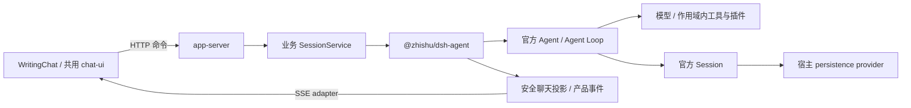

# dsh-agent 设计方案

状态：2026-10-24 已实现进程内官方 DSH runtime、单写者持久化端口、产品投影、审批、取消和恢复，并接入 app-server。公开入口见 [包 README](../../packages/dsh-agent/README.md)，实际协议和未验证项见 [实施记录](ai-chat-implementation.md)。下文拟定接口保留为设计背景。

**原设计时状态（已由上方实施更新覆盖）**：2026-10-23，文档阶段。包名为 `@zhishu/dsh-agent`，与上游 `@deepseek-ai/dsh-agent` 区分。当前仅有 package/TypeScript 配置、依赖和上游来源记录；已验证官方基础服务可以装配与释放，尚无对外实现，未接入应用。本文的 API、目录、数据库适配和验收项均为待实现设计。

[总方案](ai-chat-architecture.md) · [产品协议](chat-contracts.md) · [能力插件](ai-plugins.md) · [返回文档地图](../README.md)

## 1. 目标与责任

2026-10-24 项目接入范围：本包用于协作 AI 写作 Chat，前端由 app-web 的 WritingChat 封装。RAG Chat 继续使用 LangChain，由独立 RagChat 接入。包本身保持可独立消费，但当前方案不接管 RAG 的执行、历史、checkpoint 或协议。

提供可独立消费的 Node.js 对话包：宿主在自己的 Server 进程内创建和恢复 Session，提交消息、观察更新、停止生成和回应审批。执行循环使用官方 Agent Loop，消息历史使用官方 Session，模型与工具使用官方扩展点。

| 层                     | 负责内容                                                                                     |
| ---------------------- | -------------------------------------------------------------------------------------------- |
| 官方 Cordis / DSH 内核 | 插件作用域、Agent 创建与驱动、输入队列、模型调用、工具调度、Session 日志、单次审批语义       |
| `@zhishu/dsh-agent`    | 内核装配与生命周期、产品 Run 关联、聊天投影、持久化接入约束、浏览器审批桥接、执行限额        |
| 宿主应用               | 身份和权限、会话归属、数据库与事务、HTTP/SSE、模型凭据、文件访问、业务产物和文档写入         |
| WritingChat / chat-ui  | WritingChat 消费写作协议、归并业务状态；与 RagChat 共用 chat-ui 基础组件，分别维护请求和会话 |

包只导入官方公开 exports 和通用产品契约。应用框架、数据库连接、工作区权限及编辑器逻辑留在宿主，通过明确接口注入。按实际需要组织文件，不另建 Agent 循环、模型 SDK 或通用插件框架。

## 2. 官方源码依据与依赖

### 2.1 阅读范围

以用户提供的官方源码副本为设计依据：

`E:\Project\source\deepseek-harness-master (1)\deepseek-harness-master`

该副本相关 DSH manifest 标记为 `0.2.1-rc.2`。源码用于理解语义，实际实现只消费锁定 npm 包的公开入口；本地目录和 GitHub master 不作为构建依赖，也不将源码副本直接认定为 npm 发布物的同一提交。

| 官方文件（相对上述根目录）                                    | 已核对的责任                                                     |
| ------------------------------------------------------------- | ---------------------------------------------------------------- |
| `packages/test-support/agent-loop-testkit/src/index.ts`       | 官方基础服务装配顺序；文件系统和工作目录能力是按需选项           |
| `packages/core/agent/src/index.ts`、`runtime-types.ts`        | Registry、AgentHandle、输入队列、取消、空闲和实时流              |
| `packages/core/agent-loop/src/index.ts`、`agent.ts`           | 具体 factory、作用域创建、恢复、执行循环及资源释放               |
| `packages/core/session/src/index.ts`                          | 追加日志、事件观察、flush 与公开读取边界                         |
| `packages/llm/llm/src/index.ts`、`message.ts`                 | 模型 adapter、流协议、消息身份生成                               |
| `packages/core/tools/src/index.ts`                            | 工具 Schema、执行与作用域策略                                    |
| `packages/session/session-persistence/src/index.ts`           | 官方 persistence service、单写者 handle、append/flush/close 合约 |
| `packages/session/session-checkpoint-policy/src/index.ts`     | 模型请求和工具执行前的持久化检查点                               |
| `packages/interaction/user-approval/src/index.ts`、`types.ts` | 审批 answerer、单次 outcome、取消和审计                          |

公开来源：[官方仓库](https://github.com/deepseek-ai/deepseek-harness)、[Agent Loop](https://github.com/deepseek-ai/deepseek-harness/tree/master/packages/core/agent-loop)、[Session Persistence](https://github.com/deepseek-ai/deepseek-harness/tree/master/packages/session/session-persistence)、[User Approval](https://github.com/deepseek-ai/deepseek-harness/tree/master/packages/interaction/user-approval)。链接用于源码导航，兼容性以锁定发布物和测试结果为准。

### 2.2 依赖基线

`packages/dsh-agent/package.json` 已固定以下直接依赖。DSH 均为 `0.2.1-rc.2`，Cordis 为 `4.0.5`；后续升级按整体兼容组合验证。

| 依赖（均为 `@deepseek-ai/*`）                              | 用途                                                |
| ---------------------------------------------------------- | --------------------------------------------------- |
| `cordis`                                                   | Context、服务和作用域释放                           |
| `dsh-agent`、`dsh-agent-loop`                              | 官方 Agent Registry 与执行循环                      |
| `dsh-session`、`dsh-session-projection`                    | 原生会话与派生状态                                  |
| `dsh-scope`                                                | Agent/Session 事件作用域                            |
| `dsh-llm`                                                  | 官方模型 adapter 和流协议；具体 provider 由宿主配置 |
| `dsh-tools`、`dsh-system-prompt`                           | 工具与 Prompt 贡献                                  |
| `dsh-user-approval`                                        | 单次工具审批                                        |
| `dsh-session-persistence`、`dsh-session-checkpoint-policy` | 存储接口与副作用前持久化屏障                        |

Node.js 支持范围跟随该依赖组合：`^22.19.0 || >=24.0.0`。2026-10-30 在 Node.js 24.14.0 / pnpm 9.15.4 重新核对实际源码和锁定发布物，完成官方 Loop 多轮流式对话、审批、持久化失败和 PostgreSQL 重启恢复验收。模型为显式确定性 adapter，真实收费 provider 与其他 Node.js 版本仍未验收。具体证据见实施记录。

包与插件使用同一兼容的 Cordis/DSH 依赖组合；发布插件时声明真实 peer，验证实际解析结果，避免两份运行时产生服务或类型身份问题。具体 provider 属于宿主显式选择的依赖。

### 2.3 已确认的内核语义

| 官方 API / 事件                        | 本包必须遵守的语义                                                                |
| -------------------------------------- | --------------------------------------------------------------------------------- |
| `ctx.agents.create(...) / resume(...)` | 返回 AgentHandle；setup 用于装配，创建完成后再投递输入；句柄有独立 dispose        |
| `agent.send(message, target, wakeup)`  | 返回 void，只表示入队；普通聊天使用 followup/next-turn，不默认插入正在执行的 step |
| `agent.whenIdle()`                     | 等待整个 Agent 活动收敛，不能代替某条输入的 Run 结果                              |
| `agent.cancel(cause, options?)`        | 协作式取消当前活动；需要明确 inbox 处理，并等待活动收敛                           |
| `createUserMessage(...)`               | 由官方生成消息 ID，不接受调用方传入 id；产品幂等键与原生消息 ID 分别保存          |
| `agent/assistant-stream`               | start/chunk/end 实时通知；revision 仅在当前 Agent 生命周期内递增                  |
| `session/event`                        | 观察内存中已追加的事实；监听器参数是 Session 和 event，通知本身不是数据库提交     |
| `ctx.sessions.flush(session)`          | 等待挂载的持久化监听器；必须有实际 provider 才能建立持久化保证                    |
| `approval/request`                     | answerer 返回一次性 outcome；只有 allowed-once 允许被询问动作                     |

流结束时的 committed 表示已写入原生 Session 日志，仍需经过实际 provider 的 flush，才能向产品层确认 durable。新实现使用官方当前公开的投影/读取/恢复接口，不新增对已废弃同步历史扫描 API 或上游私有文件的依赖。

2026-10-30 发布物核验补充：锁定的 Loop 每发送一个原生 start/chunk/end 都会增加 `revision`，原生 `attemptId` 才标识一次模型流。当前 adapter 按 attempt 固定产品 revision，对过滤私有推理之后的 text delta 单独生成从 0 开始的连续 index。不能用原生 revision 直接判断文本流替换。Run 的持久化 `cancelRequested` 先于取消派发提交，恢复不会重新生成显式取消的请求；原生 blocked/error/max-tokens 在产品提交失败后仍恢复为失败。

## 3. 进程内运行结构



应用启动时创建一个受控 runtime，按官方依赖顺序安装 LLM、Session、Projection、SystemPrompt、Tools、Agent Registry 和 Agent Loop；生产模式在接受会话前装配持久化 provider、checkpoint policy 与审批桥接。装配失败释放此前已创建资源，并拒绝开始对话。

SessionService 按需获取会话句柄。每个内部 Session 对应一个活跃 AgentHandle；并发请求共享该句柄的协调结果，空闲后可以释放，后续从持久化恢复。创建新会话与恢复已有会话是两个明确操作，恢复失败不自动新建空历史。

会话的 Prompt、工具和审批 answerer 注册在 Agent 自己的 Context 中。root Context 只共享经过设计的基础服务，默认不加载编码 preset、Shell、本地工作目录或任意文件系统工具。具备代码执行能力的插件需要另行确定隔离执行环境。

HTTP/SSE 留在应用适配层；本包返回框架无关的数据和异步事件流，不启动 CLI、绑定 stdio、监听端口或安装进程退出处理器。SSE 断开只结束订阅，已受理执行由 runtime 继续管理。

## 4. 拟定公共 API

以下是本包目标接口，尚未实现；其中的产品输入、回执、快照和 frame 以 [chat-contracts](chat-contracts.md) 为唯一契约来源，不是上游 SDK 的类型或方法签名。

```ts
export interface DshChatRuntime {
  createSession(input: CreateSessionInput): Promise<DshChatSession>;
  restoreSession(input: RestoreSessionInput): Promise<DshChatSession>;
  dispose(): Promise<void>;
}

export interface DshChatSession {
  submit(input: SubmitChatMessage, signal?: AbortSignal): Promise<RunReceipt>;
  snapshot(input: SnapshotInput, signal?: AbortSignal): Promise<ChatSnapshot>;
  observe(input: SubscribeInput, signal: AbortSignal): AsyncIterable<ChatFrame>;
  cancel(input: CancelRunInput, signal?: AbortSignal): Promise<RunReceipt>;
  resume(input: ResumeRunInput, signal?: AbortSignal): Promise<RunReceipt>;
  decide(input: ApprovalDecision, signal?: AbortSignal): Promise<ApprovalReceipt>;
  dispose(): Promise<void>;
}
```

根入口拟定提供 `createDshRuntime(options)` 与上述公开类型。首期保持单一入口；只有产生实际独立消费需求后才增加 persistence、approval 或 testing 子入口。

- createSession/restoreSession：接收宿主已验证的会话映射、配置和可信访问范围。Session ID 由服务器生成，不接受浏览器提供任意原生历史或运行配置。
- submit：完成校验和原子受理后返回回执，不等待整轮生成。相同幂等键返回同一结果，内容变化返回冲突。
- snapshot/observe：返回有权限的产品投影，observe 的 AbortSignal 只控制该订阅。
- cancel：只作用于所指 Run；排队 Run 移出队列，活跃 Run 请求取消并在后续事件中确认结果。回执不等于已取消完成。
- resume：恢复已受理的 interrupted Run；完成副作用核对后增加 attempt。它与 restoreSession 的历史装载不同，也与创建新 Run 的重新生成不同。
- decide：完成当前审批的一次性决定，返回已记录决定或稳定的过期/冲突结果。
- session.dispose：停止该会话的投递与活动、处理未完成审批、flush 并释放句柄；runtime.dispose 对全部自有会话执行有界关闭。

submit/cancel/decide 的 signal 控制命令等待；受理成功后，即使 HTTP 等待取消，已记录命令仍然有效，客户端用相同幂等身份查询结果。已受理 Run 的执行取消只能由显式 cancel、宿主撤权、预算或执行 deadline 触发。

宿主扩展直接使用官方公开 Context、Agent、LLM adapter 和 ToolDefinition 类型，不再提供一套内容相同的工具/模型接口。模型插件在 runtime 装配，具体会话的工具、Prompt 和审批策略在受控 setup 中装配；setup 代码来自宿主，浏览器只提交已注册能力 ID。

## 5. 宿主接口与状态归属

| 接入点                  | 宿主提供                                                      | 本包使用方式                                                  |
| ----------------------- | ------------------------------------------------------------- | ------------------------------------------------------------- |
| 官方 SessionPersistence | 符合官方 service/handle 合约的存储 provider                   | 交给官方 Agent Loop 创建、恢复和追加；本包建立必要 flush 屏障 |
| 产品 ChatStore          | 会话映射、Run 受理/状态、产品事件 journal、审批记录的事务操作 | 协调幂等、终态与重放；以用例操作为单位，不暴露 ORM            |
| AccessPolicy            | 当前主体对会话、资料、工具动作和产物的权限校验                | attach、订阅、恢复和关键外部动作前检查                        |
| 执行配置与预算          | 模型/provider、插件集合、并发/耗时/字节/费用限制和必要预留    | 调用前限制与预留，取消/恢复后结算；恢复不重置累计额度         |

接口名称是设计角色，完整方法签名在实现前随契约收敛。产品 ChatStore 的多个方法可由同一 repository 实现，不要求拆成多套数据库或独立服务。业务存储事务由应用实现，本包不导入 Drizzle row、Fastify request 或知书身份类型。

官方 Session 日志是引擎历史的权威来源；ChatStore 保存产品受理、投影和浏览器所需事件。无需为事件改名再复制一份完整原生日志。原生日志与产品事务之间通过 checkpoint、稳定关联和可重放投影协调，不假设两次独立写入天然原子。

生产使用 required persistence 模式：缺少 provider 或产品持久化能力则拒绝受理。ephemeral 模式只能显式启用，用于独立示例和确定性测试，不能对外声称刷新/重启可恢复。

## 6. 会话、Run 与消息投递

Conversation 是产品会话，原生 Session 是引擎历史，Run 是一次受理的生成任务。它们的 ID 分别保存。Run 固定输入、模型/插件版本、预算和 attempt；原生 messageId、turn、step 在投递和执行中建立关联。

默认每会话一个活跃 Run，后续输入进入有上限的应用队列，满额返回明确错误。运行时只向官方 inbox 投递当前 Run，普通聊天使用 next-turn；steering 留作显式能力，首期不开放。这样避免一次取消清空其他已受理 Run 的输入。

一次发送的处理顺序：

1. 宿主验证身份、会话归属和资源权限；校验大小、模式和插件参数。
2. ChatStore 按会话、主体及幂等键原子受理用户消息、Run 和待投递记录；相同键不同摘要拒绝。
3. 获得单写者资格，获取或恢复 AgentHandle，先安装事件捕获与 Run 关联。
4. 使用官方消息工厂生成原生消息，保存业务 ID 与原生 ID 的关联，再通过官方输入接口投递；不覆盖 SDK 自动生成的 ID。
5. 依据输入消费和对应 turn 的日志维护 Run，持续投影消息、工具与审批状态。
6. 确认对应 turn 的完成原因、所需产物和 Session flush 后，提交产品终态与事件，再通知订阅者。

不能依靠 agent idle 或 assistant 流 end 判定 completed；blocked、error、max-tokens、aborted 等需要转换为明确产品状态。工具调用后仍有模型步骤的中间消息也不代表整轮结束。

业务受理和原生投递之间存在崩溃窗口。恢复必须通过当前公开 inbox/投影/存储读取能力核对已排队、已消费或未投递事实，再决定继续处理。该关联与去重方案属于 P0/P2 必测项；结果不明时标记 interrupted，不盲目重复发送。不承诺外部模型、图片任务或其他工具副作用恰好执行一次。

## 7. 持久化与恢复

使用官方 `dsh-session-persistence` service，宿主提供 PostgreSQL adapter。官方 Agent Loop 在存在 provider 时接管 create/open 和写句柄生命周期，封装遵守其合约，不旁路写入 Session 内部结构。

| 官方边界                     | adapter 必须保证                                            |
| ---------------------------- | ----------------------------------------------------------- |
| create / open(write)         | 原子获取单写者；已有 writer 时拒绝，跨实例同样有效          |
| open(read) / read            | 返回完整、已校验的连续前缀；读取不抢写锁                    |
| append                       | 从 seq 0 连续追加，不改写已有事件；处理重复、缺口和存储错误 |
| handle.flush / service.flush | 等待目标写入达到真实持久化边界，错误向上传播                |
| close                        | 完成规定的持久化和资源释放，归还写者资格                    |

保存原生 header、格式版本、继承边界和完整事件，按官方规则验证，拒绝未知不兼容格式。读取/恢复使用锁定版本公开 API。adapter 不通过吞掉异常、跳过坏事件或改写原生日志来“恢复成功”。

生产装配官方 checkpoint policy，在模型请求和顶层工具执行前持久化已记录前缀。该 policy 不替代最终 turn 和产品终态的 flush；封装需要在这些边界显式等待。终态写入失败时保持待协调/中断状态，不能向浏览器发送成功确认。

进程重启后，先核对会话 owner 和存储版本，再恢复官方历史和产品投影。已 completed 的 Run 不重新执行；未完成 Run 先核对原生输入、工具结果、外部 job 和预算。无法确定副作用结果时保留 interrupted，只有确认安全后才能 resume。

恢复历史不恢复 JavaScript Promise、网络连接或外部工具进程。旧审批失效，旧实时 token 预览丢弃；需要用户重新决定的动作建立新请求。插件版本不兼容则提供明确的升级或历史只读策略。

数据库 schema/migration 和存储 adapter 留在 app-server。本文不规定必须新建多少张表，实施时复用现有 ai_runs 等业务事实，按缺失的 DSH 原生日志、会话映射与事件能力增量设计。

## 8. 事件投影与 SSE

### 8.1 原生事件到产品消息

本包提供白名单投影，浏览器只接收 [chat-contracts](chat-contracts.md#5-持久化事件与实时-frame) 定义的协议。

| 来源                                            | 产品含义                               |
| ----------------------------------------------- | -------------------------------------- |
| `agent/assistant-stream` start/chunk/end        | 临时 assistant 预览，按流身份归并      |
| 原生 user/assistant message 及当前 surface 投影 | 产品消息；持久化屏障后确认完整内容     |
| tool call/result                                | 已校验、脱敏的工具名称、状态和结果摘要 |
| turn 边界和完成原因                             | 与 Run 关联后的状态变化                |
| 审批桥接、插件产物提交                          | 浏览器审批投影和版本化产物引用         |

系统/开发者 Prompt、模型私有推理、原始 provider 数据、内部 request header、凭据和未经筛选的工具参数不进入公开流。服务端需要原生诊断时通过独立受控扩展处理。图片和文件是宿主资源引用，不直接将上游 attachment 对象或签名 URL 当作永久地址。

### 8.2 临时流与持久化事件

临时 frame 带 streamEpoch、runId、attemptId、revision 和 index，不带 durable cursor。streamEpoch 在 Agent 实例替换时变化，因为官方 revision 不是跨重启的全局序号；旧实例和旧 attempt 的残留 chunk 不再追加。

原生事件在 flush 后形成可确认投影；产品事件持久化后才携带会话 sequence 和恢复 cursor。`message.committed` 用完整内容替换临时预览。遇到 abandoned、流断档或实例变化时回到最近确认消息，不继续拼接旧 token。

产品投影记录原生日志处理水位和稳定去重身份。若在原生 flush 后、产品事件提交前崩溃，恢复可以补做投影；已发布结果不重复登记。日志 seq、产品 sequence 和临时 index 是三种不同位置，不能互用。

### 8.3 订阅、重连与背压

snapshot 与 observe 使用同一产品 journal 和一致性水位：快照携带 cursor，订阅从其后补齐事件，再接实时更新。订阅建立期间的事件不能落在未覆盖窗口；cursor 已超出保留范围时明确要求重取快照。

SSE adapter 负责 HTTP header、心跳、Last-Event-ID/显式 cursor、写入背压和断开清理。持久化事件才推进 SSE 恢复 ID；临时 frame/心跳不推进。鉴权方式沿用应用，token 不放 URL；需要 Bearer header 时使用支持 header 的 fetch 流式客户端。

每个订阅有字节/事件上限。慢消费者先丢弃可重建预览并要求重同步，仍无法跟上则结束该连接，从 journal 恢复；不阻塞 Agent，也不无限缓存。订阅者异常只影响该订阅。

attach、快照、重连和决定接口均重新检查当前权限；存量长连接通过宿主撤权通知或周期校验关闭。SSE 断开与显式停止生成分别处理。

## 9. 工具、审批与能力插件

工具直接通过官方 tools 服务注册，使用官方输入/输出 Schema 与 execute 上下文。首期使用 native 工具模式。工具必须遵守 AbortSignal、超时、大小和预算约束；填写一个 timeout 字段本身不代表运行时已具备强制超时能力。

对需要决定的动作，在开放 turn 内调用官方 approval service。桥接在当前 Agent Context 安装 answerer，维护当前请求到浏览器 approvalId 的映射。公开请求仅显示安全摘要，实际执行参数由服务器保存，浏览器不能修改后回传执行。

审批生命周期：

1. 建立绑定会话、Run、attempt、动作摘要和有效期的请求，持久化后发出产品事件。
2. HTTP decide 校验当前权限和请求身份，以 CAS/等价事务记录一次决定；重复决定返回已有结果，冲突决定拒绝。
3. 仅当前有效 answerer 返回 allowed-once 时允许这次动作；拒绝、取消、过期、不可用均不执行。
4. 取消、撤权、dispose 和进程重启结束旧等待；迟到决定不能唤醒新 attempt。

安装审批服务不会自动拦截所有工具，需要决定的工具或 guard 必须显式调用它。实际副作用前再次校验权限、owner 和预算，并等待所需审批记录及 Session 前缀持久化；仅收到浏览器的允许决定不等于可以立即执行。

官方 outcome 为 `allowed-once | rejected | cancelled | unavailable`；产品 expired 映射为关闭等待，不创造上游 outcome。官方 approval/request 不暴露审计请求 id，桥接不能按“最后一条审批”猜测并发请求的关联；产品 ID 和官方 audit ID 分开管理。只有绑定真实 tool call 时才提供 toolCallId，首期浏览器工具审批限定这一范围。

[ai-plugins](ai-plugins.md) 中的 writing、research、image 在写作链路复用 runtime/Session；research 提供写作资料调研，独立 RAG Chat 仍由 LangChain 执行：

- writing 注册写作能力，结果为提案；接受提案和写入正文由宿主原有文档链路完成。
- research 注册搜索、阅读和报告工具，复用宿主来源权限与证据契约，展示研究阶段和引用。
- image 注册图片创建工具，宿主管理 provider job、费用、私有资源和结果查询，取消不伪装成撤销外部计费。

插件通过 Cordis 作用域、官方 tools/Prompt 扩展和版本化产物接入。执行引擎不感知知书页面、资料选择控件或正文布局。

## 10. 多用户并发、取消与释放

| 风险                 | 设计要求                                                                                 |
| -------------------- | ---------------------------------------------------------------------------------------- |
| 会话串数据           | 服务端会话映射绑定 tenant/主体/业务范围；Agent、Prompt、工具、审批和事件按当前会话隔离   |
| 全局事件泄露         | 在源头匹配精确 Agent/Session，再做产品投影和权限校验；不能把 root 通知直接广播           |
| 同会话多实例执行     | 存储 write handle 保证单写者；应用 lease/fence 防止过期 owner 继续更新产品状态或发起动作 |
| 单用户占满资源       | 全局、租户/主体和会话维度设置并发、队列、输入、工具、时长和费用限制                      |
| 一个取消影响其他人   | 取消对应 Agent/Run，释放对应 AgentHandle；root dispose 仅用于整个 runtime 关闭           |
| 插件读取跨用户状态   | 凭据和数据依赖来自可信作用域，禁止用全局可变对象保存当前用户/会话                        |
| 同进程工具越权       | 只装配可信插件；每次资源访问独立授权。Cordis 作用域不提供 OS 级沙箱                      |
| 大量闲置句柄或慢连接 | 设置活跃句柄上限、空闲释放、订阅背压和有界 drain                                         |

多用户不要求每人独占进程，但同进程内一个插件崩溃、CPU 阻塞或内存膨胀仍可能影响其他用户。阻塞/不可信执行放入受控隔离设施，由工具 adapter 接入；官方 Agent Loop 继续在 Server 内运行。

活跃 Run 取消时，向对应 Agent 发出明确 cause，停止该 Run 的后续投递并等待官方活动收敛。工具/provider 必须配合取消；不可取消外部 job 保留引用和查询状态，结果未知时保持 interrupted。不能仅用 Promise.race 超时就宣称工具已停止，也不能立即放行同会话下一项副作用。

关闭顺序：停止受理和投递 → 请求取消/结束审批 → 等待活动收敛 → flush 原生和产品状态 → 释放 AgentHandle/作用域/订阅 → 释放 runtime 自有资源。应用数据库池由宿主关闭。超过关闭 deadline 时记录未确认状态并让宿主完成进程关闭；普通单会话操作不得退出整个进程。

结构化日志记录 conversationId/runId/attempt、owner/fence、延迟、队列和 flush 结果；默认不记录正文、完整 Prompt、工具敏感参数或凭据。

## 11. 包组织与独立消费

目标目录如下，按实际实现合并简单模块，不预先创建空壳文件：

```text
packages/dsh-agent/
  src/
    index.ts
    runtime.ts             # 官方服务装配、启动与关闭
    session.ts             # AgentHandle、输入、Run 协调
    projection.ts          # 原生事实到产品消息/事件
    approval.ts            # answerer 与浏览器决定关联
    persistence.ts         # 官方 provider 接入与 flush 协调
    types.ts
  test/                    # 真内核 + 确定性模型/存储宿主
  package.json
  tsconfig.json
  README.md
  UPSTREAM.md
examples/dsh-consumer/      # 从构建入口消费，不依赖 app-server
```

产物使用 ESM、完整声明和受控 exports，导入无副作用；编译后可由独立 Node.js 项目使用，不依赖源码别名、其他仓库或应用环境变量。README 记录使用入口与运行要求，UPSTREAM 记录官方来源和版本；依赖保留原有许可证声明，项目许可证在发布前确认。

当前 package 为 private 骨架，exports 对应的 dist 尚未生成，不能视为可安装使用的发布包。发布准备必须通过 pnpm pack 的独立安装检查，再确认 peer、文件清单、许可证和变更记录。

## 12. 实施顺序与验收出口

下列阶段细化[总方案](ai-chat-architecture.md#11-实施阶段与出口)中的 P0—P2；三类业务插件仍按总方案后续阶段推进。

| 阶段             | 交付范围                                                           | 通过条件                                                                    |
| ---------------- | ------------------------------------------------------------------ | --------------------------------------------------------------------------- |
| P0：官方内核原型 | 固定依赖、公开入口和最小装配；用确定性 adapter 驱动真实 Agent Loop | 创建/恢复/输入/取消/流/flush/审批的官方调用验证，尤其消息身份与投递恢复关联 |
| P1：写作基础对话 | runtime/session、写作产品投影、独立内存消费示例                    | 多轮写作对话、工具结果、逐 Run 终态、会话不串流、资源释放可验证             |
| P2：生产接入     | 宿主持久化、业务受理与幂等、单写者、恢复、审批、Fastify HTTP/SSE   | 数据库错误不报成功；重复发送、断线、重启、撤权及迟到决定均有明确结果        |
| P3—P5：能力插件  | 按 writing → research → image 接入                                 | 复用同一会话与事件体系，真实产物、权限和费用链路逐项验收                    |

必须覆盖的关键场景：

- 并发创建同会话句柄、两实例抢 writer、lease 失效后的旧 owner、单会话取消不影响其他会话。
- 相同幂等键重试、受理后投递前崩溃、已投递但关联提交失败、原生完成后产品终态写入失败。
- 模型失败、工具失败/不响应取消、预算耗尽、flush 失败；失败不能变成 completed。
- 实时流重复/断档/旧 epoch、快照期间新事件、SSE 慢消费者、断线重连和游标过期。
- 无 answerer、并发审批、重复/冲突/迟到决定、撤权、取消和重启后旧决定失效。
- 官方历史恢复后继续多轮；插件版本不兼容；已完成外部 job 不重复执行。
- WritingChat 与 RagChat 同时消费 chat-ui 时各自状态隔离；RAG 继续走 LangChain，不进入 DSH Session。
- 独立构建/类型/包边界检查、tarball 消费与无应用依赖验证。真实模型与收费工具测试使用显式配置，不由普通测试自动触发。

完成这份文档不代表上述验收已通过。当前证据仅是依赖安装与基础服务装配/释放，后续先补齐 P0，再继续公共接口实现；本轮不继续编写运行时代码、路由或 migration。
