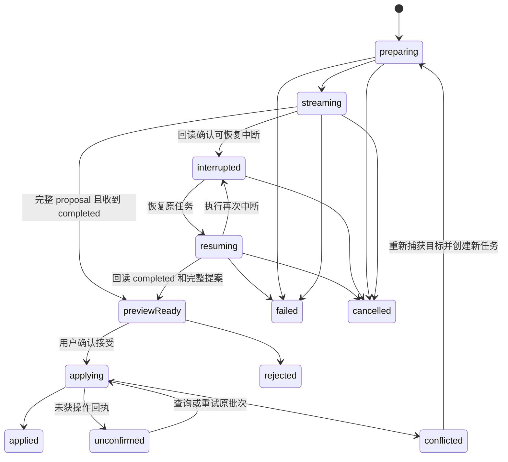

# editor-ai-bridge 设计规划

> 2026-10-24 适配边界：本包只衔接协作 AI 写作与文档，写作对话状态由 [app-web 的 WritingChat](../apps/app-web.md#ai-chat-业务组件库)维护，执行由 [dsh-agent](dsh-agent.md)负责。RAG Chat 继续由 LangChain 与 RagChat 管理；二者共用 chat-ui 基础组件，RAG 转写作时创建独立请求。bridge 聚焦目标捕获、产物预览、用户接受与协同提交，复用 ai-plugins/ai-contracts，不维护第二份聊天状态。

状态：待用户审核，尚未创建工作区包，审核通过后再实施。拟定名称 `@zhishu/editor-ai-bridge`，目录 `packages/editor-ai-bridge`；[返回文档地图](../README.md)。依赖 [ai-contracts](ai-contracts.md) 与内容合约，通过宿主接入生成服务和编辑器；与 [ai-runtime](ai-runtime.md)、[rag](rag.md) 独立消费。

## 1. 产品职责

把生成、续写、改写、摘要、翻译和 Deep Research 报告转换为可预览、可接受的编辑操作，撤销按宿主能力开放。bridge 不安装 Deep Agents/LangChain，不处理模型工具循环；它只消费 ai-contracts 定义的产品事件。没有知识库的业务也可注入自己的生成服务；知识域、模型、配额和鉴权由 app-server/宿主负责。

本包根入口不依赖 React、Tiptap 或 Yjs。UI 由 editor-ui/宿主消费任务状态，定位与提案应用通过必需的宿主接口完成。Tiptap 适配器使用 core 公共能力，协同宿主注入现有 captureAnchor/resolveAnchor/submitStructureOperation，不把用户、权限或生成模型接入协同包。模型密钥和服务端策略不进入浏览器包。

## 2. 功能清单

| 编号  | 能力       | 细节                                                            |
| ----- | ---------- | --------------------------------------------------------------- |
| AB-01 | 任务入口   | 全文生成、指定块后续写、选区/多块改写、摘要、翻译、结构化块生成 |
| AB-02 | 目标捕获   | 文档/代次、稳定 Block ID、锚点、原始目标摘要、允许操作范围      |
| AB-03 | 流消费     | 事件解析、顺序/重复处理、大小与时间限制、可取消的传输           |
| AB-04 | 草稿与预览 | 渐进显示、原文对照、保留不完整草稿、生成说明与来源              |
| AB-05 | 接受/拒绝  | 首期完整接受、前置条件复核、单次逻辑操作；撤销按宿主能力开放    |
| AB-06 | 并发安全   | 他人编辑、目标删除、输入法组合、切换文档、旧代次与只读切换      |
| AB-07 | 失败与恢复 | 取消、超时、限额、断流、无效结构、重新生成、重复接受            |
| AB-08 | 引用与扩展 | 引用属性校验、来源卡片回调、不支持扩展的阻断与提示              |
| AB-09 | 任务观察   | 生成/应用/持久化分别上报，安全诊断与资源释放                    |

## 3. 拟定公共接口

| 接口                      | 输入/输出                                                  | 语义                                                           |
| ------------------------- | ---------------------------------------------------------- | -------------------------------------------------------------- |
| `createAuthoringBridge`   | host port、generation service                              | 创建编辑器侧任务 owner，不自动开始生成                         |
| `start`                   | intent、target、instruction、语言/长度约束、宿主上下文引用 | 返回 requestId 与任务状态，不直接覆盖正文                      |
| `subscribe`               | 状态与草稿/提案变更，返回取消函数                          | UI 按任务订阅                                                  |
| `accept`                  | requestId、完整 proposalId、预期目标版本                   | 再验证目标后应用，返回 operationId 与宿主结果                  |
| `reject / cancel / retry` | 任务 ID                                                    | 分别放弃提案、停止生成、创建明确的新一轮任务                   |
| `resume`（可选）          | 中断任务 ID                                                | 宿主支持 checkpoint 时恢复原任务，不重新捕获目标；回读最终结果 |
| `dispose`                 | 释放任务与订阅                                             | 停止自身传输与订阅，后续回调不能写入已卸载实例                 |

生成服务接收 ai-contracts 的 AuthoringRequest 与 AbortSignal，返回统一 AsyncIterable。宿主提供的 contextRef 由服务端解析和授权，bridge 不解释知识库业务规则。普通 Chat / 问答由应用消费对应协议，不让 bridge 将回复自动当作编辑操作；只有用户明确选择用于创作时，才建立绑定当前合法编辑器目标的新提案。

2026-10-22 应用删除手动/自动模式，正文只由用户显式确认后更新。每处段落建议独立接受/拒绝，底部批量动作仅处理剩余建议，状态由服务端持久化；权限规则见 [服务端空间与写入策略](../apps/app-server.md#92-空间与写入策略2026-10-21-设计)。通用预览与控件已落在 editor-core/react/ui，独立 bridge 包仍待实现。

恢复与任务回读是 generation service 的可选宿主能力，结果复用共享 AuthoringProposal，HTTP 状态响应由应用合约定义。知书首期使用 resume → 查询任务结果，不重连第二条 SSE；独立消费宿主不提供这两项能力时，UI 只提供复制草稿和重新生成。bridge 不直接访问 LangGraph/checkpointer，也不新增线程对象。

拟定入口为根入口（任务与状态机）、`/fetch`（fetch SSE 适配）和 `/tiptap`（editor-core 适配）。fetch 适配由宿主注入 endpoint、fetch、凭据/请求头获取函数，不读取应用 token store；支持分段 UTF-8、跨网络 chunk 的 SSE、多行 data、心跳和累计上限。根入口不导入两个适配入口，Tiptap 只作为适配入口的 optional peer。

宿主契约的关键形状如下，引用类型来自 ai-contracts/document-contracts；实现时提供完整类型声明：

```ts
interface AuthoringHost {
  captureTarget(signal: AbortSignal): Promise<CapturedAuthoringTarget>;
  checkProposal(proposal: AuthoringProposal): Promise<ProposalCheckResult>;
  applyProposal(proposal: AuthoringProposal, signal: AbortSignal): Promise<ApplyProposalResult>;
}

interface GenerationService {
  generate(request: AuthoringRequest, signal: AbortSignal): AsyncIterable<AiTaskEvent>;
}
```

CapturedAuthoringTarget 包含完整 document 版本、稳定目标和支持能力；ProposalCheckResult 区分可应用、目标变化、只读、组合输入和不支持节点；ApplyProposalResult 区分 applied、conflict、rejected 和 unknown，并返回 operationId、可用的 durableSeq。unknown 表示请求已发出但尚未确认，不能按失败重新创建操作。

captureTarget 在宿主确认本地编辑已获 durable ack 后绑定对应 generation/durableSeq/baseStructureRevision；快照未就绪时等待有界时间或提示稍后重试，不能把未确认本地正文冒充服务端快照。独立消费时由宿主提供自己的文档版本机制。

同一编辑器实例最多一轮活动生成，其他编辑器有独立 bridge；实例/文档 key 变化时旧任务不能应用到新文档。选区捕获复用现有 Anchor，目标摘要单独携带，不能把当前绝对位置保存为长期定位。首期目标范围与 intent 能力矩阵见 ai-runtime；unsupported target 在开始生成前提示，不浪费模型调用。

## 4. 任务状态与正文变更



`applied` 表示宿主确认本次提案已应用；独立编辑器可能只是本地事务，协同结构提案则需要结构通道 accepted/duplicate 回执并观察到对应更新。状态快照分别提供 generation、application、persistence 三组状态；持久化进度来自真实协同回执。生成完成、应用成功与文档已保存分别展示。

拒绝提案不改变正文；用户取消通过宿主 cancel 接口终止任务，同时中止传输并丢弃后续事件，但保留可选的本地草稿；撤权时按应用策略清理敏感草稿。仅断流不等于显式取消，先查询服务端状态；只有确认 interrupted 才显示恢复，cancelled 不可恢复。重复 accept 返回同一 operationId 和已有结果；结果 unknown 时只能用同一 operationId、完全相同批次和原结构修订查询/重试，不创建新批次。重新生成使用新 requestId；恢复沿用原 requestId、目标和 baseStructureRevision。dispose 结束自身传输与订阅，不销毁宿主共享 client，也不撤销可能已被服务端接受的操作。

流式输出仅进入独立草稿。完整提案验证后，宿主处理用户的逐段/全部接受或拒绝；普通 Chat 不参与正文应用。已接受段落和决定在同一持久化事务提交，已拒绝项不进入后续全部替换。刷新恢复未决定的建议，不触发写入。

## 5. 流事件与结构校验

统一消费 ai-contracts 的 v1 事件；本桥接接受 authoring 的 started/progress/text-delta/proposal/completed/failed，收到 answer 或不匹配任务的事件即失败。research 仍返回 authoring 提案，额外展示阶段进度和可授权打开的来源；内部研究笔记不进入预览。事件顺序由 ai-contracts 唯一维护，本包负责编辑器实例归属和任务状态。

`text-delta` 只更新预览文本；结构化 JSON 需要完整解析、Schema 校验及节点能力检查后产生 proposal。网络 chunk、SSE event、模型 token 和一个完整 Block 都是不同边界，不能将不完整 JSON 直接传给 `insertContentAt()`。

提案引用已有 OperationBatchSchema。例如 replace-block 的节点字段为 `block`，不能另造 `content` 字段。文档代次、操作身份和 contentHash 来自受信目标与运行时编译结果，模型只生成受限内容。完整请求/提案字段见 ai-contracts，不在此再维护另一套载荷定义。

`proposal` 必须是完整、可校验的编辑批次；不完整模型对象只存在预览草稿中。桥接层核对事件 requestId、文档代次、目标摘要、扩展要求和操作限制后可先展示候选，收到 `completed` 或授权回读确认 completed 的完整结果后，才进入可接受的 `previewReady`。正常生成先发 `proposal`，后发 `completed`；proposal 后不接受新的文本增量或第二个最终提案。若此时断流，先查询任务状态，保留候选供复制/比较；未确认最终结果前不允许应用。

重连仅在服务端声明事件保留与游标重放能力时携带最后 seq。初版不支持事件重放；原流断开后通过任务回读获知 completed/interrupted/终止状态。恢复时保留旧预览供对照，查询到完整最终提案后替换预览，不拼接新旧文本。恢复接口失败不自动改成新任务；来源或目标变化时提示冲突并保留有权限的草稿。

## 6. 目标与冲突语义

开始任务时捕获 documentId、generationId、durableSeq、baseStructureRevision、目标 blockId/锚点、所选内容摘要和 intent。接受使用版本前置条件，接受时再次检查编辑权限、扩展集、目标是否存在，以及目标内容是否仍符合前置条件。客户端检查只改善反馈，权威版本检查必须与写入位于宿主同一受控顺序内。

| 场景                                       | 处理方式                                                                                                |
| ------------------------------------------ | ------------------------------------------------------------------------------------------------------- |
| 目标之前插入了其他内容                     | 首期因结构修订变化而冲突，保留草稿；后续有目标级校验再开放                                              |
| 目标正文被修改                             | 进入 conflicted，保留草稿和差异；复制可直接进行，插入新块必须以新目标准备并校验提案，重新生成使用新任务 |
| 普通字符变化但结构修订未变                 | 通过 durableSeq 检出冲突；不能把结构修订不变当成内容未变                                                |
| 目标块被删除                               | 不自动落到邻接块；要求重新选择目标                                                                      |
| 切换文档/恢复旧版本                        | 保留原任务审阅状态，原提案仍绑定原文档代次                                                              |
| 变为只读/撤权                              | 停止应用；未确认草稿按宿主策略处理                                                                      |
| 知书目标移入团队空间或不再属于本人个人空间 | 阻止写入；资料与草稿按当前权限展示                                                                      |
| 正在中文组合输入                           | 延迟接受到组合结束，再复核目标                                                                          |
| 连续点击接受/重复事件                      | 客户端任务与 operationId 去重；已接受操作不再次插入                                                     |
| 同账号多标签页或自动/手动同时接受          | 共用原 operationId；由宿主返回唯一权威结果，不能分别本地插入                                            |

首期只允许完整提案接受。后续部分接受按语义完整且独立的 Block/操作组处理，重新生成该组合法批次、前置条件和操作身份；不能任意删除原批次中的操作。全文生成已有内容时也必须选择替换/插入等明确动作并提供预览。

## 7. 应用、撤销与单一写入方

手动接受调用唯一的宿主 applyProposal。独立编辑器可在支持范围内调用 core 的 applyOperations；自带协同服务的宿主可适配现有 submitStructureOperation，并在 owner 内原子检查预期文档版本。知书手动路径调用应用 AI accept 接口，自动路径由服务端协调器调用同一接受用例，读取已登记提案，经协同模块公开结构 owner 端口执行相同命令，再同步给客户端。bridge 在自动路径只观察应用结果；不能再本地 applyOperations 一次，也不能借助 setContent 覆盖 Y.Doc。

生成服务只产出提案，用户确认后由结构 owner 受控提交。本轮成功决定记录其后续版本，剩余建议可继续审阅；外部正文/结构变化返回冲突，不能刷新到他人的新基线。超时查询或重试相同决定，拒绝不写正文。

普通模式使用 core 历史；协同撤销由 CO-05 的受控操作语义提供，不能假定结构通道结果已进入客户端 Yjs UndoManager。若未提供经验证的安全撤销能力，宿主声明 canUndo 为 false，界面不提供失效的撤销承诺。后续协同撤销通过新操作、目标前置条件和 durable ack 完成，覆盖 Block ID 退役与他人后续编辑；禁止写回旧全文。

应用状态须在同一受控操作链路中绑定 requestId、proposalId、operationId 与实际 durableSeq；客户端的“已接受”通知只是观察数据，不能证明正文已落库。知书初版接受权绑定发起主体与请求，跨主体共享提案不开放；同主体多会话接受同一提案仍用同一 operationId 去重。应用接入详情见 ai-runtime 的 app-server 接入章节。

## 8. 取消、错误与引用

取消通过 AbortSignal 传递到网络和服务端生成任务，停止接收后续结果；模型供应商不能立即停止时，服务端也不得继续向已结束任务发送可应用提案。默认预览模式取消不改变原文，已接受内容只通过显式撤销处理。

错误区分网络、鉴权、配额、模型失败、结构无效、目标冲突和不支持扩展。重试创建新 attempt 并保留旧草稿供对照，不能让两条活动流共同更新同一提案。耗时、输出大小和并发任务均有上限。

引用仅接受合约化来源标识，不能把模型生成的任意 URL 当作已验证企业知识来源；来源展示与跳转由宿主获取授权结果。引用失效时显示不可访问/已删除，不伪造内容。模型输出经过与用户粘贴相同的结构/URL/嵌入净化。

## 9. 交付与验收

最小消费例包含一个可替换生成服务、草稿预览和宿主接受适配，不要求知识库或模型 SDK。扩展 examples/editor-consumer 和 examples/collaboration-consumer 分别展示普通模式与结构通道应用；示例从构建后的包入口导入，不配源码别名。

React 接入沿用 editor-react：新增可选 `/ai` 入口提供 useAuthoringBridge/useAuthoringState，按实例生命周期订阅桥接，不让现有根入口强制加载 AI。editor-ui 以受控 props/callbacks 提供 AuthoringPanel/ProposalPreview/SourceList；不创建第二个 ai-react 或 ai-ui 包。业务侧继续通过现有 requestAIAction 将 polish/expand 映射为 rewrite 加 instruction，continue/summarize/translate 直接映射。

验收覆盖多字节流、重复/缺失事件、无效节点、中断/取消、逐段与批量操作、拒绝不写入、跨段隔离、已决定状态恢复、多标签页旧 revision、权限/外部版本冲突，以及丢失回执不重复提交。
