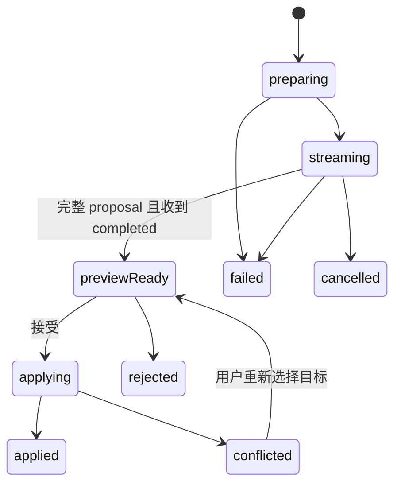

# editor-ai-bridge 设计规划

状态：规划，主要于 M3 交付。对应 `packages/editor-ai-bridge`；[返回文档地图](../README.md)。依赖内容合约与 editor-core，通过宿主接入 AI 服务。

## 1. 产品职责

把生成、续写、改写、摘要、翻译等任务转换为可预览、可接受、可撤销的编辑操作。没有知识库的业务也可注入自己的生成服务；知识域选择、Prompt、模型、RAG、配额和鉴权由 app-server/宿主负责。

本包不依赖 React 或 Yjs。UI 由 editor-ui/宿主消费任务状态，协同定位通过 core 的锚点接口取得适配实现。模型密钥和服务端策略不进入浏览器包。

## 2. 功能清单

| 编号  | 能力       | 细节                                                            |
| ----- | ---------- | --------------------------------------------------------------- |
| AB-01 | 任务入口   | 全文生成、指定块后续写、选区/多块改写、摘要、翻译、结构化块生成 |
| AB-02 | 目标捕获   | 文档/代次、稳定 Block ID、锚点、原始目标摘要、允许操作范围      |
| AB-03 | 流消费     | 事件解析、顺序/重复处理、大小与时间限制、可取消的传输           |
| AB-04 | 草稿与预览 | 渐进显示、原文对照、保留不完整草稿、生成说明与来源              |
| AB-05 | 接受/拒绝  | 全部或按合法操作单元接受、前置条件复核、单次原子事务、撤销      |
| AB-06 | 并发安全   | 他人编辑、目标删除、输入法组合、切换文档、旧代次与只读切换      |
| AB-07 | 失败与恢复 | 取消、超时、限额、断流、无效结构、重新生成、重复接受            |
| AB-08 | 引用与扩展 | 引用属性校验、来源卡片回调、不支持扩展的阻断与提示              |
| AB-09 | 任务观察   | 生成/应用/持久化分别上报，安全诊断与资源释放                    |

## 3. 拟定公共接口

| 接口                      | 输入/输出                                                  | 语义                                          |
| ------------------------- | ---------------------------------------------------------- | --------------------------------------------- |
| `createAuthoringBridge`   | editor port、generation service、上下文/锚点适配器         | 创建编辑器侧任务 owner，不自动开始生成        |
| `start`                   | intent、target、instruction、语言/长度约束、宿主上下文引用 | 返回 requestId 与任务状态，不直接覆盖正文     |
| `subscribe`               | 状态与草稿/提案变更，返回取消函数                          | UI 按任务订阅                                 |
| `accept`                  | requestId、可接受操作集合、预期目标版本                    | 再验证目标后应用，返回 operationId 与本地结果 |
| `reject / cancel / retry` | 任务 ID                                                    | 分别放弃提案、停止生成、创建明确的新一轮任务  |
| `dispose`                 | 释放任务与订阅                                             | 取消自身请求，后续回调不能写入已卸载实例      |

生成服务接收规范化请求与 AbortSignal，返回统一的异步事件流。默认 HTTP/SSE 适配由宿主提供 endpoint、凭据和传输函数；框架包不绑定企业 API 路径。宿主提供的知识上下文引用是 opaque token/配置，由服务端解析和授权，bridge 不解释空间或知识库业务规则。

生成请求捕获编辑器当前文档上下文，但不携带容易过期的绝对位置：

```ts
interface AuthoringRequest {
  requestId: string;
  intent: "create" | "continue" | "rewrite" | "summarize" | "translate";
  documentId: string;
  generationId: string;
  target: Anchor | { kind: "document-end" };
  instruction?: string;
  constraints?: { language?: string; maxBlocks?: number; maxCharacters?: number };
  contextRef?: string; // 宿主/服务端解释并授权
}
```

选区任务的 `Anchor` 包含稳定 Block ID、选区相对范围与目标摘要。桥接层只传递宿主提供的 `contextRef`，不得从客户端选择的空间 ID 推导授权范围；服务端仍按当前用户和文档权限重新校验。

## 4. 任务状态与正文变更



`applied` 只表示已产生本地编辑事务；服务器持久化进度由宿主保存机制或 collaboration 回执提供。服务端的生成完成不等于用户已接受，更不等于文档已保存。

拒绝提案不改变正文；用户取消会中止传输并丢弃后续事件，但保留可选的本地草稿。重复 `accept(requestId)` 返回第一次接受的 `operationId` 和结果，不能再次执行。重试创建新的 attempt/requestId，并保留旧草稿用于对照。`dispose()` 结束本桥接实例拥有的活动请求与订阅，不销毁宿主共享的网络 client。

默认流式输出进入独立草稿预览，不逐 token 修改正式正文。后续可提供“在新建临时区域展示”的模式，但在定义临时区域的同步、取消和撤销规则前不开放直接流式覆盖原文。

## 5. 流事件与结构校验

统一消费 DC-08 的 `started / text-delta / proposal / completed / failed` 事件。每条事件携带 requestId、seq；客户端验证任务归属、顺序和重复，协议错误结束消费并保留安全草稿。

`text-delta` 只更新预览文本；结构化 JSON 需要完整解析、Schema 校验及节点能力检查后产生 proposal。网络 chunk、SSE event、模型 token 和一个完整 Block 都是不同边界，不能将不完整 JSON 直接传给 `insertContentAt()`。

符合 DC-08 外壳的关键载荷示例：

```json
{
  "type": "proposal",
  "requestId": "req_01",
  "seq": 9,
  "payload": {
    "proposalId": "proposal_01",
    "target": {
      "documentId": "doc_01",
      "generationId": "gen_01",
      "blockId": "block_01",
      "contentHash": "sha256:..."
    },
    "operationBatch": {
      "operationId": "op_ai_01",
      "documentId": "doc_01",
      "generationId": "gen_01",
      "origin": "ai-accept",
      "preconditions": [{ "blockId": "block_01", "contentHash": "sha256:..." }],
      "operations": [
        {
          "type": "replace-block",
          "targetBlockId": "block_01",
          "content": { "type": "paragraph", "attrs": { "blockId": "block_01" }, "content": [] }
        }
      ]
    },
    "summary": "精简并澄清该段落"
  }
}
```

`proposal` 必须是完整、可校验的编辑批次；不完整模型对象只存在预览草稿中。桥接层核对事件 requestId、文档代次、目标摘要、扩展要求和操作限制后可先展示候选，但只有收到 `completed` 才允许进入可接受的 `previewReady`。正常生成先发 `proposal`，后发 `completed`；proposal 后不接受新的文本增量或第二个最终提案。若此时断流或收到 `failed`，保留候选供复制/比较，但不允许应用，提示重试或重新生成。

重连仅在服务端声明事件保留与游标重放能力时携带最后 seq；去重后继续消费。缺口无法补齐时读取最终任务结果或提示重新生成，不盲目续接两轮不同输出。初版可不支持流重放，但必须支持明确失败与草稿保留。

## 6. 目标与冲突语义

开始任务时捕获 documentId、generationId、目标 blockId/锚点、所选内容摘要和 intent。接受时再次检查编辑权限、扩展集、目标是否存在，以及目标内容是否仍符合前置条件。

| 场景                   | 处理方式                                                      |
| ---------------------- | ------------------------------------------------------------- |
| 目标之前插入了其他内容 | 重新解析锚点；若目标内容未变，可继续接受                      |
| 目标正文被修改         | 进入 conflicted，保留草稿和差异；允许复制、插入新块或重新生成 |
| 目标块被删除           | 不自动落到邻接块；要求重新选择目标                            |
| 切换文档/恢复旧版本    | 取消自动应用路径，原提案仍绑定原文档代次                      |
| 变为只读/撤权          | 停止应用；未确认草稿按宿主策略处理                            |
| 正在中文组合输入       | 延迟接受到组合结束，再复核目标                                |
| 连续点击接受/重复事件  | 客户端任务与 operationId 去重；已接受操作不再次插入           |

部分接受按语义完整的 Block/操作批次进行，不按任意 token 切片；若提案中操作相互依赖，需要整组接受。全文生成已有内容时也必须选择替换/插入等明确动作并提供预览。

## 7. 应用、撤销与单一写入方

客户端接受提案后，通过 core 一次逻辑事务执行，并标记 origin 和 operationId。协同模式由该客户端的 Yjs 更新同步到其他人；服务端生成任务只产生提案，不再把同一输出同时写入 Y.Doc。

普通模式使用 core 历史，协同模式由 CO-05 将整次接受分组。撤销只能撤销对应操作，不能用旧全文快照覆盖他人后续编辑。多客户端均可看见提案的未来场景，需要服务端接受状态的条件更新/幂等协议；初版限定接受权属于发起任务的会话。

本地应用后等待对应持久化结果，才能确认“已保存”。如果服务端记录 AI 任务的 applied 状态，应绑定实际保存的 operationId/版本回执；单纯客户端通知不能证明正文已落库。

## 8. 取消、错误与引用

取消通过 AbortSignal 传递到网络和服务端生成任务，停止接收后续结果；模型供应商不能立即停止时，服务端也不得继续向已结束任务发送可应用提案。默认预览模式取消不改变原文，已接受内容只通过显式撤销处理。

错误区分网络、鉴权、配额、模型失败、结构无效、目标冲突和不支持扩展。重试创建新 attempt 并保留旧草稿供对照，不能让两条活动流共同更新同一提案。耗时、输出大小和并发任务均有上限。

引用仅接受合约化来源标识，不能把模型生成的任意 URL 当作已验证企业知识来源；来源展示与跳转由宿主获取授权结果。引用失效时显示不可访问/已删除，不伪造内容。模型输出经过与用户粘贴相同的结构/URL/嵌入净化。

## 9. 交付与验收

最小消费例包含一个可替换生成服务、草稿预览和 core 接受命令，不要求知识库或模型 SDK。提供普通模式与协同模式的同一提案流程示例。

验收覆盖分段和多字节事件、重复/缺失序号、无效节点、模型中断、取消、重试、目标漂移、同块并发改写、卸载与重复接受。结果需证明：失败保留原文，冲突保留草稿，单次接受只写一次，撤销不覆盖他人修改。
