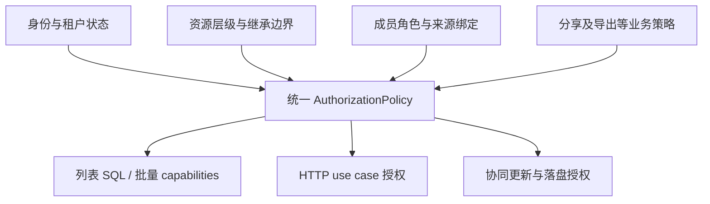

# 知书权限审查与统一 ACL 设计方案

## 本轮收尾状态：2026-11-01

以本节为当前状态；下方各批次和初次审查均为历史记录。按用户明确范围，**F4 / P3 目录 ACL 延期，只保留禁用的规划入口**；其余已知权限重构项在本轮完成。

| 项目            | 最终行为                                                                                                                                                                                             |
| --------------- | ---------------------------------------------------------------------------------------------------------------------------------------------------------------------------------------------------- |
| F1 最小披露     | 空间、目录、搜索、定位和分页按当前 read 过滤；单篇共享不暴露空间详情或不可读祖先，前端支持独立共享文档视图。                                                                                         |
| F2 所有权与治理 | 团队空间使用独立 ownerIdentityId，createdBy 仅审计；支持带授权版本校验的所有权转移。受限文档通过所有者显式填写原因恢复管理，记录审计。可信身份 active 状态同步后，停用主体禁止访问并触发会话失效。   |
| F3 能力一致     | 标题/标签、正文、移动、分享、导出、附件和管理均消费各自真实 capability；服务端每次持久化重新校验权限。                                                                                               |
| F4 目录 ACL     | 按用户要求延期；存储/继承模型保留，菜单禁用且标记“规划中”，没有开放目录授权写接口。                                                                                                                  |
| F5 来源生命周期 | 链接区分长期邀请 invite 与限时访问 access。加入后按 sourceShareId 独立保存；访问来源随撤销、过期和创建者失去委托资格失效，邀请接受后独立保留。撤销单一来源不删除其他有效来源，旧无来源授权保守保留。 |
| F6 转授权上限   | read/share 是分享前提，编辑档额外需要 write/comment；访问链接不能作为再次委托的权限来源，避免循环授权。                                                                                              |
| F7 事务一致性   | 授权变更持租户排他锁，正文/标题/版本/附件/评论写入先持共享锁；判权、业务落盘和审计在事务内完成。真实多连接验证先提交的撤权阻止排队中的加入或写入。                                                   |
| F8 数据搬运     | 模板复制要求 export 和目标空间组织权。跨空间文档/目录移动要求可导出全部内容，并提交绑定源/目标授权版本、元信息和子树关系的影响预览；撤销旧公开链接，保留明确提示的独立授权，失效预览拒绝提交。       |
| P4 跨实例与审计 | 同事务 outbox、单调空间授权版本、每实例独立消费者和链接到期扫描；关闭相关本地协同连接。空间设置支持审计、缓存策略和治理操作；文档面板解释当前角色与直接授权来源。                                    |
| P4 离线         | 授权版本、来源到期或可访问空间变化后清理接口缓存和已确认快照，隔离保留未确认草稿；禁止旧在途响应回写，到期离线缓存须重新联网校验。空间所有者可关闭正文离线缓存。                                     |

新增 forward migrations：0040（显式所有者、分享来源、缓存策略、授权版本/审计 outbox 与触发器）和 0041（可信身份 active 投影与生命周期事件）。0038/0039 兼容规则保持；部署时按顺序迁移并退出全部旧实例，避免混用旧写入协议。没有迁移开发或生产数据库。

验证记录见 [授权实现与验收说明](authorization.md)。真实 PostgreSQL 多连接、两个独立 outbox 消费者和真实 Hocuspocus WebSocket 已执行；双消费者测试不代表生产负载均衡、故障转移或无限规模压力已验收。账号停用以可信适配器输出/同步 active 为入口，外部通知时延由身份集成负责。完全离线的已下载内容不能远程收回；已签发附件 URL 最长保留其 TTL，且不超过已知分享到期时间。

本轮验收结果：

- PGlite/Fastify 权限套件 **17 项通过**；独立真实 PostgreSQL 套件 **19 项通过**，额外执行多连接竞争与真实 WebSocket 测试。跨空间移动覆盖文档及嵌套目录子树，验证缺少 export 拒绝、版本预览校验、链接撤销及长期邀请保留。执行日志在 `output/qa/permission-pglite.log` 和 `output/qa/permission-postgres.log`。
- 整仓 `pnpm check` 通过，覆盖格式、lint、类型、应用/示例构建和 OpenAPI/Orval 漂移。按仓库要求运行 `pnpm format`，也统一了同时新增的 Casdoor 文件格式，并将一处 lint 禁止的 any 断言替换为 unknown；未改变其运行行为。
- Playwright 检查安全治理、缓存策略切换、授权审计、分享创建/来源、跨空间预览及确认请求、公开正文到期隐藏；IndexedDB 验证授权失效清理、旧响应拒写、已确认快照清理、未确认草稿保留、期限和身份隔离。桌面 1280/1440px、390px 暗色窄屏无横向溢出，截图和夹具在 `output/playwright/`。
- 浏览器布局夹具的编辑会话固定返回 503，未将它当作协同验收；正文持久化/确认及撤权/只读拒绝由真实 Hocuspocus WebSocket 测试证明。没有执行面向开发/生产数据库的迁移或 smoke。

以下内容保留实施过程，其中“尚未完成”和测试数量只描述对应历史批次。

## 后续范围调整：2026-11-01

按用户要求，**目录 ACL 是未来任务，当前仅预留入口**。目录树与目录浏览页的非根目录操作菜单中，为具有 canManage 的用户展示禁用的“目录权限 · 规划中”入口；不打开空面板、不发送授权请求。

后续实现复用现有 resource_acl、catalogActionSql 和继承规则，由 CatalogActionDialogs 接入配置界面，CatalogService 承接目录授权与继承变更的事务。逐成员授权、继承切换、版本冲突、目录/后代管理连续性及协同撤权仍须在正式实施时完成并验收。当前没有新增这些 API、migration 或授权行为，不能将预留入口视为 F4 已完成。

## 第二批重构实施：2026-11-01

本批完成 F1 的空间与祖先元信息收敛，并修正创建者撤权后的列表边界：

- 空间列表仅返回具备空间 read 的资源。单独获得文档授权不会带出空间名称、描述、图标、所有者、成员数或根目录入口；共享文档仍可从全部文档、最近、收藏、搜索和直达 URL 打开。
- 文档列表与搜索在没有空间 read 时将空间名称统一呈现为“与我共享”。locate 同样脱敏名称和图标；无权读取当前目录时 catalogId 返回 null。workspaceId 仍作为已有文档的路由定位标识，不赋予空间浏览能力。
- 搜索和 locate 共用逐目录 read 校验的有界递归路径投影，只返回可读祖先，保留根到叶顺序；目录不可读不影响合法共享子文档的访问，也不会产生父目录或兄弟目录的读取权。路径与文档授权在同一查询快照内返回，不再另查未过滤的完整路径。
- 所有文档列表视图先校验 read，再应用创建者、归档/回收站管理、收藏和最近过滤，过滤发生在分页前。修复第一批移除创建者特权后 mine 视图仍可能返回已撤权文档摘要的问题。
- 前端增加共享文档独立视图，空间不在列表时仍可打开已授权文档；隐藏空间成员、设置及目录入口，返回动作进入文档列表。旧 `/documents/:id` 入口改为由稳定定位结果触发一次导航，修复浏览器检查中发现的重复重定向。

验证：隔离 PGlite/Fastify 权限测试 **11 项通过**，新增个人空间单篇分享、路径脱敏、可见子目录/不可见祖先、hasChildren、跨租户、分页、收藏/最近及创建者撤权后所有列表视图的回归。Playwright 网络夹具验证旧 URL 跳转、共享文档独立视图、返回列表、1440px 浅色与 390px 暗色布局；窄屏页面宽度等于视口且无空间管理入口。截图位于 `output/playwright/`。浏览器夹具将正文协同会话固定返回 503，用于检查入口、布局和失败反馈，**不代表真实 WebSocket/正文协同已验收**。

整仓第一轮 `pnpm check` 通过；最终复检时仓库同时新增的 `packages/casdoor` 有 14 个文件未满足 Prettier，检查停在格式阶段。本批文件单独格式检查、服务端类型/lint、前端类型/构建/lint、OpenAPI/Orval 一致性及权限测试均通过。未改动这些新增 Casdoor 文件，也未运行需要真实数据库的 knowledge smoke；仅同步了其与空间发现政策相关的断言。

本批没有新增 migration，也没有操作开发或生产数据库。F4 目录 ACL API/UI、F5 分享来源生命周期、F8 数据搬运政策以及 P4 多实例/离线/真实并发验收仍待后续批次。

## 第一批重构实施：2026-11-01

本批按下文复核优先级实施 F6、F2 与 F7，并补齐受影响的管理连续性检查；不代表整份方案已完成。

| 项目                | 本批结果                                                                                                                                                                                 | 剩余边界                                                                              |
| ------------------- | ---------------------------------------------------------------------------------------------------------------------------------------------------------------------------------------- | ------------------------------------------------------------------------------------- |
| F6 转授权上限与升级 | 创建可阅读链接须具有 read + share；可编辑链接还须具有 write + comment。加入按完整目标能力判断，已有 read 不阻止升级；重试不重复增加计数。前端根据服务端 canWrite/canComment 禁用编辑档位 | 普通链接只授 read/comment/write，不授管理、分享、导出或 AI                            |
| F2 团队创建者治理   | 删除文档 createdBy → owner 的运行时映射。正常团队继承文档跟随当前成员角色，创建者降级/移出后不再获得旁路；个人/受限文档创建时写入显式 admin                                              | 独立直接授权仍须独立撤销；空间 owner 关系仍沿用现有字段，所有权转移与治理恢复尚未实现 |
| 管理连续性          | 访问模式、文档 ACL、空间角色策略、成员变更及文档/目录移动删除在事务内校验保留可查看且可管理文档的主体；拒绝删除/降级最后管理员并回滚                                                     | 尚未提供目录逐成员授权和断继承 API/UI；未验证账号停用场景                             |
| F7 分享事务         | create/join/revoke 与成员、角色策略、访问模式、目录变更共用 knowledge-tree 租户事务锁。链接状态、文档状态、委托资格、授权、计数、通知及审计均在事务中检查/提交；文档 ACL 也加入此锁协议  | 尚未进行真实 PostgreSQL 多连接并发验收；PGlite 通过不证明多连接锁调度                 |
| F5 链接委托资格     | 公共详情、正文、附件及加入都复核创建者当前完整委托资格，失去资格时停止公开访问和新加入                                                                                                   | 仍为“接受后独立长期授权”的邀请语义；来源绑定、限时 access link、来源级撤销尚未实现    |
| F8 AI 隐含权限      | 单独 write 不再隐含 ai，避免编辑邀请顺带授予 AI；editor 角色的默认 AI 能力仍由角色策略显式配置                                                                                           | 模板复制/export 政策、跨空间搬运影响预览仍待实施                                      |

新增 forward migration `0039_explicit_document_managers`，不改写已发布 migration。私人/受限旧文档、无业务所有者的旧系统空间文档，以及被受限目录隔断的旧文档，将原创建者管理能力回填为可撤销的显式 manage 兼容授权并写审计，避免迁移后无人管理；正常团队继承文档不回填创建者直接授权。这些兼容授权和既有直接授权不会因移出空间自动删除，界面/API 可独立撤销。本批没有执行开发或生产数据库迁移，部署时必须将 migration 与服务版本一起切换，旧实例同时退出。

验证：隔离 PGlite/Fastify 权限测试 **9 项通过**，包括 migration 兼容、SQL/Casbin 判权、创建者降级/移除、直接授权独立撤销、最后管理员保护、策略降级回滚、分享上限、只读升级、跨租户拒绝、过期/撤销/委托资格失效及审计故障注入回滚。整仓 **pnpm check 通过**，覆盖格式、lint、类型、构建、OpenAPI 导出及 Orval 生成漂移。真实多连接 revoke/join、WebSocket durable ack、浏览器多账号和多实例广播仍待专项验收。

下一批继续处理 F1 的空间/路径最小披露、F4 的目录 ACL API/UI，以及 F5 的来源生命周期；F8 数据搬运和 P4 离线、多实例、审计解释仍保留为后续任务。

以下 Casbin 复核表为本批实施前快照，状态以本节为准。

## Casbin 重构后复核：2026-11-01

**仍有未解决项。引入 Casbin 完成了统一存储、角色策略和主要能力判断，但没有完成全部权限治理方案。** 以下表格是当前状态；后续第 1–10 节保留初次审查快照，涉及的旧文件、表名和行号可能已迁移或删除，不能据此认为当前仍使用旧授权表。

| 编号                     | 当前状态                 | 已完成                                                                                                                                             | 尚未完成及代码依据                                                                                                                                                                                 |
| ------------------------ | ------------------------ | -------------------------------------------------------------------------------------------------------------------------------------------------- | -------------------------------------------------------------------------------------------------------------------------------------------------------------------------------------------------- |
| F1 空间/目录元信息边界   | 部分解决                 | 空间列表有授权过滤，目录 children 与 hasChildren 按目录权限过滤，无权正文仍不可读                                                                  | 只分享一篇文档仍会返回所在空间的描述、成员数等完整空间元信息；locate/search 祖先路径没有独立过滤或脱敏。见 `knowledge.repository.ts:listWorkspaces/search`、`catalog.repository.ts:locate`         |
| F2 创建者永久特权        | **未解决**               | 外围重复的创建者判权已清理，授权集中在统一策略入口                                                                                                 | `document-access.ts:documentRolesSql` 仍把 createdBy 映射为 owner，移出空间/降为只读不能撤销此来源。这是被保留的现有业务规则，不是 Casbin 自动修复的问题                                           |
| F3 前后端能力不一致      | 已解决原报告所列入口问题 | 标题/标签用 canWrite，移动用 canMove，分享/导出独立控制；树与详情的管理能力一致；回收站按 manage 过滤；列表 workspaceId 转发、owner 身份 ID 已修正 | 此次进一步清理了前端权限隐含关系推算、响应的创建者兜底和附件创建者捷径。manage 内部的删除/授权细分属于后续能力设计，尚未拆开                                                                       |
| F4 文档管理角色/目录模型 | 部分解决                 | 文档可直接授 admin/editor/viewer；统一 resource_acl 支持目录，继承 SQL 支持目录断继承；目录管理不再只认创建者                                      | 缺少目录逐成员授权及断继承的 API/UI；未实现断继承后管理主体校验、所有权转移与显式治理恢复。见 `document-community.service.ts:setAccess` 与 `authorization/index.ts`                                |
| F5 分享来源与撤销        | **未解决**               | 新表合并没有丢失旧授权；界面明确提示“撤销链接不移除已加入成员”                                                                                     | resource_acl 无 sourceShareId/expiry，join 仍生成长期直接授权；revoke 只撤链接；公共读取/加入不复核链接创建者当前委托资格。见 `share.repository.ts:create/revoke/requireActivePublicDocument/join` |
| F6 转授权上限/加入升级   | **未解决**               | 分享入口的前端能力已与 share 分开                                                                                                                  | 创建 edit 链接只检查 share，没有 grantableRoles/write 上限；join 检测已有 read 后提前返回，只读用户点击编辑链接仍不升级。见 `share.repository.ts:create/join`                                      |
| F7 分享并发撤销          | **未解决**               | 文档持久化仍复核当前权限，角色配置会关闭相关房间                                                                                                   | 分享创建/加入的授权检查仍未与状态检查、授权写入置于同一事务锁协议；无法据此承诺 revoke/join 并发严格有序。见 `share.repository.ts:create/join/revoke`                                              |
| F8 AI/导出/跨域搬运      | 部分解决                 | 新角色可分别配置 AI、导出、分享等权限点；前端导出按 canExport 控制                                                                                 | 单独 write 操作授权仍包含 AI；模板复制仍仅要求 read；跨空间移动保留直接授权，缺少统一的数据搬运政策与授权影响预览。见 `authorization/policy.ts:defaultActions`、`document.service.ts:copyTemplate` |

### 本轮清理

- 删除重复的 `document.permissions.ts`；API schema、文档 service/repository、AI 使用授权模块的唯一 `permissionActions/PermissionAction` 定义。
- 删除附件创建、引用、读取中的创建者直接放行分支及无职责的 hasAction 包装，统一调用 hasDocumentPermission；文档创建者是否有权由统一策略决定。
- 删除响应层的 `createdBy === identityId` 权限兜底。新建、导入、复制及幂等重放结果都重新读取当前授权；能力缺失时默认拒绝，不从审计字段推算权限。
- 删除前端 `describeEffectiveActions` 中的 read/write/comment/AI 蕴含推算，直接展示服务端已解析的能力。
- 历史 migration、迁移测试中的旧表名和仍有效的单独操作授权数据保留。这些承担升级或合法授权职责，不是第二套运行时判权。

### 剩余验收与优先级

优先处理 F6 的转授权上限、F2 的团队创建者治理和 F7 的并发一致性；F5 需要明确“长期邀请”与“限时访问”各自语义后实现来源关系。随后补 F1 路径脱敏、F4 目录管理及 F8 数据搬运政策。

本轮扩充了隔离 PostgreSQL/Fastify 集成测试，覆盖创建/复制/导入响应的真实能力、附件只读拒绝及角色降级后的上传拒绝。权限测试 5 项通过。真实多连接 revoke/join 并发、真实 WebSocket 撤权、敏感内容离线禁用、多实例撤权广播、空间授权审计和权限来源解释尚未完整验收或实现；不能把已有测试通过理解为这些项目已完成。实际数据库是否应用 migration 0038 本轮未检查或变更。

---

以下是 **Casbin 重构前** 的审查与目标方案，审查日期同为 2026-11-01；仅作历史问题及方案记录。原审查范围包括当时尚未提交的实现，原审查阶段仅新增文档。

## 1. 结论与问题逐项回答

现有实现具备实质性的服务端授权，并非只靠前端隐藏按钮。但还不能认为权限体系完整、统一，尤其是空间/目录元信息可见性、创建者特权、分享授权生命周期和 UI capability 的一致性。

| 用户问题                                         | 审查结论                                                                                                                                                                                               | 主要依据                                                                                               |
| ------------------------------------------------ | ------------------------------------------------------------------------------------------------------------------------------------------------------------------------------------------------------ | ------------------------------------------------------------------------------------------------------ |
| 文档/目录 tree 是否按 ACL 展示？                 | **文档节点基本是；空间与目录不是。** 文档按统一 SQL 判读，目录树只限制 tenant/workspace/parent，未要求空间成员或目录读取权；同租户用户可查看其他空间甚至个人空间的目录元信息。                         | `document-access.ts:12`；`catalog.repository.ts:142`；`knowledge.repository.ts:46`                     |
| 拼接 URL 访问文档接口是否拦截？                  | **核心正文、详情、版本、编辑、删除有服务端校验。** 未登录通常 401，无权访问通常伪装为 404。例外是明确公开的分享能力链接，以及空间/目录元信息边界。不能据此承诺“所有相关接口均安全”。                   | `identity/index.ts:7`；`document.service.ts:590`；`document.repository.ts:3297`                        |
| 前端编辑是否拦截？                               | **正文编辑有拦截。** 根据服务端协同 session 的 `readOnly` 禁止编辑，用户选择阅读模式另外控制；缓存正文也只读。但标题、标签等用 `canManage` 控制，而 API 实际要求 `write`，会误拦有编辑权的用户。       | `document-collaboration-editor.tsx:493`；`document-topbar.tsx:159`；`document.repository.ts:1570` 附近 |
| 删除文档前端/API 是否拦截？                      | **两端都有。** 前端按 `canManage` 隐藏或禁用，API 在事务内检查 `manage`，不是有 `write` 就能删。但目录 children 中的 `canManage` 仅看创建者，漏掉 API 允许的继承管理员；回收站列表也只列本人创建文档。 | `document.repository.ts:1658`；`catalog.repository.ts:195`；`routes/_app/documents/index.tsx:429` 附近 |
| ACL 是否合理、统一、抽象，能否扩展目录成员角色？ | **已有统一文档判权入口，但模型不统一，不能直接无痛扩展。** 空间是角色，文档是 action 集合，目录是创建者 + 空间组织权；文档不能直接授予管理角色，也没有目录继承链。                                     | `workspace-access.ts`；`document.permissions.ts`；`document-access.ts`；`catalog.repository.ts:128`    |

建议方向：**保留 Fastify/PostgreSQL 与模块化单体，引入统一资源层级 + 统一角色绑定 + 统一动作决策。** UI 消费服务端 capabilities；目录成为正常授权资源，扩展目录不再增加一套 ACL。

## 2. 方法、验证与边界

- 静态追踪：`UI → Orval client → route → service/repository → SQL/事务 → 协同会话与落盘`。正文、目录、成员、版本、分享、附件与 AI 相关权限入口均作了交叉检查；后两者属于扩展抽查，并非全量专项审计。
- 实际执行：`pnpm --filter @react-fastify-template/app-server test:workspace-policy`，**3 项通过，0 失败**。这些测试覆盖空间角色纯函数与空间 schema，不证明 HTTP、数据库 SQL、WebSocket 和浏览器链路全部通过。
- 阅读现有 `community-smoke.ts`：已有跨租户、restricted、继承、成员移除、ACL、评论、AI/附件等案例，也明确测试了“移出空间后保留直接 ACL”的现有语义。
- **没有执行会迁移/写入数据库的 smoke、真实多账号 HTTP 攻防或浏览器回归。** `community-smoke.ts:76` 要求 disposable test/smoke/qa 数据库，且会运行 migration；本次未建立这样的隔离环境。下文“复现步骤”是根据代码得出的待执行回归场景，不冒充已运行结果。
- 没有运行整仓 `pnpm check`：本次仅新增 Markdown；该命令会构建并导出生成物，仓库同时存在大量既有未提交改动。只对本文单独检查格式。
- 风险级别表示本次建议处理优先级，不是经过部署环境验证的 CVSS 评分。

## 3. 当前授权模型

### 3.1 身份与租户

`registerIdentityGuard` 在 `/api` 的注册树中校验可信 `Principal`，要求账号 active，再把身份放入 request；`auth: false` 的明确公共路由例外。业务使用 `principal.tenantId/identityId`，不会把 URL 中的用户 ID 直接视作当前身份。

`app.ts:41` 附近支持 mock 与外部可信 authenticator，外部模式缺少 authenticator 会拒绝启动；`config.ts:137` 附近阻止 production 使用 mock。这是正确基础。本次没有验证生产身份提供方、禁用账号传播时效及 token 撤销。

### 3.2 空间

空间类型为 `personal/team/unclassified`。`workspaceRole` 把 owner、admin、editor、viewer 映射成 `canManage/canOrganize`：

| 身份          | 空间管理 | 组织/创建 |
| ------------- | -------- | --------- |
| owner/admin   | 可以     | 可以      |
| editor        | 不可以   | 可以      |
| viewer/非成员 | 不可以   | 不可以    |

个人空间仅 `personalOwnerId` 匹配者具有 owner；团队/旧空间用创建者识别 owner。`workspaceAccess` 返回 `isMember`，**但不是所有调用方都会要求它为真**，这正是树读取边界宽的原因。

### 3.3 文档

`documentActionSql` 是现有最值得保留的集中决策入口，`hasDocumentPermission` 复用它。逻辑可概括为：

```text
同租户 AND（文档创建者 OR 满足团队空间继承规则 OR 显式 document_acl）
```

| 授权来源                                     | read                                  | write/comment/ai                       | share/export    | manage           |
| -------------------------------------------- | ------------------------------------- | -------------------------------------- | --------------- | ---------------- |
| 文档创建者                                   | 是                                    | 是                                     | 是              | 是               |
| 团队 owner/admin，文档为 workspace-inherited | 是                                    | 是                                     | 是              | 是               |
| 团队 editor，文档为 workspace-inherited      | 是                                    | 是                                     | 否              | 否               |
| 团队 viewer，文档为 workspace-inherited      | 是                                    | 否                                     | 否              | 否               |
| 显式 ACL                                     | read/write/comment/export/ai 任一可读 | write 隐含 comment/ai；否则对应 action | 各查对应 action | **不能显式授予** |

`personal/restricted` 都不会继承团队权限，但仍接受显式 ACL；`personal` 不等于“绝对不分享”。显式 `share` 不隐含 `read`。直接 ACL 与空间继承叠加，给成员一条 `read` 不能降低其已继承的 `write`。

`hasDocumentPermission` 本身没有判断文档 active，调用方仍要校验资源状态；不能把该函数单独当成完整业务准入。

### 3.4 目录

没有目录 ACL 或目录角色。创建要求空间组织权；重命名、移动、删除通常要求“目录创建者 + 空间组织权”。目录读取则只按租户与位置过滤。

删除目录会把其中的文档移至空间根目录并放入回收站，而非永久删除；如果子树含其他人创建的目录或文档，会拒绝操作。这些是当前约束，不是统一管理角色能力。

## 4. 实际链路审查

### 4.1 列表、树、搜索、面包屑

| 入口                      | 实际校验                                                            | 评价                                                                         |
| ------------------------- | ------------------------------------------------------------------- | ---------------------------------------------------------------------------- |
| 文档 all/recent/favorites | `DocumentRepository.list` 使用 `documentActionSql(read)`            | 正向基础；计数与分页在过滤后进行                                             |
| mine/archived/trash       | 同租户 + 创建者                                                     | 当前创建者永远可读，故未构成额外文档泄露；但管理员的管理视图不完整           |
| 目录 children 的文档      | active + 同租户/空间/目录 + read SQL；canWrite 也用 SQL             | 文档正文元信息过滤正确                                                       |
| 目录 children 的目录      | 同租户/空间/parent；无目录可见性判定                                | **空间非成员也可枚举目录**                                                   |
| 空间列表                  | 仅 tenant 过滤；返回名称、描述、创建者、个人归属、成员数、根目录 ID | **空间成员边界未落实**；documentCount 虽按 read 计数，也不能补救元信息暴露   |
| 全局搜索                  | active + read SQL 后匹配标题/正文                                   | 文档命中过滤正确；返回空间名及真实目录路径，路径没有独立脱敏                 |
| locate                    | 文档 read 后查询真实祖先                                            | 文档不可读会 404；可读子文档的祖先名称全部返回，未来目录私密化时必须同步调整 |

目前注释还明确把目录结构描述为 tenant-visible。因此，元信息暴露是**确定的实现行为**；是否视为当前产品安全缺陷，取决于空间是否允许同租户发现。对个人空间及用户提出的空间/目录 ACL 目标，应按必须收紧处理。

### 4.2 直接请求与编辑

核心 API 不依赖从树里点进去：详情/正文/历史读取先 `read`；标题/标签/icon 更新、版本创建/恢复在 repository 事务中校验 `write`；导出要求 `export`，并在记录导出审计时复核；ACL 列举/修改/删除要求 `manage`。

协同链路也有多层拦截：

1. `createCollaborationSession` 先检查 read，再独立计算 write 与 schema 兼容性；服务端签发带 document/generation/tenant/subject/有效期的票据。
2. `hocuspocus.server.ts:472` 握手验票并复核 read 与代次；token 更新继续检查实时权限。
3. 写更新在 `:644` 附近检查有效期、当前 read/write 与只读连接；只读会话不能提交改变正文的 update。
4. `persistUpdate` 在事务内锁定文档/代次并复核 write，再落库。不能通过修改前端 editable 绕过落盘检查。
5. 结构命令入口也复核当前授权；ACL/空间成员/访问模式改变和文档生命周期会触发对应协同连接撤销。

因此，静态审查**没有发现用任意 documentId 直接读取无 ACL 正文、让纯只读成员持久化正文、让纯编辑成员直接删除文档的简单绕过**。这一结论不覆盖后文分享委托路径及未执行的并发验证。

前端 `editable={!session.readOnly && viewMode === 'edit'}`，工具栏也按相同条件；离线缓存只读；404 给出“文档不存在或无权访问”。阅读模式与服务端只读分离的方向正确。

### 4.3 删除与管理

`DELETE /api/documents/:id`、永久删除、归档和恢复均进入 `setLifecycle`，在事务内检查 manage，再验证状态转换；成功后撤销房间会话。编辑者只有 write 无法直接删文档。前端文档页/文档列表也按服务端 `canManage` 控制删除入口。

但目前 `canManage` 实际混合了 ACL 管理、移动、删除、标题/标签编辑等不同动作，而这些 API 的授权条件并不相同，详见下节。

## 5. 发现的问题与优先级

### F1：空间/目录元信息绕过成员边界（高，目标策略缺口）

证据：`knowledge.repository.ts:46` 的 listWorkspaces；`catalog.repository.ts:142` 的 listChildren。后者调用 workspaceAccess 后只使用 canOrganize，没有拒绝 isMember=false；目录 children 无 read 条件。

待执行复现：A 创建个人/团队空间和敏感目录；同租户非成员 B 调用空间列表获得根目录 ID，再请求 `/api/knowledge/workspaces/:workspaceId/catalogs/:catalogId/children` 逐级读取名称、图标、关系。正文文档仍会按 ACL 过滤，**不能把此问题描述为已证实的任意正文泄露**。

方案：独立定义空间 discover/read、目录 read/traverse；个人空间默认不可发现。只分享单篇文档给 B 时，通过“与我共享”入口呈现文档或最小导航，不开放整个空间树。

### F2：创建者永久特权，空间移除/降级不等于撤销（高，治理策略缺口）

证据：`document-access.ts:45` 附近，createdBy 与所有权限来源并列，无成员状态前置条件。

待执行复现：editor E 创建继承文档；owner 将 E 降为 viewer 或移出空间；E 仍因 createdBy 保有 read/write/share/export/manage，甚至删除与改 ACL。关闭连接只会迫使重新连，重新判权仍会放行。

需要区分：移出空间后仍保留直接分享 ACL 是现有 smoke 明确认可的策略，不能一概视为漏撤权；**团队文档创建者不受成员降级/移除约束**则很难符合企业团队内容治理预期。

方案：createdBy 只作审计。团队内容归空间，创建者默认取得空间角色已有能力；如确需单篇管理权，以可撤销 role binding 表达。个人空间所有者权利独立建模。区分“移除空间成员但保留独立分享”“撤销该空间全部授权”“租户禁用/封禁”，后者是全局拒绝条件。

### F3：前后端 capability 不一致（中，确定缺陷）

- 目录 children 的文档 canManage 只看创建者；文档列表/详情采用集中 SQL，因此同一继承文档的非创建者 admin 在树里不能管理，进入文档详情又可以。
- 标题与标签前端要求 canManage，API 要求 write；editor 实际可调 PATCH 改标题，但 UI 不允许。
- 文档详情 canManage 对继承 admin 为 true；移动按钮也用它，`KnowledgeRepository.move:206` 附近却要求文档创建者。管理员看到可移动入口，提交收到 404。
- archived/trash 列表仅创建者可见，继承管理员虽可按 ID 调恢复/永久删除接口，却找不到他人回收站文档。
- `DocumentShareDialog` 整体使用 canManage，而分享链接 API 接受 share action；有 share 没有 manage 的用户不能正常使用界面。导出界面反之没有按 export capability 控制，用户会在操作后才收到拒绝。
- 文档列表 schema 接受 workspaceId，service/repository 也支持它，但 `document.routes.ts:94` 附近转发查询时遗漏该字段。因此请求某空间文档列表会混入其他空间中当前用户可读的文档；这是确定的范围过滤缺陷，**仍受 read ACL 过滤，不等于能读到无权文档**。
- 空间成员列表组装 owner 时，`knowledge.repository.ts:641` 附近把 `ownerProfile.displayName` 写进 identityId；显示名存在时，前端拿到的 owner 主体标识不是真实身份 ID。应保持身份键与展示字段分离，避免后续成员操作/权限来源解释引用错误主体。

方案：返回动作级 capabilities，移除 UI 对 createdBy/role 的权限推算。不要用一个 canManage 同时代表 editMetadata/move/trash/manageAccess/share/export。

### F4：文档无直接管理角色，目录无角色模型（中，确定能力缺失）

证据：documentPermissionActions 和数据库 check 只有 read/write/comment/share/export/ai；manage 的 explicit 分支直接 false。目录 requireOwnedCatalog 则把创建者硬编码进管理规则。

结果：无法把 restricted 文档的管理权交给另一个指定成员；空间管理员把他人创建的继承文档切为 restricted 后，也可能立即失去管理权，且不能预先授予自己直接 manage。空间 admin 无法统一维护别人创建的目录。

方案：空间、目录、文档统一 viewer/editor/manager 的绑定；owner 作为所有权/治理关系单独表达；继承断开操作校验操作后的至少一个合法管理主体。

### F5：分享加入产生不可追溯、不会随链接撤销的长期授权（高，生命周期缺口）

证据：`share.repository.ts:352` 的 join 向 documentAcl 插 read/comment/write，仅记录 grantedBy；没有 sourceShareId/expiry。`:159` 的 revoke 只更新链接 revokedAt，不移除加入产生的 ACL，也不触发这类成员撤权。

确定行为：链接撤销或过期后，已加入者仍可通过普通文档接口访问；如果创建者后来失去分享权，已创建链接也未在公共读取/加入时重新校验创建者当前委托资格。

这可以被产品定义成“链接用于一次性邀请，接受后成为长期成员”，但界面应明确区分链接有效期与成员有效期。若用户理解为“限时分享”，当前实现不满足这个承诺。

方案：区分 invite 与 access link。邀请接受后生成来源可审计的成员绑定；访问链接衍生授权必须关联 link 并按 expiry/revoked 状态实时生效。不要无来源地合并为永久 ACL，否则撤销无法判断应撤哪条授权。

### F6：分享委托缺少可授予权限上限；加入升级失效（高/中）

证据：share.create 仅校验 share，然后接受 read/edit 级别；没有检查 grantor 的 write 或可委托上限。join 只要已有 read 就直接返回 joined=false。

风险场景：给某人 read+share、没有 write；其仍可创建 edit 链接，让同租户另一个账号加入取得 write。若给予 share-only，当前不隐含 read，其甚至可以通过自己新建的 edit 链接加入取得 write。**如果 share 被明确设计成“可委托任意编辑权”，这属于强权限而非实现越权；但目前 action 名称没有表达这个上限，易误授。**

另一个确定的功能问题：已有 viewer/直接 read 的成员点击 edit 链接时，因 existing-read 分支提前返回，不会获得 write，违背“编辑链接可加入编辑”的直觉。

方案：定义 share.read/share.edit 或 grantableRoles，服务端限制所授角色；例如 editor 最多授 viewer、manager 才可授 editor/manager，具体规则固化成产品政策。join 根据来源绑定补齐目标角色，不能以已有 read 代替完整升级判断。普通分享不转授 manager。

### F7：分享授权检查与写入不在同一事务一致性边界（中，并发风险）

share.create 在权限查询后独立插入；join 在事务外检查链接有效性，再事务内写 ACL。撤销链接、移除成员与创建/加入并发时，可能出现“已检查有效，随后撤销，最后仍提交新授权”的窗口。尚未做并发运行验证。

方案：链接状态、目标文档状态、grantor 授权与衍生绑定写入在同一事务中复核；与 revoke 使用约定的锁顺序或条件写。锁文档本身不足以阻止未遵循相同锁协议的 workspace membership 变更，空间/目录授权变更也必须参与一致性方案。

### F8：权限语义与数据搬运策略不清晰（中，产品策略问题）

- write 隐含 ai；viewer 不能 ai，但 writer 自动可把正文交给 AI。AI 当前还对写入限定本人的个人空间，属于另一层业务策略，应该与基础角色分开表达。
- export action 能控制标准导出 API，但 copyTemplate 仅要求 read；可读模板可能被复制为自己管理的副本。浏览器已有正文也始终可以复制/截取，因此“禁止导出”不能承诺防止内容外流。
- 目录跨空间移动会改变子文档继承人群；当前保留既有显式 ACL，不能把“移走后旧空间成员不可访问”当成绝对保证。

方案：明确 AI 使用、标准导出、跨空间复制/移动、公开分享是否属于独立策略；UI 给出影响预览。防数据外流需要完整业务政策，不能只增加 export 按钮判断。

## 6. 推荐的统一模型

以下是针对知书的设计建议，不是现有实现描述。目标是做到目录扩展时复用同一授权模型，而非保证以后所有资源都零业务改动。

### 6.1 三个维度，各有一个事实源

1. **主体**：租户内 identity；接口预留 subjectType，未来引入 group 时再增加实现。
2. **资源**：space → catalog → catalog → document 的单父层级，personal 是空间属性。正文块与协同块排序不参与 ACL 树。
3. **授权**：subject 在某资源上的 viewer/editor/manager 角色绑定；角色映射为动作。owner 是独立所有权关系，不能靠 createdBy 推断。



授权模块不依赖 Fastify、React 或 Tiptap；协同模块通过宿主接口获得授权结果和失效信号，不自己认识成员、ACL 或业务用户模型。

### 6.2 角色与动作

角色名统一，动作按资源类型定义；不要把空间管理和正文编辑当成同一个动作。

| 动作                                     | viewer           | editor           | manager                            |
| ---------------------------------------- | ---------------- | ---------------- | ---------------------------------- |
| 读取已获授权的内容                       | 是               | 是               | 是                                 |
| 编辑文档正文/标题/标签；创建目录内子资源 | 否               | 是               | 是                                 |
| 管理本资源成员/继承设置                  | 否               | 否               | 是                                 |
| 移动、移入回收站、恢复                   | 否               | 否               | 是                                 |
| 永久删除                                 | 否               | 否               | 默认要求空间 owner/专门 purge 能力 |
| 公开分享/导出/AI                         | 另受业务策略约束 | 另受业务策略约束 | 另受业务策略约束                   |

动作示例：space.read/manageMembers/manageSettings；catalog.read/createChild/move/trash/manageAccess；document.read/editContent/editMetadata/move/trash/restore/purge/manageAccess/share/export/useAI。一个角色绑定的管理能力仅作用于本资源及明确继承的后代，不能向上取得空间管理权。

workspace 现有 admin 可在产品上对应 manager；owner 保留成员管理员任免、空间所有权转移、紧急恢复等独有能力。owner 转移使用独立事务，不能让普通 ACL 删除最后 owner。

### 6.3 继承规则：默认继承，显式断开，不做隐含降级

为资源定义 `inheritance = inherit | restricted`，与 personal/team 类型解耦：

```text
有效角色来源 = 当前节点直接绑定
            +（inherit 时）父节点传递下来的绑定
            + 有效的独立分享来源

allowed = 主体和租户有效
       AND 资源状态允许此动作
       AND 至少一个有效来源允许此动作
       AND 当前动作符合业务限制
```

- inherit：同一主体多个来源按能力并集；viewer 不覆盖 inherited editor。界面显示“仍通过父目录拥有编辑权”，不能展示虚假的降级结果。
- restricted：切断父资源的内容角色继承，保留当前节点直接绑定与有效分享来源。它不是一条 deny，也不删除父级成员关系。
- 后代默认 inherit，继承最近有效边界内的授权；restricted 目录下的默认文档自然继承该目录，文档也可再次断开。
- 子资源直接分享可允许父资源不可读者访问；这不自动允许浏览父级所有目录。若产品要禁止非空间成员直接分享，应加“仅空间成员可获授权”空间策略，而不是把租户 ID 相等误当成成员资格。
- 暂不引入逐用户 deny。真正需要全空间封禁时，用显式主体状态/空间 ban 作前置拒绝，不和普通角色优先级混用。
- restricted 生效前验证操作后的可管理性。建议把空间治理恢复与日常正文访问分离：日常 manager 不自动读 restricted 内容；空间 owner 的恢复操作独立、显式、审计，而非隐形旁路。

例子：空间甲有 A=manager、B=editor、C=viewer；目录“研发”默认继承，三人同样生效。将“财务”目录设为 restricted 并绑定 A=manager、C=viewer 后，B 不再继承；其中一篇文档直接给 B=editor，只开放该篇。给 B 再加一条 viewer 不会降低其已有 editor，真正降级须修改来源或切断继承。

### 6.4 数据结构建议

建议先在 PostgreSQL 内实现，不立即部署独立授权服务。

| 数据                   | 核心字段/约束                                                                                                                                                                          |
| ---------------------- | -------------------------------------------------------------------------------------------------------------------------------------------------------------------------------------- |
| auth_resources         | tenant_id、id、kind(space/catalog/document)、parent_id、inheritance、policy_revision；同租户复合父 FK、kind check；space 为根，catalog 父为 space/catalog，document 父为 space/catalog |
| resource_role_bindings | tenant_id、resource_id、subject_type、subject_id、role、source_type、source_id、granted_by、expires_at；按来源唯一，避免不同链接与直接授予互相覆盖                                     |
| 空间所有权/主体状态    | 显式 owner、账号有效性、成员关系/封禁；created_by 保留审计用途                                                                                                                         |
| 分享资源               | token hash/不可预测 ID、目标资源、可授角色上限、类型 invite/access、有效期、撤销状态、创建者与授权来源                                                                                 |
| 授权审计与 outbox      | actor、resource、变更前后、source、requestId、policy revision；审计与通知事件同事务提交                                                                                                |

auth_resources 与现有业务表一对一绑定，使用外键/唯一约束保证资源真实存在及 tenant 一致。授权层级与业务目录层级必须只有一个权威来源：如果保留两种父关系投影，必须在同事务维护并做一致性校验；优先让公共层级成为权威关系，业务表不另存可独立修改的 parent。

防环、父子 kind、最大深度及跨空间变化由事务内服务检查，不能声称普通 FK 能防住所有非法树结构。角色枚举应使用数据库 check/enum；source 的引用有效性需要来源表或受控写入口，不能依赖任意字符串约定。

不建议给 space_acl/catalog_acl/document_acl 各做一套重复规则；也不建议为了潜在资源把策略变成无约束 JSON。一个资源注册表和类型化动作映射足以覆盖现在的三个层级。

### 6.5 统一调用契约

```ts
type ResourceRef = { tenantId: string; id: string; kind: "space" | "catalog" | "document" };

// 示意契约：实际 Action 必须按 kind 约束，Principal 来自可信宿主。
interface Authorization {
  check(subject: Subject, resource: ResourceRef, action: Action): Promise<Decision>;
  require(subject: Subject, resource: ResourceRef, action: Action, tx: Transaction): Promise<void>;
  capabilities(subject: Subject, resources: ResourceRef[]): Promise<CapabilityMap>;
  // 为 repository 提供等价的授权过滤表达式，过滤必须发生在分页之前。
  scope(subject: Subject, kind: ResourceKind, action: Action): AuthorizedQueryScope;
}
```

这些是责任示意，不要求机械创建四层转发服务。重点是：列表过滤、单点检查、capabilities 由同一角色/继承定义产生，建立等价性测试；不手写三份相似条件。require 在 use case/事务内执行，不能只把 route preHandler 当安全边界。

文档响应示例：

```json
{
  "capabilities": {
    "read": true,
    "editContent": true,
    "editMetadata": true,
    "move": false,
    "trash": false,
    "manageAccess": false,
    "share": false,
    "export": false
  },
  "authorizationRevision": "opaque-version"
}
```

后端 Zod contract 为唯一来源，OpenAPI/Orval 生成类型。前端不依据创建者或角色重新推导权限；能力未知/未校验时禁用受保护写操作。用阅读模式继续控制 UI 偏好，不能将它写回真实权限。

### 6.6 树导航与最小披露

正常空间树只返回有 read 权的节点。对“仅被分享子文档、无权读取父目录”的用户，优先在“与我共享”平铺文档，避免为了拼完整树泄露祖先名称。若必须显示定位壳，使用脱敏的不可操作占位，不赋予列目录能力；traverse 与 read 分开。

children、搜索 path、locate、收藏、最近、回收站、数量、hasChildren 都使用同一可见性政策。hasChildren 只说明可见子节点存在，不能暴露隐藏子树。管理员的回收站列出其可 restore/purge 范围，而非仅自己的创建记录。

列表权限必须在 SQL 分页/计数前过滤，不在 React 或分页后过滤；批量计算 capabilities，避免每篇文档单独查祖先与 ACL。当前树深受限可先用有界递归 CTE；数据量上来后再评估祖先闭包表/缓存，缓存依然不是权威关系。

### 6.7 移动、删除、并发与撤权

- 移动：检查源资源 move、原容器必要的移出能力与目标容器 createChild；跨空间还要目标空间策略、所有受影响后代的新可见性、显式分享保留政策。先返回影响预览，提交时复核版本，子树变更全成或全败。
- 目录删除：检查所有受影响后代的 trash/manage 条件，或定义明确可继承的 subtree 权限；不得仅能管理父目录就静默删除独立 restricted 子文档。无权项让整个操作拒绝并返回不泄密的阻断信息。
- 权限变更：先设计与 membership、目录重挂载、文档写入共同遵循的锁顺序/版本检查。可从 workspace 授权版本行开始：写入持共享锁，成员/继承变化持排他锁；测量竞争后再细化。仅在最后查询一次版本而无提交同步，仍有竞态。
- 版本：文档 authorization revision 必须反映祖先继承变化，不能只用文档本地 policy_revision。初期可用空间单调 revision 做失效键，代价是空间内较多缓存失效；后续再细分依赖版本。
- 提交后：outbox 发权限变化事件，定向刷新 UI 和关闭相关协同连接；若有多个协同实例，需要广播到全部 owner。当前 revokeDocumentSessions 操作本进程房间，未来多实例部署不能直接照搬。
- 每次协同写入仍实时复核授权，durable ack 只在授权与持久化成功后产生。票据包含权限版本有利于失效，但签名和 TTL 不能代替实时授权。
- 拒绝语义：未登录 401；不可读资源统一 404；已可读而动作不足可用 403 + 稳定错误码。先统一 contract 再替换，避免把现有 UI 的 404 恢复逻辑破坏。

### 6.8 分享、离线与周边能力

share/read/edit 不是简单地“写几行永久 ACL”：access link 的派生访问在每次读取/写入都检查链接和期限；invite 的持久授权在接受后独立存在，产品明确说明并保留来源。撤销一个来源不应删除同一人通过另一个来源获得的权限；有效能力取剩余来源并集。

附件读取/上传、版本、评论/提及、通知目标可见性、AI sources/落盘和检索重排都调用统一决策。现有附件委托文档权限、AI 检索/提交时复核的方向值得保留，不让搜索索引 payload 取代 PostgreSQL 权威关系。

现有离线缓存以 API/tenant/identity 隔离，登出清理 Query 与离线账号，401/403/404 有缓存驱逐逻辑，是正向基础。后续补空间/文档级授权版本失效、撤权事件清理、会话失败转只读与草稿隔离。离线用户已经下载的内容无法被远程即时收回；敏感空间可提供禁用正文离线缓存策略。未确认草稿需要保留，但不能未经重新授权自动重放。

## 7. 分阶段落地与兼容

| 阶段                   | 内容                                                                                              | 完成标准                                                                  |
| ---------------------- | ------------------------------------------------------------------------------------------------- | ------------------------------------------------------------------------- |
| P0：锁定政策           | 确认空间发现、restricted 治理、创建者/离职、公开分享期限、授予上限与 AI/export 语义；先补失败用例 | 每个策略有明确预期与回归断言，不以新模型覆盖旧行为而不告知                |
| P1：修确定缺陷         | 收紧个人/非成员树读取；统一 capabilities；修标题/移动/回收站 UI；修分享升级、来源与并发           | 列表/详情/API 对同一动作给出一致结果，分享 revoke/expiry 符合声明         |
| P2：统一文档与空间授权 | 资源注册/角色绑定；移除 createdBy 隐式特权；统一所有受保护入口                                    | 新旧决策影子对比，所有差异可解释；无隐式扩权，无不可管理文档              |
| P3：目录 ACL           | 目录支持同样 viewer/editor/manager、断继承、路径脱敏与子树事务                                    | 新目录权限无需新授权引擎；只扩展 kind/action 映射及对应业务校验           |
| P4：强化一致性         | 跨实例失效、性能/并发/离线与可观测性                                                              | 授权失败审计可追踪；撤权后新写入无 durable ack；列表过滤满足分页/性能目标 |

迁移注意事项：

1. 新增 forward migration，已发布 migration 不回写。先建资源与兼容绑定，再影子读比对，最后切权威读取并移除旧路径；不能长期双事实源。
2. 空间 admin/editor/viewer 可映射 manager/editor/viewer；个人 owner 显式保留，`system` 创建的默认空间必须明确合法 owner/管理员来源，不把所有租户用户默认提升为 manager。
3. 文档现有任意 actions **不能粗暴提升为三个角色**：read-only 可转 viewer，但 comment-only、export-only、write+无 export、share-only 等组合不等价。保留有界、明确的 legacy capability grants，逐步由管理员确认迁移；禁止为了映射方便额外授予分享/管理/导出。
4. 既有 restricted 继续 restricted；目录加入继承能力时也不自动把既有文档改为 inherit，以免批量扩大访问范围。新建文档默认策略另行定义。
5. createdBy 解耦前回填经过确认的 owner/manager 或兼容来源，校验不会丢失唯一管理者；团队创建者特权收敛是行为改变，需迁移说明与审计。
6. 旧分享 ACL 缺少来源，不能凭 grantedBy 推断一定来自某链接，也不能一键批量撤销。保守标记 legacy-direct；结合 share-join 审计重建可信来源，无法重建的交管理员确认。
7. 回滚要保持授权收敛：不得在旧服务仍可直接访问时仅在新 UI 收紧。切换采用单一版本开关，旧 worker/协同实例同步退出或升级。

## 8. 验收矩阵

角色至少覆盖：空间 owner/manager/editor/viewer、非成员、直接分享 viewer/editor/manager、已移除成员、文档创建者、异租户与匿名。资源覆盖：个人/团队/旧空间、inherit/restricted 目录和文档、重复多层目录、归档/回收站、多个授权来源。

| 场景                                              | 必须断言                                                                 |
| ------------------------------------------------- | ------------------------------------------------------------------------ |
| 无 ACL 猜 documentId                              | 详情/正文/版本/locate/附件/评论/AI/协同均不泄露目标；写/删不成功         |
| 非成员猜 workspace/catalogId                      | 按确定的 discover 政策处理；个人空间、隐藏目录名/计数/hasChildren 不泄露 |
| viewer 强行 PATCH/DELETE/伪造 WS update/结构操作  | 无数据库变更，无 durable ack；前端只读且错误可恢复                       |
| editor 修改正文/标题/标签                         | UI/API 均允许；无 manageAccess/trash/purge 权时删除拒绝                  |
| manager 非创建者操作树/详情/回收站                | capabilities 一致；移动与删除按各自明确条件执行                          |
| 文档创建者被降级/移除                             | 团队文档不因 createdBy 获旁路；保留分享与全撤权两种操作分别验证          |
| 父 editor + 子直接 viewer                         | 仍可编辑；断开继承后才按 viewer 只读，UI 显示实际来源                    |
| restricted 目录 + 直接分享子文档                  | 能开子文档，无权枚举父/兄弟；path 脱敏，不产生目录列表权限               |
| 断继承/删除最后 manager/owner                     | 拒绝造成不可管理状态；治理恢复显式审计                                   |
| 只读成员进入 edit 链接                            | 正确升级到指定来源 editor；不因已有 read 提前结束                        |
| share-only/read+share 委托 edit                   | 超出 grantableRoles 时拒绝；不得绕回给自己或另一个账号扩权               |
| 链接过期/撤销/创建者失去委托资格                  | access link 派生访问随之失效；invite 按独立成员语义处理                  |
| 两链接 + 手动授权并存                             | 撤销一来源不误删其他来源；role 降到剩余来源决定的能力                    |
| 并发 revoke/join、removeMember/write、move/export | 授权提交顺序确定，撤权生效后启动的受保护操作不得成功                     |
| 子树有他人/restricted 文档时移动/删除             | 逐后代正确授权或全量拒绝，无部分移动/部分删除                            |
| 搜索、收藏、最近、计数、分页                      | 与单点 check 等价，过滤在分页前，无隐藏节点泄漏                          |
| 缓存/切账号/离线重连                              | 不跨身份读缓存；撤权后不自动恢复可写；未确认草稿不被丢弃或擅自重放       |
| 模板复制/导出/AI                                  | 满足已确认的数据搬运政策，不能用另一个入口绕开产品承诺                   |

验证分层：纯政策单测覆盖角色/继承真值表；隔离 PostgreSQL API 集成测试验证真实 SQL、复合 FK、事务与跨租户；真实 WebSocket 验证撤权与 durable ack；Playwright 验证多个账号 UI、直达 URL、键盘动作和缓存恢复。不能仅 mock check 返回值后宣称 ACL 已通过。

## 9. 外部调研与取舍

[OWASP Authorization Cheat Sheet](https://cheatsheetseries.owasp.org/cheatsheets/Authorization_Cheat_Sheet.html) 建议默认拒绝、逐请求校验权限、在可信边界执行授权，并配套测试。本项目应保留现有服务端复核，补齐目录与分享链路；前端 capability 只负责交互反馈。

[Zanzibar 论文介绍（USENIX ATC 2019）](https://www.usenix.org/conference/atc19/presentation/pang) 展示了统一 ACL 模型与授权变更一致性的价值。对知书的启发是用资源关系表达层级、把撤权与内容操作的一致性当成设计要求。本文提出的数据库模型、角色矩阵与迁移步骤是结合本仓库作出的设计推导，并非照搬论文实现。

现阶段选择 PostgreSQL 内集中决策，减少外部服务一致性成本。出现跨多个业务服务共享授权、复杂群组关系与显著规模压力时，再评估专用关系授权系统；届时仍需保留本系统的事务边界、UI capability 与资源状态校验。

## 10. 代码证据索引

路径均相对仓库根；行号对应本次审查快照，后续改动可能移动。

| 文件                                                                   | 关键位置                                                                                             |
| ---------------------------------------------------------------------- | ---------------------------------------------------------------------------------------------------- |
| `apps/app-server/src/modules/identity/index.ts`                        | :7，身份 guard 与公共路由例外                                                                        |
| `apps/app-server/src/modules/documents/document-access.ts`             | :12，统一 SQL、权限蕴含、创建者及空间继承；:48，单文档检查                                           |
| `apps/app-server/src/modules/documents/workspace-access.ts`            | :9，角色；:23，isMember/canManage/canOrganize                                                        |
| `apps/app-server/database/schema/document.table.ts`                    | documentAcl、workspaceMembers、catalogs、documents、documentShares 的字段/约束                       |
| `apps/app-server/src/modules/documents/knowledge.repository.ts`        | :46，空间枚举；:206，移动；:330 附近，搜索；listMembers/setMember/removeMember                       |
| `apps/app-server/src/modules/documents/catalog.repository.ts`          | :128，创建者管理；:142，children；:195，文档 canManage；:505，删除影响；:533，子树删除；:630，locate |
| `apps/app-server/src/modules/documents/document.repository.ts`         | :1371，列表；:1532，元数据；:1658，生命周期；:2280/:2415/:2479，ACL；:2571，落盘；:3297，单点授权    |
| `apps/app-server/src/modules/documents/document.service.ts`            | :556，删除等；:590/:602，详情/正文；:636，导出；:844，历史；:1194，协同票据                          |
| `apps/app-server/src/modules/collaboration/hocuspocus.server.ts`       | :472，握手；:523，续票；:644 附近，写入；:1372，本地房间撤销                                         |
| `apps/app-server/src/modules/documents/share.repository.ts`            | :105，创建；:159，撤销；:300，公开可读判定；:352，加入与永久 ACL                                     |
| `apps/app-server/src/modules/documents/document-community.service.ts`  | setAccess、评论与提及校验                                                                            |
| `apps/app-server/src/modules/documents/ai-document-access.ts`          | AI 来源与写入的额外政策，授权再校验                                                                  |
| `apps/app-web/src/features/document/document-collaboration-editor.tsx` | :427，离线只读；:493/:548，编辑能力与工具栏                                                          |
| `apps/app-web/src/features/document/document-pane.tsx`                 | :78，详情查询；:217，canManage；:293，标签；:309，删除请求                                           |
| `apps/app-web/src/features/document/document-topbar.tsx`               | :159，标题编辑；:309，管理操作                                                                       |
| `apps/app-web/src/features/document/document-share-dialog.tsx`         | :717，分享面板管理入口                                                                               |
| `apps/app-web/src/features/document/document-transfer-actions.tsx`     | exportFile/printSavedDocument 使用服务端 export API                                                  |
| `apps/app-web/src/features/knowledge/catalog-tree.tsx`                 | :209/:239，文档拖拽/菜单由 canManage 控制                                                            |
| `apps/app-web/src/routes/_app/documents/index.tsx`                     | :429 起，回收站/删除按钮能力判断                                                                     |
| `apps/app-web/src/api/transport.ts`                                    | :153，未授权响应驱逐；结合 offline/cache.ts 与 app-shell.tsx 登出/身份切换清理                       |
| `apps/app-server/src/modules/documents/workspace-access.test.ts`       | 本次实际运行的 3 项测试                                                                              |
| `apps/app-server/src/scripts/community-smoke.ts`                       | :76，隔离数据库要求；:514 附近，成员移除后保留直接 ACL 的显式预期                                    |
