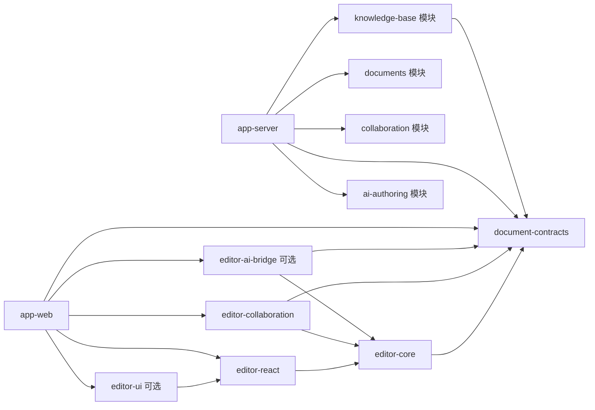

你是一个资深全栈架构师，请根据以下项目定义，按“一个 package 一份主文档、一个 app 一份主文档”组织完整技术设计：六份 package 文档、两份 app 文档，以及一份项目文档地图。具体目录、功能归属、跨包约束和交付顺序见[项目文档地图](README.md)。以下章节是整体需求覆盖清单，按责任分配到对应主文档，避免每份文档重复整套系统设计。
【项目定义】
AI驱动的企业智能文档平台。
技术栈：React + Tiptap（ProseMirror内核，Headless架构） + Yjs（CRDT协作）。
数据格式：Tiptap JSON，Block级结构化输出。
部署形态：企业私有化部署，支持多空间隔离。
【核心能力模块】
AI文档创建：LLM输出映射为Tiptap自定义Node/Block，通过editor.commands插入编辑器。
布局更新：Block级增删改，支持动态重排，AI可局部更新指定Block而非全文覆盖。
向量化：基于Tiptap JSON按Block粒度分块Embedding，存入向量数据库，文档变更时增量更新索引。
RAG检索：用户自然语言提问 → Query Embedding → 向量相似度召回Top-K → Rerank → Context拼装 → LLM生成带引用来源的回答，按空间namespace隔离。
AI创作：基于RAG召回的企业知识上下文，LLM生成/续写/改写/摘要/翻译，通过SSE流式展示草稿；完整提案校验与用户确认后，按稳定Block/选区锚点执行局部更新，并处理协同冲突。
企业文档平台：权限管理、版本控制、审批流、审计日志。
空间与知识库：初期每个空间关联一个独立知识域，关系由服务端业务层维护；向量检索按租户、空间、知识库与文档权限隔离，编辑器产品可在无空间/知识库模式下运行。
【关键技术要点】
Tiptap扩展体系定义自定义NodeType（ai-block、embed-block、rag-citation等）
Yjs Awareness实现协作光标和在线状态
Yjs Doc同步通过WebSocket传输
RAG Pipeline完整链路
AI创作提案通过编辑器命令应用；执行时由稳定Block/选区锚点解析当前位置，禁止异步任务复用过期绝对位置
协同正文以Yjs二进制状态持久化，Tiptap JSON作为快照、导出和索引格式；连接成功、同步完成和持久化完成分别表达
空间维度namespace隔离检索和创作的知识边界
【输出要求】
完整设计需覆盖以下主题，具体内容按文档地图分配到八份主文档：
一、项目概述
背景与目标
核心能力总览（表格形式）
技术栈选型及理由
二、系统架构
整体架构图（用文字描述，分层：前端层/协作层/服务层/AI层/数据层）
各层职责与交互关系
数据流全景（从用户输入到AI生成到渲染到向量化）
三、编辑器层设计（React + Tiptap）
组件架构
自定义Node/Block定义（含Schema示例）
扩展体系设计
布局更新机制（Block级操作）
与AI模块的对接接口
能够开放能力给其他业务使用
四、协作层设计（Yjs）
CRDT数据模型
WebSocket同步方案
Awareness（光标/在线状态）
冲突解决策略
版本控制与历史回溯
五、AI服务层设计
AI文档创建：Prompt工程、输出Schema、Block映射策略
AI创作：流式输出（SSE）、局部Block更新、上下文窗口管理
Prompt模板示例
六、RAG检索层设计
向量化策略：Block粒度分块、Embedding模型选型
向量数据库选型与Schema
检索Pipeline：Query → Embedding → Top-K → Rerank → Context拼装
空间隔离与namespace设计
增量索引更新机制
七、企业能力层设计
空间与知识库模型
权限体系(不同企业权限不同，通过插件的形式开放)
八、数据模型
核心表结构（文档、空间、Block、版本、权限、向量索引）
ER关系描述
九、API设计
核心RESTful接口列表（含路径、方法、入参、出参）
WebSocket接口
SSE流式接口
十、前端工程结构
React项目目录结构
核心模块划分
状态管理方案

十一、Packages 划分与编辑器产品化设计

### 目标与产品边界

- 把文档编辑与协同能力设计成可独立接入的编辑器产品：其他业务可以安装或引用编辑器包，传入文档内容、身份与协同连接配置，即可完成编辑和多人协同，不需要启用知识库、RAG、AI 创作或企业审批能力。
- 知识库、空间、权限、版本策略、审批、审计和 AI/RAG 属于数据与业务层的可选能力，由平台服务组合；它们可以增强文档产品，但不得成为编辑器运行的前置依赖。
- 在六份 package 与两份 app 主文档中说明职责、依赖方向、接入方式、可选能力和部署组合，并由文档地图维护跨包约束与阅读顺序。包边界以可独立安装、升级和替换的产品能力为依据，不按目录或技术名机械拆分。

### 建议的 Workspace 划分

```text
packages/
  document-contracts/       # 与框架无关的文档 JSON、Block、事件及版本化 Schema
  editor-core/              # Tiptap 扩展、基础 Node/Mark、命令、Block 操作和序列化
  editor-react/             # React 组件、Hooks、编辑器生命周期与宿主集成
  editor-collaboration/     # Yjs/Tiptap 协同绑定、Awareness 与可替换的连接 Provider
  editor-ui/                # 可选工具栏、菜单、协同状态展示和默认样式
  editor-ai-bridge/         # 可选的流式事件解析、AI 操作接口及结果到编辑器命令的适配
apps/
  app-web/                  # 企业文档产品前端，组合编辑器与业务页面
  app-server/               # 企业业务服务，组合文档、协同、知识库、AI 和平台能力
```

上述名称是设计基线，逐项主文档链接见[项目文档地图](README.md)。首期可将服务端能力保留在 `app-server` 的 feature modules 中；只有在确有独立部署或多服务复用需求时，才抽成可独立部署的应用或共享包。以下是拆分需求摘要，详细规范以地图指向的主文档为准。

### 包职责与边界

| 包/模块                                       | 负责                                                                          | 不负责                                               |
| --------------------------------------------- | ----------------------------------------------------------------------------- | ---------------------------------------------------- |
| `document-contracts`                          | 与 UI、数据库无关的 Tiptap JSON/Block 合约、稳定 ID、Schema 版本及迁移约定    | React、Yjs 运行时、ORM 表、空间权限和具体业务字段    |
| `editor-core`                                 | 基础编辑器 Schema、Block 级增删改/排序/局部替换命令、扩展注册和 JSON 导入导出 | React 宿主、网络同步、用户/空间/知识库策略、LLM 调用 |
| `editor-react`                                | React 集成、实例创建销毁、受控配置和编辑器状态订阅                            | 文档持久化、企业页面路由和业务权限判断               |
| `editor-collaboration`                        | Y.Doc 与编辑器绑定、光标/在线状态、Provider 接口及断线重连状态                | 企业身份系统、空间授权规则、文档业务 API 和向量索引  |
| `editor-ui`                                   | 可选的默认控件、主题与协同状态展示                                            | 强制性的编辑器核心或平台视觉系统                     |
| `editor-ai-bridge`                            | 将宿主提供的 AI 流事件映射为增量 Block 命令，管理编辑器侧生成状态             | Prompt、模型供应商、RAG 检索、知识权限和服务端密钥   |
| 服务端 `documents` 模块                       | 文档元数据、保存、版本和文档领域 API                                          | 编辑器 UI 与模型供应商实现                           |
| 服务端 `collaboration` 模块                   | WebSocket 同步、认证/授权回调、Yjs 持久化与恢复                               | 固定绑定某一种企业用户、空间或知识库实现             |
| 服务端 `knowledge-base` / `ai-authoring` 模块 | 文档快照消费、分块/Embedding/检索，以及 AI 创作流程                           | 编辑器包内部状态和私有扩展实现                       |

AI 专属 Node（如生成任务状态块、RAG 引用块）应由可选扩展提供，不应让普通编辑器依赖 AI/RAG。基础文档结构使用稳定、版本化的公共 Schema；空间、知识库、权限和审批信息保存在服务端业务模型或文档元数据中，不进入编辑器核心内容模型。

### 依赖方向与数据边界



- `document-contracts` 是前后端共享文档结构的唯一事实源；不得在前端、服务端和数据库层各自维护不兼容的 Block 类型。
- 编辑器核心不得导入 `app-web`、`app-server`、空间/租户、权限、知识库、RAG 或具体数据库代码。业务信息通过初始化配置、公开命令或宿主回调传入。
- 协同客户端只依赖 Provider 合约；连接 URL、认证凭据、文档授权和持久化由宿主或协同服务提供。服务端不得信任客户端提交的 `tenantId`/`spaceId` 来授权。
- 知识库模块从已授权的文档快照/事件构建 Block 索引，并在服务端按租户和空间范围执行检索授权。编辑器只呈现宿主传入的检索或引用结果。
- 初期可沿用“一个空间关联一个知识域”的产品默认值，但空间和知识库应是不同业务实体/职责；关联关系由服务端维护，不能固化进编辑器包，以便后续支持多个知识域、外部数据源或其他业务复用。

### 独立接入与产品组合

| 接入形态         | 引入能力                                                                   | 典型用途                                                 |
| ---------------- | -------------------------------------------------------------------------- | -------------------------------------------------------- |
| 编辑器嵌入       | `document-contracts`、`editor-core`、`editor-react`，按需加 `editor-ui`    | 其他业务复用结构化编辑和 Block 操作，由宿主保存文档      |
| 文档协同         | 编辑器嵌入能力 + `editor-collaboration` + 一个实现 Provider 合约的协同服务 | 独立使用多人编辑、光标和在线状态，不要求知识库或 AI 服务 |
| 企业智能文档平台 | 文档协同 + `app-server` 的空间/权限/版本/知识库/AI/RAG 等模块              | 启用知识检索、AI 创作、审批和审计等数据业务能力          |

设计中需明确 pnpm workspace 包的公开入口、版本化 Schema 与升级/迁移策略、React/Tiptap/Yjs 等依赖是 peer 还是可选依赖、CSS 是否按需引入，以及宿主认证和 Provider 的最小接入契约。先支持 monorepo 内独立引用；是否发布到私有 npm registry、如何独立发版，应作为产品交付决策明确说明。
